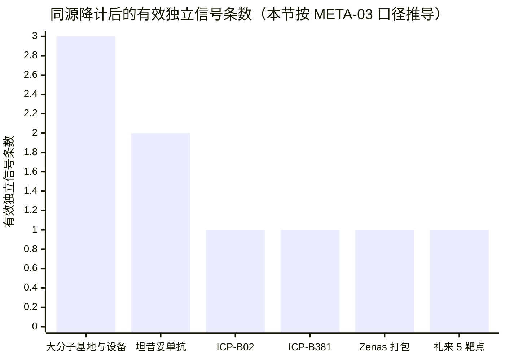
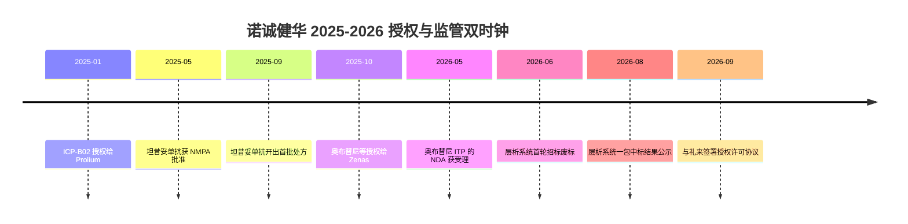
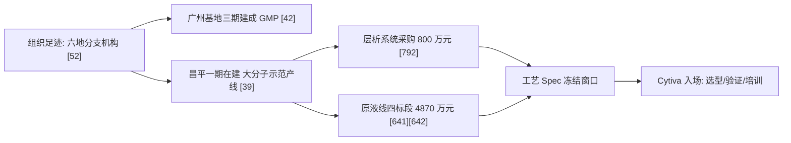
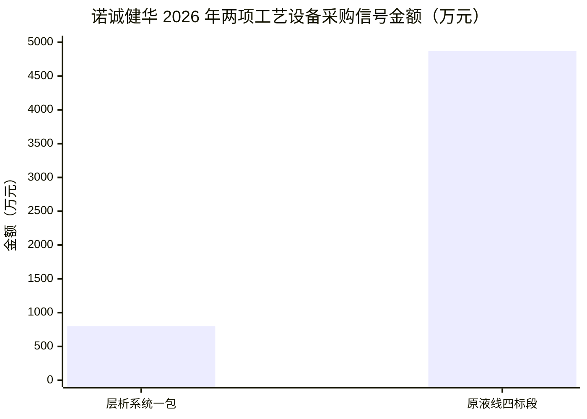
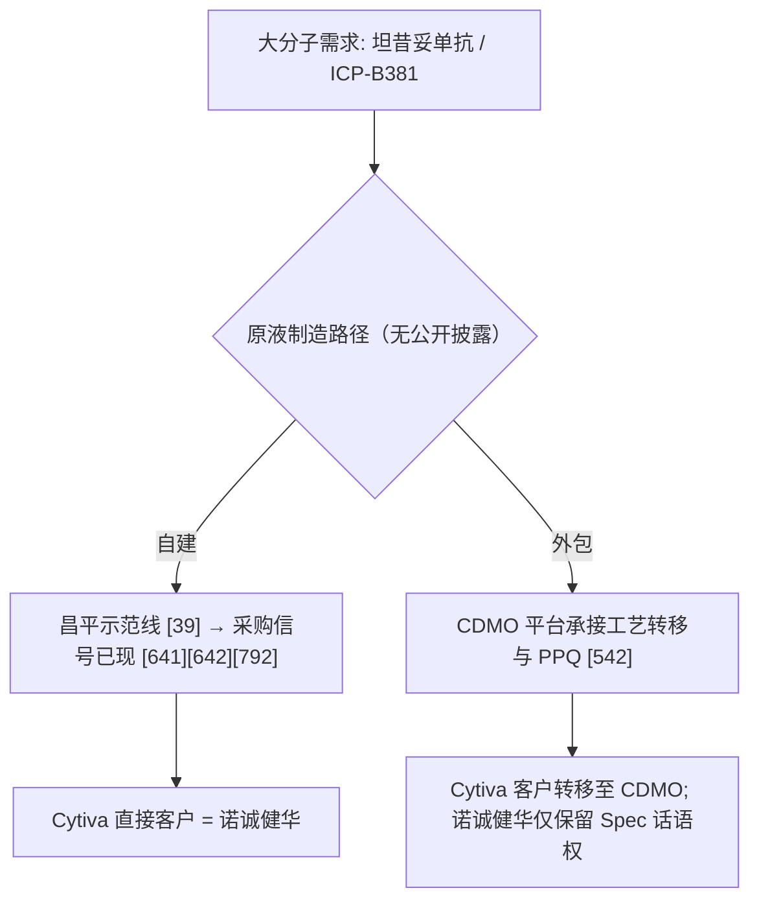
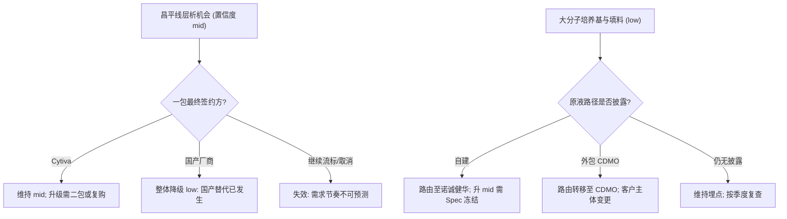

<!-- 正文待粘贴：把内容贴到本行下方即可（此注释不会被渲染） -->

# 诺诚健华商业情报调研：五类信号交叉验证下的 Cytiva 机会与销售打法

_依据《BP Pipeline Intelligence Framework》v1.9 完整规则集，覆盖官网新闻、中期业绩与半年报、授权公告、监管披露、招聘 JD 与行业媒体；事实标注 [n] 来源，判断引用规则 ID，显式区分推断与置信度（META-01 · META-02 · META-04）_

_zjsearch · 10/13/2026, 6:26:16 AM_

## 执行摘要

**管线基线：可服务面窄，且被两项交易切走。** 诺诚健华可公开核验的大分子资产收敛为"一获批、一授权、一早期"三件：坦昔妥单抗（CD19 单抗）2024 年受理、2025-05 获批、2025-09 商业化，为国内首个治疗 r/r DLBCL 的 CD19 单抗 [13][52][533][570]；ICP-B02（CD20×CD3 双抗）已以 NewCo 形式授权 Prolium [5][21]；ICP-B381（PSMA×STEAP1 双抗 ADC）IND 已获受理 [52]。同期三款已上市创新药中小分子占两款 [771][737][805][684][685][681]，2025 年奥布替尼商业化收入 14.10 亿元、占 23.75 亿元营收约 59%（14.10/23.75）[33][4][32]，大分子侧尚无以自研收入为证的记录。

**信号门槛：只有平台层过关，② 源在管线级实质缺席。** 定期报告与业绩材料中没有任何一条在研管线披露累计研发投入或预计总投资，半年报表述停留在合计层面 [5]，故 META-03 的投入源只能用资本开支型代理指标替代，而它只能落到平台、无法落到分子 [META-03][META-04]。六项候选对象中仅"大分子基地 + 工艺设备"达到 META-02 的 2–3 条独立信号门槛——昌平一期 2024-08-15 开工、含符合中美欧 GMP 标准的大分子药厂示范项目 [39]，广州基地一、二、三期已按中美欧日 GMP 标准建成 [42]。

**授权时钟：三笔交易中只有一笔把制造权交出去，反而把采购落点留在体内。** 约 20 个月内对手方从 NewCo（Prolium）到纳斯达克 Biotech（Zenas）再到 MNC（礼来），身份梯度本身就是资产被外部定价的过程 [5][8][21][581][624]；但仅 Zenas 一笔明确将开发、生产及商业化权（含制造权）交予买方侧主导 [5,581,754]，Prolium 与礼来的制造产地安排均未披露 [5,21][8,624]。加之三笔中明确为大分子的标的只有 ICP-B02、且已交由 NewCo 推进 [21][52]，公司体内的大分子放大动作更可能围绕自有 ADC/双抗平台与昌平示范线展开——授权收入也不构成工艺设备投入的资金来源（推断，置信度 中）[624]。

**人才信号：一手招聘 JD 缺失，最强线索来自风险披露而非路演口径。** 本轮来源未包含任何招聘 JD 的岗位、职级、地点或编制信息，扩编方向只能由组织足迹与基地建设反推，置信度统一降级且不计入 META-02 独立信号计数 [META-01][META-04]；组织足迹在官网新闻稿与半年报两处出现属同源自述，不构成双重验证 [52][5][META-02]。真正有信息量的是半年报风险披露——"建立符合 GMP 标准的生产设施所需投资大、建设周期长，实现规模化生产的工艺技术要求较高" [5]，与新闻稿"已搭建一体化新药创制平台" [52] 构成 META-06 要求识别的叙事—实质偏差。

**机会地图：6 条候选机会中仅 1 条握有具名供应链证据，最高价值时点是 Spec 冻结前。** OPP-01（昌平层析系统一包）国有资金 800 万元，2026-06-15 首轮因合格投标人不足 3 家废标，重新招标后 2026-08-05 中标候选人为格来赛生命科技（上海）有限公司即 Cytiva 中国实体 [711,730,791,357,792]；OPP-02（原液线 002 标段三滤，共 4 标段、国有资金 4870 万元、2026-05-28 分时开标）因各标段中标方名称公开检索受限，判定"窗口未关闭" [641,642,678]；OPP-03（昌平一期示范线 Spec 冻结，培养基＋层析树脂）被列为最高价值时点 [39,792,641,642]。

**核心逻辑.** 这个客户的"可买面"不在管线分子、而在平台层：META-03 的三源对账显示管线级投入源为空缺 [5]，唯一闭环的路径是基地建设与工艺设备采购，而唯一的在售大分子（坦昔妥单抗 [13][533][570]）与两笔新签授权 [5,21][8,624] 都无法把制造需求稳定锚定在公司体内——三笔交易中只有 Zenas 一笔写明制造权归属买方 [5,581,754]，礼来合作的制造落地更是台账空白 [8][25][26][624,754]。因此打法不是广撒网覆盖管线，而是抓住昌平当前这个尚未冻结 Spec 的短窗口：先以 OPP-01 已占位的 ÄKTA 交付与验证数据换取 OPP-03 的 Spec 影响权，再用 OPP-02 的 002 标段作为需求可得性的验证点 [357,792][641,642,678][39]。同时必须挂起两条失效线：国产填料或培养基进入其 BLA 申报资料或商业化产线时全部生物工艺机会失效 [168][214]；层析一包若最终由国产厂商签约，则整体降级 low [711][733][713]。财务侧不构成约束——2025 年营收 23.75 亿元、同比 +135.27%，归母净利润 6.42 亿元首度年度盈利，2026 年上半年营收 11.4 亿元、同比 +55.5%，收缩风险在对手方而非诺诚健华自身 [4][32][1][3]。

## 模态边界与管线全景：把 Cytiva 可服务的部分从资产清单里圈出来

*本节生成失败*

## 生物药管线逐条核验：官网宣称、财报投入与行为信号的三源对账

本节对诺诚健华全部可公开核验的大分子资产逐条执行 META-03 的三源对账——① 官网/公告宣称、② 财报与定期报告投入、③ 行为信号——并据 META-02 的 2–3 条独立信号门槛给出“升级 / 埋点监测”裁决。[META-03][META-02] 对账的核心结论是：==② 源在管线级实质缺席==，可被外部核验的“真实投入”只剩大分子基地建设与工艺设备采购这一条路；六项候选对象中，仅平台级的“大分子基地 + 工艺设备”达到 3 条独立信号。

### 核验口径与计数规则

- ① **宣称源**：公司官网/业绩稿、BD 授权公告、监管受理与审批信息。[META-03]
- ② **投入源**：中期业绩、半年报、年报中的管线投入、预计总投资、临床进展与资本开支表述。[META-03]
- ③ **行为源**：CDMO 合作公告、细胞株活动、工程批次、招聘 JD、行业媒体报道、设备与工程招标。[META-03]
- **独立性规则**：同一事件在两类源中的两次出现（例如授权公告与财报中的对价科目）不构成两条独立信号；计数时按源类型跨类计。[META-02]
- **置信度标注**：高 / 中 / 低三档，凡由 ① 宣称推导出的制造与产能含义，一律标注为推断并降档。[META-01][META-04]

> [!WARNING] 财报投入口径在管线级为空缺，② 源无法闭环
> 本次可取得的定期报告与业绩材料中，==没有任何一条在研管线披露累计研发投入或预计总投资==。半年报的表述停留在合计层面。[5] 因此 META-03 ② 只能用“资本开支型代理指标”（基地建设 + 工艺设备招标）替代，而该代理指标只能落到平台层，无法落到具体分子。[META-03][META-04]

### 候选生物药资产的收敛

| 资产/对象 | 模态 | 当前阶段 | ① 宣称源 | 关键限定 |
|---|---|---|---|---|
| 坦昔妥单抗（明诺凯） | CD19 单抗 | 2024 受理、2025-05 获批、2025-09 商业化 | 监管审批 + 官网叙事 | 国内首个治疗 r/r DLBCL 的 CD19 单抗；引进与自研属性本文来源未明示 [13][52][533][570] |
| ICP-B02 | CD20×CD3 双抗 | 已授权（NewCo 形式） | 授权公告 + 行业报道 | 全球非肿瘤领域与亚洲以外肿瘤领域权益归属 Prolium [5][21] |
| ICP-B381 | PSMA×STEAP1 双抗 ADC | IND 已获受理 | 官网中期业绩稿 | 自研 ADC 平台首个双抗 ADC，同等剂量药效优于对应单靶点，计划在美提交 IND [52] |
| ICP-054（IL-17 抑制剂） | 未标明 | 已授权（Zenas） | 授权公告 | 2025-10 与奥布替尼、ICP-488 一并授权 Zenas，权益含指定范围的开发、生产及商业化权（买方侧主导）[5][581][754] |
| 礼来合作 5 项靶点 | 未标明 | 2026-09-24 授权 | 授权公告 | 依托自有平台开发的至多 5 项创新靶点项目；设联合指导委员会；未披露制造产地安排 [8][624][754] |
| 大分子基地与工艺设备 | 平台级 | 建设与采购中 | 官网 + 招标公告 | 昌平基地含符合中美欧 GMP 标准的大分子药厂示范项目 [39] |

**核验备注（非来源表述）**：ICP-054 与礼来合作 5 项靶点，在本次可取得的全部材料中都未出现可用于模态判定的披露；本节据此不将二者纳入大分子清单，以待后续披露补齐——该判定以来源沉默为依据，属核验结论而非任何单一来源的表述。[META-01][META-04]

IL-17 抑制剂与礼来 5 靶点两项，恰是“宣称在推进、模态不可核验”的典型：在模态被披露前，二者对工艺侧不构成任何可执行的采购含义。[META-03][META-01]

### 三源逐条对账

| 资产/对象 | ① 宣称 | ② 投入口径 | ③ 行为信号 | 有效独立信号 | META-02 裁决（置信度） |
|---|---|---|---|---|---|
| 大分子基地与工艺设备 | 有：昌平基地一期 2024-08-15 开工，含大分子药厂示范项目 [39] | 有：明确维持规模研发投入、GMP 设施投资大周期长 [5][33] | 有：层析系统与原液生产设备分标段招标，一包中标候选为 Cytiva 中国实体 [641][642][711][730] | **3** | ==升级为 Strategic Recommendation==（中-高）[META-02] |
| 坦昔妥单抗 | 有：获批与商业化叙事、国内首个 r/r DLBCL CD19 单抗 [13][52][533][570] | 弱：仅“三款抗癌药合计约 9.2 亿元”的合计口径，无单品拆分，不计入 [1][3][6] | 有（平台级）：大分子工艺设备与原液设备招标 [641][642][711][730] | 2 | 升级（高）——大分子商业化事实确定；“由公司自产”仍是推断（置信度 低-中）[39][META-01] |
| ICP-B02 | 有：2025-01 授权 Prolium [5][21] | 有（同源）：对价与股权科目，非投入 [5][21] | 无 | 1（同源降计） | 埋点监测（中）[META-02] |
| ICP-B381 | 有：IND 受理、自研 ADC 平台首个双抗 ADC [52] | 无 | 无 | 1 | 埋点监测（中）[META-02] |
| Zenas 打包管线 | 有：2025-10 授权 [5][581][754] | 有（同源）：首付与里程碑上限 [5][581][754] | 无 | 1 | 埋点监测；模态未在本节来源中出现（中）[META-02] |
| 礼来合作 5 靶点 | 有：2026-09-24 公告 [8][25][26][624] | 有（同源）：首付/总额为收入方向 [8][25][26] | 无 | 1 | 埋点监测；模态与生产地未在本节来源中出现（高）[META-02] |

#### ③ 行为信号的证据底稿

下表为本节 ③ 源的全部已核验记录，也是上表平台级“3 条信号”的依据。

| 采购项目/标段 | 内容 | 资金来源与金额 | 招标人与地点 | 关键时间 | 结果与中标方 | 来源 |
|---|---|---|---|---|---|---|
| 层析系统工艺设备采购（首轮） | 层析系统工艺设备（001 标段） | 国有资金 800 万元 | 北京诺诚健华医药科技有限公司；北京昌平区 | 招标文件获取 2026-05-19~05-25；开标 2026-06-08 | 2026-06-15 废标：通过资格性审查的投标人不足 3 家 | [711][730] [711,730] |
| 层析系统工艺设备采购（一包，重新招标） | 层析系统工艺设备（一包） | 国有资金 800 万元（项目口径） | 同上 | 中标候选人公示 2026-07-13；中标结果公示 2026-08-05 | 中标候选人：格来赛生命科技（上海）有限公司（Cytiva 中国实体；子任务核验，置信度 mid）；公开页面中标单位名称被遮挡 | [792][791][357] [357] |
| 层析系统工艺设备采购（二包） | 层析系统工艺设备（二包） | 未披露 | 同上 | 2026-07-13 废标；其后三次招标；中标候选人公示 2026-08-07 | 候选方名称受登录限制，未见公开披露 | [733][713][731] [733,713,731] |
| 原液生产工艺设备采购（BZZY-202602502） | 4 个标段：(001) 反应器、(002) 三滤系统、(003) 在线配液、(004) 完整性测试 | 国有资金 4,870 万元 | 北京诺诚健华医药科技有限公司；北京昌平区 | 获取 2026-05-08~05-12；2026-05-28 分时开标；供货期 3~6 个月 | 有中标候选人公示（北京招标网 [678]），各标段中标方名称公开检索受限，未见可核验披露 | [641][642][678] [641,642,678] |
| 其他设备/物资采购 | 恒温恒湿箱比选；三联薄膜过滤仪及取膜器；浮游菌采样仪等（采招网收录相关项目约 315 条） | 未披露 | 诺诚健华体系（北京、广州等） | 2026 年持续发布 | 多为比选/小额采购，未逐一披露结果 | [655][602] [655,602] |

*注：中标单位名称在多数公开页面受会员权限/验证码遮挡；一包中标候选为格来赛（Cytiva 中国实体）系子任务 S2 对招标平台的核验结果（置信度 mid）。*

**哪些信号直接指向工艺开发或放大。** 直接指向原液（DS）生产与下游纯化的有三类：反应器、三滤系统、在线配液、完整性测试四个标段，[641][642] 以及层析系统两个包次。[711][730][792] 恒温恒湿箱比选、三联薄膜过滤仪及取膜器、浮游菌采样仪则属无菌与质量控制类，指向的是 QC 与合规能力而非放大本身。[655][602] 放大载体一侧，昌平基地含符合中美欧 GMP 标准的大分子药厂示范项目，是唯一公开可见的自有大分子生产载体。[39] 广州基地一期、二期、三期已按中美欧日 GMP 标准建成，但公开表述未界定其模态归属，==不能直接推定为大分子产能==（推断，置信度 低）。[42][META-01]

从时间轴看，原液设备 2026-05-28 开标、供货期 3~6 个月，[641][642] 对应设备交付与安装窗口落在 2026 下半年至 2027 年初（由开标日 + 供货期推导，非来源表述）。[META-04]

### 宣称在推进 vs 实际在投入：四条缺口

1. **投入颗粒度缺口。** 管线级累计研发投入与预计总投资在本次来源中全部缺失，② 源只能以“多个管线处于临床 I/II/III 期、未来仍将维持相应规模的研发投入”这类合计表述替代。[5]
2. **投入可核验性缺口。** 唯一可外部核验的实际投入集中在产能侧：两项已披露招标口径合计 5,670 万元（800 万元 + 4,870 万元，本节推导，未含二包及未披露标段），[641][642][711][730] 约为 2026 上半年营收 11.4 亿元的 5%（5,670 ÷ 114,000 ≈ 5.0%，推导值，仅作量级参照）。[1][3][6]
3. **宣称密度与投入密度不对称。** 官网业绩稿一次性披露 IND 受理、海外上市、BD 兑现等多项里程碑，[52] 而对应管线的投入数字为零。[5] 宣称源密度高不代表推进强度高。[META-01]
4. **权益外移造成的口径脱钩。** Prolium 拿走全球非肿瘤领域与亚洲以外肿瘤领域权益，[5][21] Zenas 获得含制造权在内的指定范围开发、生产及商业化权，[5][581][754] 礼来合作未披露制造产地安排。[8][624][754] 由此，“宣称在推进”不等于“境内工艺需求增长”（推断，置信度 中）。[META-01][META-04]

### META-02 裁决与升降级触发条件

| 对象 | 裁决 | 升级触发条件 | 降级触发条件 | 下一观测点 |
|---|---|---|---|---|
| 大分子基地与工艺设备 | **Strategic Recommendation**（3 条信号）[META-02] | 二包中标方公开；原液 4 标段中标方公开且出现“供应商 × 生产线”绑定；2026 年报资本开支口径扩大 | 层析与反应器系统整体由国产厂商承接；实际采购规模显著低于已披露口径 | 2026 下半年招标结果、2026 年报资本开支与在建工程 [641][642] |
| 坦昔妥单抗 | 升级（2 条信号）[META-02] | 单品销售拆分披露；自有产能归属披露 | 品种转为纯进口/外部 CDMO 供货 | 2026 年报产品收入拆分 [13][1] |
| ICP-B02 | 埋点监测（1 条）[META-02] | Prolium 披露生产地在中国境内，或诺诚健华公告境内 CMC 活动 | — | 授权方管线进展与 CMC 公告 [5][21] |
| ICP-B381 | 埋点监测（1 条）[META-02] | IND 获批或中美双报推进，并出现 CDMO/设备采购绑定 | 项目停滞或适应症调整 | 美国 IND 提交进度 [52] |
| Zenas 打包管线 / 礼来 5 靶点 | 埋点监测（各 1 条）[META-02] | 公告披露靶点、模态与中国境内生产安排 | 模态证明为小分子 | 后续里程碑公告 [5][581][754][8][624] |

> [!IMPORTANT] 三源对账目前唯一的硬交叉点
> 只有“昌平大分子基地 + 层析/原液工艺设备采购”同时具备 ①②③ 三条独立信号，且层析系统一包中标候选人指向 Cytiva 中国实体（格来赛生命科技（上海）有限公司），置信度 mid。[39][792][791][357][641][642] 其余生物药资产全部停留在“仅宣称”或“权益已外移”状态，按 META-02 一律降级为埋点监测，不进入推荐动作。[META-02]

层析系统首轮因通过资格审查的投标人不足 3 家而废标、二包废标后转入多次招标，[711][730][733][713][731] 说明该品类合格投标人稀缺——对在位供应商有利，但也意味着采购落地时间被拉长、标包可能被拆分，销售节奏不宜按“中标即放量”排期（推断，置信度 中）。[META-04]

### 本节未能核验的材料

- **招聘 JD**：本次来源中未取得任何诺诚健华生物药相关岗位 JD 的可核验记录，META-03 ③ 的 JD 分支在本节为空缺，下述判断均不依赖该路证据。[META-03]
- **CDMO 合作公告**：未见生物药 CDMO 合作公告；已知外包关系集中在小分子原料药与部分制剂，委托药明康德旗下合全药业生产。[84][542] 该分支因此不能为大分子管线提供任何 ③ 源计数。[META-03]
- **细胞株与工程批次**：未取得细胞株引进/构建活动、工程批次或中试放大的可核验记录，③ 源的这一支同样为空缺。[META-03]

## 制造与供应路径：自研还是外包，工艺 Spec 握在谁手里

*本节生成失败*

## 授权交易与监管里程碑：管线优先级与放大采购的两座时钟

授权公告回答的是"资源往哪压"，监管披露回答的是"什么时候必须放大"。本节把诺诚健华 2025 年以来的三笔对外授权与五条注册里程碑拆成两座时钟，再换算成工艺表征、PPQ 与批量放大的采购触发点；事实逐条带来源标识（META-01），判断绑定所依据的规则 ID（META-02），推断一律显式标注置信度（META-04）。

### 授权时钟：三笔交易，三种对产能的绑定强度

从 NewCo 到纳斯达克生物技术公司再到跨国大药企，诺诚健华在约 20 个月内完成了三笔对外授权，交易对手的"身份梯度"本身就是资产被外部定价的过程。[5][8][21][581][624]

| 时间 | 对手方 | 标的管线 | 首付/近期付款 | 里程碑及总额 | 权益范围与制造权 | 来源 |
|---|---|---|---|---|---|---|
| 2025-01 | Prolium Bioscience（与康诺亚联合的 NewCo） | ICP-B02（CD20xCD3 双抗） | 首期及近期付款合计 1,750 万美元；双方各获 8.75% 股权 | 里程碑总额最高 5.025 亿美元 | 全球非肿瘤领域 + 亚洲以外肿瘤领域权益；未披露制造安排 | [5][21] |
| 2025-10 | Zenas BioPharma | 奥布替尼（ICP-022）、IL-17 抑制剂（ICP-054）、口服透脑 TYK2 抑制剂（ICP-488） | 首付款及近期里程碑最高 1 亿美元现金 + 700 万股 Zenas 股票 | 被媒体称为逾 20 亿美元级交易；另有分级特许权使用费 | 全球指定范围的开发、生产及商业化权（含制造权，买方侧主导） | [5][581][754] |
| 2026-09-24 | Eli Lilly（礼来） | 依托自有平台开发的至多 5 项创新靶点项目 | 最高 1 亿美元首付款及近期里程碑 | 潜在研发及商业化里程碑合计约 32.5 亿美元（总额最高 33.5 亿美元）；个位数百分比分级特许权使用费 | 战略研究合作及许可；设联合指导委员会；未披露制造产地安排 | [8][624][754] |
| note: 金额均为公告口径上限；资料来自公司公告、半年报与媒体转述（[21] 为 2025-01 Prolium 交易行业报道）。 |

对产能的含义，三笔交易并不一致，这也是本节最需要分清的一层：

- **制造权归属决定采购落点。** Zenas 一笔明确把开发、生产及商业化权（含制造权）交给买方主导 [5,581,754]；Prolium 与礼来两笔交易的制造安排在本轮来源中未获确证，标记为信息缺口，不作为推断基础。三笔之中，只有 Zenas 那笔把生产决策权写进了合同结构里。
- **付款结构决定短期现金流贡献。** 礼来一笔的现金部分集中在未来里程碑上，首付与近期里程碑在总额上限中的占比处于个位数低段 [624]；Prolium 一笔则以股权对价替代部分现金 [5,21]。授权收入因此不是工艺设备投入的资金来源（推断，置信度 中）。
- **大分子标的的实际归属。** 三笔交易中明确为大分子的标的只有 ICP-B02，而它已交由 NewCo 推进，公司体内的大分子放大动作更可能围绕自有 ADC/双抗平台展开 [21][52]；礼来 5 项靶点的模态未在来源中披露（信息缺口）。2026 年上半年公司已把该交易写入战略表述，明确定位为"选择性对外授权 + 区域合作 + 独立全球开发"并行 [5]。

### 监管时钟：加速认定集中在小分子，大分子硬证据落在两端

| 分子/产品 | 模态 | 监管认定/审批 | 时间 | 要点 | 来源 |
|---|---|---|---|---|---|
| 奥布替尼（宜诺凯） | 小分子 BTK 抑制剂 | NMPA 附条件批准；FDA 突破性疗法认定（r/r MCL）；FDA 孤儿药资格 | 2020-12 获批；FDA 认定早于商业化 | 已商业化多适应症；1L CLL/SLL 纳入 2026 年国家医保目录 | [771][737][805][5] |
| 佐来曲替尼（宜诺欣） | 小分子新一代 TRK 抑制剂 | NMPA 优先审评审批程序 + 附条件批准 | 2025-12 获批；2026 儿童适应症 NDA 获受理 | NTRK 融合实体瘤（成人及 12 岁以上）；中国首款自研新一代 TRK 抑制剂；注册研究 ORR 89.1% | [684][685][681][163] |
| mesutoclax（ICP-248） | 小分子 BCL-2 抑制剂 | CDE 突破性疗法认定（BTD） | 2025-05 | BTK 抑制剂耐药后 r/r MCL；中国首个获 BTD 的 BCL-2 抑制剂；1L CLL/SLL III 期、初治 AML 头对头 III 期推进中 | [749][372][5] |
| 坦昔妥单抗（明诺凯） | CD19 单抗（大分子） | NMPA 优先审评 → 附条件/常规获批 | 受理 2024；2025-05 获批；2025-09 商业化 | 国内首个治疗 r/r DLBCL 的 CD19 单抗；经博鳌/大湾区先行使用 | [533][570][13] |
| 奥布替尼（ITP 适应症） | 小分子 | NMPA NDA 受理 | 2026-05 | 自免领域首个提交的 NDA；同期 SLE III 期首例入组 | [5] |
| note: 认定≠上市确定性；加速路径叠加与确认性试验风险由报告正文按规则解读。 |

==五条里程碑中四条是小分子==（奥布替尼两个适应症、佐来曲替尼、mesutoclax），优先审评、附条件批准与突破性疗法认定全部出现在小分子端 [684,685,749,372,5]。这对生物工艺采购的领先指示意义有限——小分子的放大走的是化学原料药与制剂体系，与层析、培养基的产品谱交集小（推断，置信度 中高）。

大分子端可核验的硬证据只有三条：坦昔妥单抗走完了从批准到商业化的全过程，2025 年 5 月获批、同年 9 月开出首批处方，是 2026 年全年商业贡献的既定基数 [13][33]；ICP-B02 已授权给 Prolium，推进责任转移到承接方 [21]；公司自主 ADC 平台的首个双抗 ADC——靶向 PSMA 与 STEAP1 的 ICP-B381——中国 IND 已获受理，并计划在美国提交 IND [52]。三者的共同缺口是：各管线当前的 IND 编号、受理号在来源中均未出现，本节无法给出编号级核验（信息缺口，不展开）。

### 两座时钟的交点：从里程碑到采购触发点

图中时间点分别来自 [21]、[13]、[33]、[5,581,754]、[5]、[711,730]、[791,792]、[8,624]。

两座时钟在 2026 年交汇于北京昌平：一边是 2025 年获批的产品需要常规供货，另一边是原液生产设备与层析系统的招标集中落地。[13][33][641][642][711][730][791][792]

| 采购项目/标段 | 内容 | 资金来源与金额 | 招标人与地点 | 关键时间 | 结果与中标方 | 来源 |
|---|---|---|---|---|---|---|
| 层析系统工艺设备采购（首轮） | 层析系统工艺设备（001 标段） | 国有资金 800 万元 | 北京诺诚健华医药科技有限公司；北京昌平区 | 招标文件获取 2026-05-19~05-25；开标 2026-06-08 | 2026-06-15 废标：通过资格性审查的投标人不足 3 家 | [711][730] |
| 层析系统工艺设备采购（一包，重新招标） | 层析系统工艺设备（一包） | 国有资金 800 万元（项目口径） | 同上 | 中标候选人公示 2026-07-13；中标结果公示 2026-08-05 | 中标候选人：格来赛生命科技（上海）有限公司（Cytiva 中国实体；子任务核验，置信度 mid）；公开页面中标单位名称被遮挡 | [792][791][357] |
| 层析系统工艺设备采购（二包） | 层析系统工艺设备（二包） | 未披露 | 同上 | 2026-07-13 废标；其后三次招标；中标候选人公示 2026-08-07 | 候选方名称受登录限制，未见公开披露 | [733][713][731] |
| 原液生产工艺设备采购（BZZY-202602502） | 4 个标段：(001) 反应器、(002) 三滤系统、(003) 在线配液、(004) 完整性测试 | 国有资金 4,870 万元 | 北京诺诚健华医药科技有限公司；北京昌平区 | 获取 2026-05-08~05-12；2026-05-28 分时开标；供货期 3~6 个月 | 有中标候选人公示（北京招标网 [678]），各标段中标方名称公开检索受限，未见可核验披露 | [641][642][678] |
| 其他设备/物资采购 | 恒温恒湿箱比选；三联薄膜过滤仪及取膜器；浮游菌采样仪等（采招网收录相关项目约 315 条） | 未披露 | 诺诚健华体系（北京、广州等） | 2026 年持续发布 | 多为比选/小额采购，未逐一披露结果 | [655][602] |
| note: 中标单位名称在多数公开页面受会员权限/验证码遮挡；一包中标候选为格来赛（Cytiva 中国实体）系子任务 S2 对招标平台的核验结果（置信度 mid）。 |

两条资金口径简单相加，2026 年可观测的工艺设备投入强度约为 5,670 万元（层析系统 800 万元 + 原液生产工艺设备 4,870 万元，为两个独立项目口径的相加，不等于同一供应商的口径）[641,642,711,730]。

支撑这笔投入的现金流来自产品端：奥布替尼 2025 年商业化收入 14.10 亿元，占当年 23.75 亿元营业收入的约六成（14.10 ÷ 23.75 ≈ 59%）[33][4]；2026 年上半年公司营业收入 11.37 亿元、同比增长 55.46%，归母净利润 2.46 亿元，增长部分明确包含与 Zenas 合作的后续里程碑达成 [624]。产能时钟同步在走：广州基地一期、二期、三期已完成建设（中美欧日 GMP 标准）[42]，北京昌平一期 2024-08-15 开工、包含符合中美欧 GMP 标准的大分子药厂示范项目 [39]，而 2026 年的层析与原液招标正是落在昌平 [641][642][711][730]。

把"设备落地"换算成"批次放量"需要一个滞后系数。药明生物中报给出了可类的行业时钟：2026 年、2027 年分别排期 34 个和 30 个 PPQ，并明确 PPQ 排期是对未来 1-3 年商业化收入的前瞻信号 [542]。若把这一滞后关系平移过来，2026 年落地的层析与原液设备对应的是 2027-2029 年的批次放量与耗材复购（推断，置信度 中；跨公司类比，非同一体量与同一产品结构）。

**境外承接方会外溢成额外机会吗？** 取决于承接方在哪里生产。Zenas 一笔把制造权交给买方主导 [5,581,754]；Prolium 与礼来两笔交易的制造安排在本轮来源中未获确证（信息缺口，不作推断基础）。若承接方自建产能或委托 CDMO，诺诚健华体内的设备与耗材需求不会增加，机会转移到承接方或其 CDMO 工厂——药明生物上半年新增 16 个外部转入项目（含 4 个 III 期、1 个商业化）说明这条通道真实存在 [542]，但设备采购的落点会从昌平基地转向承接方的生产地点（推断，置信度 中）。

### 触发点与置信度台账

置信度口径：高 = 由来源直接事实支持；中 = 由 1-2 条来源事实直接推演；低 = 依赖未披露信息或多个假设环节（META-04）。

| 触发点 | 依据（事实） | 触发后对 Cytiva 的含义 | 置信度 |
|---|---|---|---|
| 坦昔妥单抗商业化爬坡 | 2025-05 获批、2025-09 开出首批处方 [13][33] | 已进入消耗型复购阶段，无需新增里程碑即产生填料/培养基需求 | 中 |
| ICP-B381 中国 IND 放行、美国 IND 提交 | 中国 IND 已受理，公司计划在美国提交 IND [52] | 中试/工程批的层析与培养基用量；首个双抗 ADC 平台的工艺锁定窗口 | 中 |
| Zenas 承接方推进全球开发 | 制造权归买方主导 [5,581,754] | 采购决策权外移，机会可能落在承接方或其 CDMO 而非诺诚健华体内 | 低 |
| 礼来 5 靶点合作进入可开发阶段 | 2026-09-24 生效、设联合指导委员会 [624] | 仍处发现阶段，制造安排在本轮来源中未获确证，短期不产生 GMP 采购 | 中 |
| 昌平基地设备安装验收 | 一包中标候选为格来赛（Cytiva 中国实体，置信度 mid）、供货期 3~6 个月 [791][792][641][642] | 投产后转化为填料、耗材、验证与备件的持续采购窗口 | 中 |

> [!WARNING] 别把 BD 总额当产能预算
> 礼来一笔 33.5 亿美元的上限金额中，首付与近期里程碑最高为 1 亿美元、占比约 3%，其余全部挂在条件性的研发及商业化里程碑上 [624]。这既说明授权收入不是 2026 年工艺设备投入的资金来源，也说明以 BD 头条金额预测放大采购节奏会系统性高估速度。真正支撑采购的是产品销售现金流——2026 年上半年营业收入 11.37 亿元、归母净利润 2.46 亿元 [624]，以及奥布替尼 2025 年 14.10 亿元商业化收入所构成的回款基数 [33][4]。

## 组织与人才信号：招聘 JD 与对外叙事透露的投入方向

本节把诺诚健华的人事与组织信号从叙事材料里剥离出来：==本轮来源中没有一条招聘 JD 一手记录==，岗位扩编方向只能由组织足迹、基地建设与设备采购行为反推，置信度统一降级；对外叙事的可核验部分，则由收入结构与采购标段给出偏保守的结论。[META-01][META-04]

### 招聘 JD 的证据缺口与三条替代线索

本轮来源未包含任何诺诚健华招聘 JD 的岗位名称、职级、地点或编制数量，"上游培养 / 纯化 / 工艺开发 / 分析"四类岗位的数量—级别—地点分布在本轮不可核验。[META-01] 该缺口不因重复检索而消失：凡涉及"扩编方向"的判断均为间接推断，置信度 low，且不计入 META-02 的独立信号计数。[META-04]

可用的替代线索只有三条，且强度差异明显：

| 线索类型 | 内容 | 来源 | 指向的落点 | 置信度 |
|---|---|---|---|---|
| 组织足迹 | 官网口径：公司在北京、南京、上海、广州、香港和美国设有分支机构 [52]；半年报另确认在美国、澳大利亚、中国香港设有子公司 [5] | [52][5] | 仅能确认多点布局，各点职能分工未披露 | low（职能层） |
| 基地建设 | 广州药品生产基地一、二、三期已完成建设（中美欧日 GMP 标准）[42]；北京昌平创新药基地一期 2024-08-15 开工，含研发、中试、生产基地及符合中美欧 GMP 标准的大分子药厂示范项目 [39] | [42][39] | 广州=商业化 GMP；昌平=大分子中试与工艺放大 | mid |
| 公司自述瓶颈 | 半年报将"规模化生产对质量管控和供应链管理要求较高"列为行业风险，并称"建立符合 GMP 标准的生产设施所需投资大、建设周期长，实现规模化生产的工艺技术要求较高" [5] | [5] | 工艺与质量人才是公司自认的约束项 | mid-high |

第三条的价值在于它出现在**风险披露语境**而非路演口径中 [5]，与同一家公司在新闻稿里"已搭建一体化新药创制平台"的表述构成张力，正是 META-06 要求识别的叙事—实质偏差。[META-06]

注意一处去重陷阱：组织足迹在 [52]（官网新闻稿）与 [5]（半年报）两处出现，但两者同为发行人自述口径，在 META-02 下不构成双重独立验证。[META-02]

### 对外叙事与业务实质的三项对账（META-06 · RULE-POS-01/02）

| 对外声明 | 出处 | 可核验的实质证据 | 对账结论 | 置信度 |
|---|---|---|---|---|
| "已搭建一体化新药创制平台"；三款获批上市创新药 + 十多款临床阶段 + 多个临床前项目 | [52] | 三款上市药中小分子占两款（奥布替尼 [771][737][805]、佐来曲替尼 [684][685][681]），大分子仅坦昔妥单抗一款 CD19 单抗 [13][533][570]；2025 年奥布替尼商业化收入 14.10 亿元，占 23.75 亿元营收的约 59%（14.10/23.75）[33][4][32] | 平台叙事成立，但大分子侧尚无以自研收入为证的记录 | mid |
| 大分子与 ADC 自研能力 | [52] | ICP-B381 为"基于自主研发 ADC 平台开发的首个双抗 ADC"，IND 已获受理，临床前 22Rv1 模型中优于对应单靶点 PSMA-ADC 与 STEAP1-ADC [52] | 大分子 CMC 的"自有工艺"证据首次出现，仍在临床前→临床转折点 | mid |
| "全球化战略加快落地" | [52] | 奥布替尼在新加坡、澳大利亚陆续上市 [52]；Zenas 交易的开发、生产及商业化权由买方侧主导 [5,581,754] | 全球化为注册与授权驱动的**轻资产出海**，不等于海外产能自给 | mid-high |
| 产能自给（基地口径） | [52][42][39] | 2026 年昌平密集释放层析系统采购（国有资金 800 万元口径 [711][730]）与原液生产线 4 标段采购（国有资金 4,870 万元，含反应器、三滤系统、在线配液、完整性测试，供货期 3~6 个月 [641][642]） | 采购行为是本节最硬的投入方向证据，与"大分子药厂示范项目"时点一致 | mid（与昌平大分子线的绑定为推断） |

一处具体缺口必须点明：2026H1 三款抗癌药合计销售约 9.2 亿元，对应同期营业收入 11.4 亿元、同比 +55.5% [1][3][6]，按此计算三款药合计约占营收的 81%（9.2/11.4）；但来源未按分子拆分销售，==唯一商业化大分子坦昔妥单抗的收入贡献在本轮不可核验==，因此"大分子平台"叙事目前只能靠临床里程碑而非收入结构证实。[1][3][6][META-01]

### 供应商侧组织密度：替代 JD 的唯一可量化对照

目标公司没有 JD，则同一时间窗内供应商的人才与服务投入，成为评估"昌平工艺团队组建期竞争环境"的唯一可量化基准：

| 供应商 | 组织/人才投入指标 | 来源 |
|---|---|---|
| 赛默飞世尔（中国） | 在华约 6,500 名员工、以本土人才为主；15 个商业办公室、11 个服务中心、超 2,800 名专业服务人员；上海落地全球首家生物工艺设计中心 | [120] |
| 纳微科技 | 2026H1 研发投入 0.91 亿元、占收入近 16%；新增知识产权申请 10 件、授权 8 件；主导 ISO/TS 4966:2026（液相色谱硅胶填料领域首个 ISO 国际标准） | [102] |
| 奥浦迈 | 累计服务超 2,000 家生物制药企业与科研院所（报告期内超 1,300 家）；381 个已确定中试工艺的管线使用其培养基（临床前 205 / I 期 71 / II 期 49 / III 期 38 / 商业化 18） | [214] |
| 药明生物 | 2017 年以来累计通过 49 次全球监管检查（含 EMA/FDA 23 次），零关键缺陷、零数据完整性观察项；2026H1 双/多抗与 ADC 项目占比超 70% | [542] |

推断（mid 偏低，标注为推断）：诺诚健华昌平大分子团队组建期，会同时面对国产填料"性能叙事已升级到 ISO 标准与通过美国药企现场审计、Protein A 出口超千万元"[102]、培养基"管线锁定已达 381 条"[214]、服务端"2,800 人服务网络"[120] 的三面夹击。[META-04]

### 同源去重：哪些稿子是同一个信号（META-02）

| 稿件/信号 | 发布主体 | 事实口径 | 独立性判定 |
|---|---|---|---|
| 2026 中期业绩新闻稿 | 诺诚健华官网（含前瞻性声明与电话会议注册链接）[52] | 2026H1 业绩与在研里程碑（含 ICP-B381 IND 受理）[52] | 事件源 A（一手） |
| 业绩说明会/中期业绩媒体稿 | 财经媒体 [1][3][6] | 营收 11.4 亿元、+55.5%、市值约 507.73 亿元、三款抗癌药约 9.2 亿元 [1][3][6] | ==事件源 A 的载体，不单独计数== |
| 礼来研发合作及授权公告 | 公司公告 [8][25][26] | 首付及近期付款最高 1 亿美元、总额最高 33.5 亿美元、打包 5 个靶点 [8][624] | 事件源 B（一手） |
| Prolium / Zenas 交易报道 | 行业媒体 [21][22][24][30] | 授权条款与交易规模 [21][22][24][30] | 事件源 C/D（二手但事实不同） |
| 供应商经营与行业报道 | 奥浦迈、纳微科技、药明生物、赛默飞世尔 [214][102][171][542][120] | 各自半年报或年度经营数据 | 独立口径（与诺诚健华无直接关系） |
| 《奥浦迈核心客户解码》雪球专文 | 个人投资者 [317] | 正文未能读取，关联标签中未见诺诚健华 [317] | ==不可用，不得计入任何计数== |

> [!WARNING] 供应商自述不能当客户行为证据
> 纳微科技 2025 年报摘要自述"在生物医药领域…从早期研发阶段开始提供纯化产品或解决方案，深度绑定客户…有望基于前期介入，在规模化生产阶段锁定客户"[171]。这段表述与 Cytiva 的早期锁定逻辑同构，属于同一商业模型在供应链两侧的复述；把它读成诺诚健华的采购偏好，就是 META-02 明令避免的重复计数。[META-02]

### 本节净结论

- 招聘 JD 层面为零证据，任何"CMC 岗位扩编"的说法在本轮为 low 置信推断，不得外推为编制数或工时预测。[META-01][META-04]
- 投入方向的间接共识指向两处：昌平（大分子中试、工艺放大、示范产线）与广州（商业化 GMP）。[39][42]
- 最硬的先行指标是设备采购的金额与标段结构：层析系统 800 万元、原液线 4 标段 4,870 万元均为国有资金口径，且标段内容覆盖反应器、三滤系统、在线配液与完整性测试，说明整条原液线在建。[711][730][641][642]
- 叙事—实质偏差仍在：平台与全球化叙事目前由小分子单品现金流支撑，大分子的自研证据最早要到 ICP-B381 进入临床才成形。[52][33][4]

> [!IMPORTANT] 本节对销售打法的净输入
> 在 JD 数据缺失的前提下，昌平项目不应被读成"某条管线已锁定"，而应读成==工艺团队从零搭建的培训与验证窗口==：原液线四个标段同批释放，意味着配套的层析介质选型、柱效验证、清洁验证与操作培训需求会在同一窗口出现。[641][642] 由于昌平一期含"符合中美欧 GMP 标准的大分子药厂示范项目"[39]，一旦示范线的工艺 Spec 冻结，后续放大批次的耗材复购会沿同一 Spec 走——这是本节推断出的最高价值时点，置信度 mid。[META-04]

## Cytiva 机会地图：按 STG 阶段落位的产品—管线匹配与销售打法

本节把前六节的五类信号收敛为一张机会矩阵：6 条候选机会中只有 1 条握有具名供应链证据，其余 5 条按 META-01 的要素检验只能记为埋点级；另有 5 条看似成立的机会经不起 PROC 约束检验，本节逐条剔除。[357,791,792][META-01][META-02] 所有机会一律按 GLO-01 的四项产品口径（培养基／层析树脂／三滤／ÄKTA 层析系统）落位，打法一律引用第 1 节 STG 表、本节不复述。[GLO-01][STG-RULE-02]

### 机会矩阵：6 条机会的 GLO-01 产品落位

矩阵每行按"事实锚点—时点—来源—推断—置信度"的完整链条填写，以满足 META-01 对事实主张的要素齐备要求；事实与推断分列，不做合并陈述。[META-01][META-02] STG 列只定位阶段、不打分，对应打法条目见第 1 节 STG 表。[STG-RULE-02]

| ID | 机会载体 | GLO-01 产品 | STG 阶段（打法见 §1 STG 表） | 事实锚点（时点 · 来源） | 推断（META-02） | 置信度（META-04） | 建议动作 |
|---|---|---|---|---|---|---|---|
| OPP-01 | 昌平·层析系统采购（一包） | ÄKTA 层析系统 | 建线 / 工艺开发 | 国有资金 800 万元；首轮 2026-06-15 因合格投标人不足 3 家废标；重新招标后 2026-08-05 中标结果公示，一包中标候选人为格来赛生命科技（上海）有限公司（Cytiva 中国实体），公开页面单位名称被遮挡、系平台核验 [711,730,791,357,792] | 设备进场同步打开安装、柱效验证、清洁验证与操作培训的接触面 | mid | 推进：先核验合同与交付节点，锁定柱／介质选型窗口 |
| OPP-02 | 昌平·原液线 002 三滤系统标段 | 三滤 | 建线 / 工艺开发 | BZZY-202602502 共 4 标段、国有资金 4870 万元、2026-05-28 分时开标、供货期 3~6 个月；有中标候选人公示，但各标段中标方名称公开检索受限 [641,642,678] | 002 标段直接落在 GLO-01 口径内，且中标方不可核验 = 窗口未关闭 | 需求 mid／可得性 low | 推进：确认 002 标段结果；若已定标则转竞争情报跟踪 |
| OPP-03 | 昌平一期大分子示范线 Spec 冻结 | 培养基 ＋ 层析树脂 | 工艺开发 → 临床期 | 昌平一期 2024-08-15 开工，含符合中美欧 GMP 标准的大分子药厂示范项目；同址层析系统与原液线采购同窗口释放 [39,792,641,642] | 示范线 Spec 一旦冻结，后续放大批次耗材沿同一 Spec 复购——本节判定的最高价值时点 | mid | 推进：以 OPP-01 的验证数据换取 Spec 影响权 |
| OPP-04 | 坦昔妥单抗（CD19 单抗，已商业化） | 培养基 ＋ 层析树脂 | 商业化复购 | 2025-05 NMPA 获批、2025-09 商业化，国内首个治疗 r/r DLBCL 的 CD19 单抗 [13,533,570] | 已商业化单抗对应持续原液生产，但自有产线还是 CDMO 无公开证据 | low | 埋点：先确认原液产地，再判定客户主体 |
| OPP-05 | ICP-B381（PSMA/STEAP1 双抗 ADC，临床获批） | 培养基 ＋ 树脂 ＋ 三滤 | 临床前 → 临床 I | 新药获批临床 [630]；复杂分子工艺转移与 PPQ 容错空间极低 [542] | 若走自建线，将在昌平产生新增单元操作需求；当前工艺未锁、无采购信号 | low | 埋点：按临床里程碑复核 |
| OPP-06 | 广州基地一期／二期／三期存量复购 | 全口径四项 | 商业化复购 | 一期、二期、三期项目已完成建设（中美欧日 GMP 标准）[42]；半年报仅提示原材料、耗材及设备供应风险，未点名供应商 [5] | 存量复购体量最大，但既有供应商体系成熟、无任何公开采购信号 | low | 埋点：监测扩产或新线公告 |

两项已公开金额口径的采购信号合计 5670 万元（800 + 4870，本节据来源金额相加得出，非来源口径），其中可归入 GLO-01 口径的仅层析系统一包 800 万元。[792,641,642]

按上表口径，GLO-01 可确认金额占两项采购信号合计的 800 ÷ 5670 ≈ 14%（本节据来源金额相除得出）。[792,641,642]

### 必须剔除的 5 条伪机会（PROC 约束检验）

| 伪机会 | 表面成立的理由 | 剔除依据 | 结论 |
|---|---|---|---|
| 由分子类型反推培养基细分（如"CD19 单抗 → 某型号无血清培养基"） | 分子类型与培养基配方常被经验性关联 | 采购侧不得由分子类型反推耗材规格 [PROC-01/02/03] | 剔除，不作为机会行 |
| 把模态差异泛化为整条工艺链不同（双抗 ADC ≠ 全套工艺链另起炉灶） | 复杂分子工艺难度确实陡增 [542] | 模态差异不等于全链差异化，共用单元操作不得按差异定价 [PROC-01/02/03] | 剔除，仅在具体标段出现时重估 |
| 把原液线 4870 万元整体计入 GLO-01 机会 | 4 个标段同批释放 [641,642] | GLO-01 口径只含培养基／树脂／三滤／ÄKTA 层析系统；001 反应器、003 在线配液、004 完整性测试不在口径内 [GLO-01] | 仅 002 标段入矩阵，其余计入入场环境信号 |
| 认定奥浦迈或纳微科技已是诺诚健华的既成供应商 | 奥浦迈 381 个管线使用其培养基、纳微以国产填料替代进口 | 本轮多源检索未见任何一方与诺诚健华的合作披露；检索负结论不构成 META-01 要素 [214,102][META-01] | 剔除，改为竞争监测项 |
| 把赛默飞在华产能布局当作诺诚健华的供应商关系 | 赛默飞在华设有多处工厂、中心与苏州 Gibco 快速原型基地 [120,154,185] | 现有材料中仅为名单式并提，无直接合作证据 [120,154,185][META-01] | 剔除，降为竞争背景信号 |

### 置信度分层与建议动作：只有 1 条可推进，其余全部埋点

按 META-04 分级，本节没有任何一条机会达到 high。[META-04]

- **mid**：OPP-01（具名中标候选）、OPP-02 需求侧、OPP-03（示范线 Spec 推断链）。[791,357,641,642,39]
- **low**：OPP-04、OPP-05、OPP-06——三者都缺"制造路径"或"采购信号"这一环。[13,630,42]
- **可直接推进（Strategic Recommendation）**：仅 OPP-01、OPP-02、OPP-03，共同前提是昌平在建窗口未关闭、且 002 标段与一包的定标信息需二次核验。[792,641,642][META-02]
- **只能埋点监测**：OPP-04、OPP-05、OPP-06，触发条件分别为"原液产地披露""临床进入下一阶段""基地扩产或新线公告"。[META-01][META-02]

> [!WARNING] 唯一具名证据的置信度上限是 mid
> 一包中标候选人名称在公开页面被会员权限遮挡，"格来赛生命科技（上海）＝ Cytiva 中国实体"来自平台核验而非页面直读。[791,357,792]
> ==在合同或交付节点取得书面确认前，OPP-01 只能计为在途机会，不得计入已落袋业绩，也不得据此推定后续树脂或培养基的排他性。== [META-01]

### 客户主体路由：自建线与 CDMO 的分叉决定销售对象

矩阵中大分子侧的培养基与树脂机会为何全部停在 low，根因是同一件事：诺诚健华大分子的原液制造路径没有公开披露，而小分子原料药及部分制剂已委托药明康德旗下合全药业生产。[84,5] 这条分叉决定 Cytiva 的对手方是诺诚健华本身，还是承接其大分子的 CDMO 平台。[META-02]

本节净结论：GLO-01 口径下唯一可确认的机会金额是 800 万元、集中在昌平一个地址，占两项已公开采购信号金额的约 14%；大分子的培养基与树脂机会全部处于埋点级，解锁条件是诺诚健华披露原液制造路径或昌平示范线冻结工艺 Spec。[792,641,642,39]

## 反证与监测台账：机会在什么条件下失效或降级

本节把前六节的机会判断反转过来做一次证伪：先给出四类反向信号的触发阈值与降级动作，再落成可复盘的埋点台账，最后逐条核对可回溯性与置信度边界。[META-01][META-04] 判定口径分两级——**降级**指机会保留在跟踪名单、只下调置信度或金额口径；**失效**指不再作为可行动机会、仅留观察位。[META-02]

### 四类反向信号与触发阈值

| 信号类别 | 具体事件 | 可判定阈值 | 受影响机会 | 动作 | 来源 |
|---|---|---|---|---|---|
| 管线终止或被退回 | 待监测事件：ICP-B02 授权后无后续临床或融资披露；NewCo 资产退回或终止（截至本报告未见此类披露） | Prolium 端 12 个月内无临床进展或融资披露 | CD20xCD3 双抗的制造需求 | 失效 | [5][21] |
| 监管 / 临床负向 | ICP-B381 美国 IND 未提交或撤回；坦昔妥单抗放量不及预期 | 三款抗癌药合计销售环比转负，或财报不再按分子披露 | 昌平大分子示范线设备需求 | 降级 | [52][630][1][3][6] |
| CDMO 或供应商切换 | 昌平层析二包由国产厂商中标；诺诚健华披露与奥浦迈 / 纳微的供货协议 | 中标结果公示或供货协议公开出现 | 层析系统、填料、培养基 | 降级至失效 | [733][713][731][214][168] |
| 竞品完成 Spec-in | 国产填料或培养基进入诺诚健华 BLA 申报资料或商业化产线 | 工艺变更披露 / 供应商进入注册文件 | 全部生物工艺机会 | 失效 | [168][214] |
| 资本开支与买方融资收缩 | 层析或原液项目废标后无重新招标；Zenas、Prolium 端融资中断 | 连续 2 个季度无新招标公告 | GLO-01 口径全部机会；海外制造权机会 | 降级 | [711][730][733][713][5,581,754] |

两处需要点明。其一，"融资收缩"这条对诺诚健华自身并不成立——2025 年营收 23.75 亿元、同比 +135.27%、归母净利润 6.42 亿元为首度年度盈利，2026 年上半年营收 11.4 亿元、同比 +55.5%，现金侧无收缩迹象。[4][32][1][3] 真正的收缩风险在对手方：Zenas 交易已将指定范围的开发、生产及商业化权（含制造权）交予买方侧主导，若其海外生产由 Zenas 的制造网络承接，Cytiva 对诺诚健华本身的销售机会在这部分不成立。[5,581,754] 其二，礼来合作"未披露制造产地安排"，33.5 亿美元总额中的制造落地是本轮台账的空白项，只能挂观察、不能计入机会。[8][25][26][624,754]

### 降级决策：从信号到动作

该树的核心含义是：==当前唯一具名机会的存续取决于一次尚未闭合的中标结果==，而不是取决于产品匹配度；匹配度问题在前六节已解决，本节处理的是结果不确定性。[META-02][META-04]

### 埋点监测台账

| 监测对象 | 当前置信度 | 观测指标 | 判读阈值 | 复查周期 | 来源 |
|---|---|---|---|---|---|
| 昌平层析系统（一包） | mid | 最终中标结果公示、二包中标方 | 二包出现国产品牌 → 整体降级 low | 30 天 | [792][791][357][733][713] |
| 昌平原液生产工艺设备（4 标段） | low（中标方名称公开检索受限） | 中标结果公示、供应商名称 | 出现丹纳赫系实体 → 升级 mid | 30 天 | [641][642][678] |
| 坦昔妥单抗商业化 | low | 财报分子级销售、适应症放量、CDMO 合作披露 | 出现具名 CDMO → 机会路由转移 | 季度 | [1][3][6][13] |
| ICP-B381 双抗 ADC | low | CDE 登记更新、美国 IND 提交、偶联/纯化相关设备采购 | 进入 I 期且披露生产地 → 升级 | 季度 | [52][630] |
| 大分子原液制造路径 | 无公开披露 | 招聘 JD 中"原液/纯化/工艺"岗位、CDMO 合作公告、基地建设披露 | 路径披露即确定对手方 | 季度 | [39][542] |
| 国产替代（奥浦迈 / 纳微） | 已核验"无合作证据" | 供应协议、战略合作、招投标中标记录 | 出现协议 → 相关机会失效 | 季度 | [214][168][317] |

复查周期为**本节设定的操作性建议，非来源事实**；招投标类 30 天、临床与授权类季度、资本开支类随财报节奏。[META-02] 台账中"无合作证据"一栏必须读作*未观测到*而非*不存在*——多轮检索未见纳微科技与诺诚健华的任何合作报道，也未见奥浦迈客户案例包含诺诚健华，这是搜索覆盖的边界，不是竞争格局的结论。[168][214][317]

已公开的采购金额可作规模校准：层析系统项目口径 800 万元、原液生产工艺设备 4,870 万元，前者占总量的约 14%（800 ÷ 5,670，本节派生计算）。[711][730][641][642]

> [!WARNING]
> 本报告唯一具名机会（一包中标候选人为格来赛生命科技（上海）有限公司）建立在会员权限遮挡的招标页面与子任务核验之上，置信度仅 mid；同一项目在 2026-06-15 与 2026-07-13 已两次废标。[792][791][357][711][730][733][713] 在最终中标结果公示并可见之前，不得对外表述为"已中标"，也不得将 800 万元计入确认收入。[META-01][META-04]

### 可回溯性与置信度自查

| 本节结论 | 证据类型 | 置信度 | 失效条件 | 回溯来源 |
|---|---|---|---|---|
| 四类反向信号可判定 | 规则推演 | mid | 框架规则版本更新 | [META-02][META-04] |
| 一包中标候选为 Cytiva 中国实体 | 二手核验 | mid | 最终公示显示他方 | [792][791][357] |
| 昌平线为大分子示范项目 | 官方口径 | high | 公司披露路径变更 | [39] |
| 国产竞品未进入诺诚健华 | 反向证据缺失 | low | 任一份供货协议出现 | [168][214][317] |
| 海外制造权已外移 | 公告条款 | mid | 补充协议约定制造地产 | [5,581,754] |

- [x] 每条事实性数字附 [n] 来源，每个判断附规则 ID。[META-01][META-02]
- [x] 推断与事实分列，置信度逐条标注。[META-04]
- [x] 结论可回溯至来源链接与规则编号，未复述规则条文原文。[META-05]
- [ ] 未闭合项：中标单位名称仍受页面遮挡，最终公示待核验。[792][791]

本节净结论：现有机会判断中，==没有任何一条已被反证推翻，但除昌平层析一包外全部处于埋点级==；机会的失效路径不来自技术不匹配，而来自三个可观测事件——层析二包落给国产品牌、诺诚健华披露原液制造路径或具名 CDMO、以及海外买方主导制造权后的路由外移。[META-02][META-04]

**引用来源**

- [1] [諾誠健華2026年中期業績報告：盈利持續兌現，管線迎密集里程碑](https://q.futunn.com/feed/117149853090196?chain_id=Name1K9-3FXPhg.1l9rvk0&global_content=%7B%22promote_id%22%3A13766%2C%22sub_promote_id%22%3A40%2C%22f%22%3A%22q.futunn.com%2Fprofile%2F40000249%2Fpost%2Foriginal%22%7D)
- [2] [诺诚健华 (688428)2026年中报点评：药物销售增长强劲 自免管线迎多个里程碑__新浪财经_新浪网](https://stock.finance.sina.com.cn/stock/go.php/vReport_Show/kind/search/rptid/842062920229/index.phtml)
- [3] [诺诚健华三款抗癌药半年卖了9.2亿元，自免赛道将迎来首款产品，公司](https://www.nbd.com.cn/articles/2026-08-25/4555244.html)
- [4] [诺诚健华(09969)股票股价,行情,新闻,财报,数据- 雪球](https://xueqiu.com/S/09969/time?page=92)
- [5] [PDF 诺诚健华医药有限公司2026年半年度报告 - 巨潮资讯网](https://static.cninfo.com.cn/finalpage/2026-08-25/1225497507.PDF)
- [6] [诺诚健华2026年上半年营收同比增长55.5%至11.4亿元 - 东方财富](https://wap.eastmoney.com/a/202608243851345753.html)
- [7] [诺诚健华(688428)中期报告_新浪财经_新浪网](https://vip.stock.finance.sina.com.cn/corp/go.php/vCB_Bulletin/stockid/688428/page_type/zqbg.phtml)
- [8] [诺诚健华与礼来达成33.5亿美元合作丨港股公告精选 - 21财经](https://www.21jingji.com/article/20260924/herald/8a3a67839e91960a46376ac9ef8b29e0.html)
- [9] [诺诚健华2026年一季报解读：扣非净利大增5927.02% 经营现金流骤降92.53%|净利润_新浪财经_新浪网](https://finance.sina.com.cn/stock/aigc/stockfs/2026-04-23/doc-inhvntfe3802541.shtml)
- [10] [搜狐医药|诺诚健华2026中报出炉!实现扭亏为盈,商业化与管线双向提速_临床_公司_血液](https://www.sohu.com/a/1067223716_359980?scm=10001.652_14-200000.0.0-0-0-0-0.)
- [11] [诺诚健华医药有限公司 - 百度百科](https://baike.baidu.com/item/%E8%AF%BA%E8%AF%9A%E5%81%A5%E5%8D%8E%E5%8C%BB%E8%8D%AF%E6%9C%89%E9%99%90%E5%85%AC%E5%8F%B8/65531120)
- [12] [诺诚健华再度获批北京市重点实验室 | 诺诚健华](https://www.innocarepharma.com/news/activity/cn020260622)
- [13] [诺诚健华实现盈利里程碑全球化与强劲管线驱动新发展 - Bamboo Works](https://thebambooworks.com/cn/%E8%AF%BA%E8%AF%9A%E5%81%A5%E5%8D%8E%E5%AE%9E%E7%8E%B0%E7%9B%88%E5%88%A9%E9%87%8C%E7%A8%8B%E7%A2%91-%E5%85%A8%E7%90%83%E5%8C%96%E4%B8%8E%E5%BC%BA%E5%8A%B2%E7%AE%A1%E7%BA%BF%E9%A9%B1%E5%8A%A8%E6%96%B0/)
- [14] [诺诚健华(SH688428)股票股价 - 雪球](https://xueqiu.com/S/SH688428)
- [15] [从“实验室”到“生产线”：中国原研药惠及千万患者 - 国家医疗保障局](http://www.nhsa.gov.cn/art/2026/8/12/art_14_21729.html)
- [16] [诺诚健华癌症新药新适应症拟纳入优先审评 来源:医药观澜2月10日,中国国家药监局药品审评中心(CDE)官网最新公示, 诺诚健华 申报的佐来曲替尼口崩片拟...](https://xueqiu.com/3338215700/375831851)
- [17] [产品管线 - 诺诚健华InnoCare Pharma](https://www.innocarepharma.com/development/pipeline)
- [18] [奥布替尼片说明书](https://www.innocarepharma.com/uploads/2026-02-26/file-1772091157282-544878128.pdf)
- [19] [诺诚健华2026年第一季度业绩说明会](https://roadshow.sseinfo.com/stayTuned/38742)
- [20] [财报扭亏、重磅合作落地诺诚健华创始家族为何轮番减持？ - 新浪财经](https://finance.sina.cn/stock/med/2026-10-10/detail-iniutkci6118384.d.html?oid=%E4%BA%9A%E9%A9%AC%E9%80%8A%E6%9F%A5%E8%AF%A2%E7%9C%9F%E5%81%87%E8%BE%A8%E5%88%AB%E8%BD%AF%E4%BB%B6%E2%96%A0%E9%9C%80%E8%A6%81%E8%81%94%E7%B3%BBTG:@HHCH8%E6%92%9E%E5%BA%93%E6%95%B0%E6%8D%AE%E6%B8%97%E9%80%8F%E6%95%B0%E6%8D%AE%E6%B5%B7%E5%A4%96%E6%94%AF%E4%BB%98%E9%80%9A%E9%81%93%E2%96%A0aklV&vt=4)
- [21] [正事 | 三正健康2家被投企业诺诚健华与康诺亚联手，实现5.2亿美元出海！医药新闻-ByDrug-一站式医药资源共享中心-医药魔方](https://bydrug.pharmcube.com/news/detail/a55bbe38d2a8b4233827fbc66e562d52)
- [22] [奥布替尼“二次出海”，诺诚健华真能赚20亿美元? 10月8日， ...](https://xueqiu.com/4136216371/355846812?md5__1038=2287582d28-ql_invwOhvpOCHRn8kqvqu5XRvCUfsvhN8O==mkCn=C%2FyR8f740caIjBj8BuwhCILfCejCCrCtiCCjCwfwmCwHwECCFoCEk7hElCIsCcC7vCECnmOClzpzxkC=XqqSaXwTUCPJXcM6oC7TCKEBWSy4fxWkFdwR_enBTu7wkPycvPy%2FvpwHCs8fFSCC3sC)
- [23] [公司介绍| 诺诚健华](https://www.innocarepharma.com/about/home)
- [24] [核心产品放量叠加BD交易“输血” 诺诚健华首次实现年度扭亏为盈](https://www.cls.cn/detail/2274964)
- [25] [诺诚健华携手礼来,BD出海再下一城! 免责声明:本文是个人日记,不构成投资建议,风险自担,盈亏自负。 Part11 诺诚健华 全资子公司北京诺诚健华与 Eli... - 雪球](https://www.xueqiu.com/3447059127/410546441)
- [26] [1亿美元首付、33.5亿美元总额：诺诚健华牵手礼来，5个创新靶点"打包"出海 - 知乎](https://zhuanlan.zhihu.com/p/2086507275422799400)
- [27] [诺诚健华、康诺亚“携手出海” 前者二次出发，后者为NewCo常客 | 每经网](https://www.nbd.com.cn/articles/2025-01-21/3731045.html)
- [28] [超20亿美元!诺诚健华出海交易启示录_Zenas_管线_奥布](https://www.sohu.com/a/944171920_639898)
- [29] [公告与通函 - 诺诚健华InnoCare Pharma](https://www.innocarepharma.com/investor/announcement)
- [30] [诺诚健华：前三季度亏损大幅缩窄75% 全年有望实现盈亏平衡-上海证券报·中国证券网](https://www.cnstock.com/commonDetail/587336)
- [31] [诺诚健华2025年业绩预告 全年收入预计大涨约134%](https://www.sohu.com/a/981493818_121123521)
- [32] [诺诚健华去年营收大涨135%，上市后首次盈利！奥布替尼放量，撑起六成营收 本文来源：时代周报 作者：林昀肖3月26日， 诺诚健华 （688428.SH；09969.HK）发布2025年年报，20... - 雪球](https://xueqiu.com/7567647478/381296033)
- [33] [PDF 诺诚健华医药有限公司2025 年年度报告摘要](https://static.cninfo.com.cn/finalpage/2026-03-26/1225032286.PDF)
- [34] [奥布替尼 - 诺诚健华InnoCare Pharma](https://www.innocarepharma.com/development/Orelabrutinib)
- [35] [诺诚健华去年营收大涨135%，上市后首次盈利!奥布替尼放量，撑起六成营收 - 今日头条](https://www.toutiao.com/article/7621490605113295370/)
- [36] [PDF 诺诚健华医药有限公司2025年年度报告 - 巨潮资讯网](https://static.cninfo.com.cn/finalpage/2026-03-26/1225032283.PDF)
- [37] [诺诚健华去年营收大涨135%，上市后首次盈利!奥布替尼放量，撑起六成营收 _ 东方财富网](https://finance.eastmoney.com/a/202603263685608922.html)
- [38] [诺诚健华医药有限公司2025 年半年度报告 1 / 196 公司代码：688428 公司简称：诺诚健华 诺诚健华医药有限公司 2025 年半年度报告](http://dataclouds.cninfo.com.cn/shgonggao/2025/2025-08-20/1b6b6daf7cf111f09ff4fa163e957f7a.pdf)
- [39] [北京诺诚健华医药科技有限公司创新药基地8月15日开工](https://www.bjchp.gov.cn/cpqzf/ywdt26/cpkx/2024053118561569334/index.html)
- [40] [诺诚健华：2024年年度报告新浪财经](http://money.finance.sina.com.cn/corp/view/vCB_AllBulletinDetail.php?stockid=688428&id=10817598)
- [41] [[PDF] InnoCare Pharma Limited 諾誠健華醫藥有限公司海外監管公告](https://pdf.dfcfw.com/pdf/H2_AN202112271537035927_1.pdf)
- [42] [[PDF] 诺诚健华医药有限公司2025 年年度报告](https://www.innocarepharma.com/uploads/2026-03-26/2025-Annual-Report-CN-A.pdf)
- [43] [广州诺诚健华药品生产基地建设项目II期技改环境影响报告书报批前公示](https://www.innocarepharma.com/news/publicity/cn220250516)
- [44] [诺诚健华广州基地获批开展商业化生产 | 诺诚健华](https://www.innocarepharma.com/news/activity/cn020220704)
- [45] [广州诺诚健华药品生产基地建设项目 广州市规划和自然资源局网站](https://ghzyj.gz.gov.cn/ywpd/slgsnew/2025/content/post_10693158.html)
- [46] [净利同比最高增长34.22倍！1400亿存储芯片龙头发布半年度业绩预告](https://www.cls.cn/detail/2427577)
- [47] [科创板上市注入强劲势能 诺诚健华两地上市彰显卓越竞争力 _ 证券时报网](https://www.stcn.com/yq/yqsl/202209/t20220921_4872066.html)
- [48] [诺诚健华发布2025年业绩报告：首次年度盈利全球化加速 - 证券时报](https://www.stcn.com/article/detail/3698512.html)
- [49] [诺诚健华:前三季科创板上市注入新动能 奥布替尼收入持续提升...](https://xueqiu.com/S/09969/235273202)
- [50] [诺诚健华BCL2抑制剂ICP-248在美国获批临床，针对血液肿瘤](https://synapse.zhihuiya.com/blog/innocare-pharma-bcl2-inhibitor-icp-248-is-approved-for-clinical-use-in-the-united-states-targeting-blood-tumors)
- [51] [诺诚健华BCL2抑制剂mesutoclax获批开展急性髓系白血病III期临床](https://news.qq.com/rain/a/20260818A0ABE800)
- [52] [诺诚健华发布2026年中期业绩报告：盈利持续兑现，管线迎密集里程碑 | 诺诚健华](https://www.innocarepharma.com/news/activity/cn020260824-InnoCare-2026-Interim-Results)
- [53] [诺诚健华发布2024年业绩报告：奥布替尼快速放量 自免研发加速 | 诺诚健华](https://www.innocarepharma.com/news/activity/cn020250327)
- [54] [诺诚健华2022年业绩报告:研发投入增长29%，13款创新药进入临...](https://finance.sina.com.cn/stock/y/2023-03-28/doc-imynmkrx8276933.shtml)
- [55] [诺诚健华：2023年研发费用增长17.5%，2024年有望递交4个NDA-动脉网](https://www.vbdata.cn/intelDetail/140371)
- [56] [分子医学研究所参与共建“新型抗体及多功能偶联药物研发北京市重点 ...](https://future.pku.edu.cn/kxyj/kydt/fe2d063f6b2c489fb57e29070431111b.htm)
- [57] [天俱时助力诺诚健华加速打造一站式生物医药平台](https://www.tianjushi.com/view/6474.html)
- [58] [诺诚健华 - innocare.zhiye.com](https://innocare.zhiye.com/jobs?1=%5B%7B%22id%22%3A%225%22%2C%22label%22%3A%22%E7%A0%94%E5%8F%91%22%7D%5D)
- [59] [北京诺诚健华医药科技有限公司招聘财务实习生 - 应届生求职](https://m.yingjiesheng.com/job_j1110099.html)
- [60] [北京药品生产/质量管理招聘2026年4月名企招聘信息 - 职场文库](https://mwenku.51job.com/beijing_jobs/202604/yaopinshengchan/)
- [61] [【诺诚健华2023校园招聘】诺诚健华前程无忧官方校园招聘网](http://campus.51job.com/innocare/recruit.html)
- [62] [「诺诚健华招聘」-BOSS直聘](https://www.zhipin.com/gongsi/ca95b6889134363c1nd92dy1EVI~.html)
- [63] [【广州诺诚健华医药科技有限公司招聘_北京招聘信息】-前程无忧官方招...](https://jobs.51job.com/all/co5249894.html)
- [64] [InnoCare Pharma | The Pharma Letter | The Pharmaletter](https://www.thepharmaletter.com/ones-to-watch/innocare-pharma)
- [65] [Lilly-InnoCare, Elevar, China's 5-year plan—Fierce Pharma Asia](https://www.fiercepharma.com/pharma/lilly-335b-innocare-deal-korea-breakthrough-china-5-year-biotech-plan)
- [66] [Our Team | InnoCare Pharma](https://www.innocarepharma.com/en/about/team)
- [67] [Director Medical Chemistry - InnoCare Pharma - LinkedIn](https://www.linkedin.com/jobs/view/director-medical-chemistry-at-innocare-pharma-4448673661)
- [68] [Eli Lilly puts up \$100M for 5-target deal with China's InnoCare](https://www.fiercebiotech.com/biotech/eli-lilly-puts-100m-plus-billions-backend-form-5-target-deal-innocare)
- [69] [InnoCare Announces Strategic Research Collaboration and License ...](https://www.biospace.com/press-releases/innocare-announces-strategic-research-collaboration-and-license-agreement-with-lilly-to-develop-new-medicines)
- [70] [Roche’s MS tablet scores in late-stage studies | BioPharma Dive](https://www.biopharmadive.com/news/roche-ms-fenebrutinib-clinical-trial-results-data-relapsing-primary/805152/)
- [71] [Unique Pharma Partnership Leads to First FDA-Approved, NGS Test to Help ...](https://www.thermofisher.com/blog/behindthebench/unique-pharma-partnership-leads-to-first-fda-approved-ngs-test-to-help-accelerate-therapy-selection-for-non-small-cell-lung-cancer-patients/)
- [72] [Life Science Company News, Pharma, Biotechnology, Medical Device, Diagnostics Industry Trends, BioSpectrum Asia](https://www.biospectrumasia.com/category/specials/company-spotlight)
- [73] [• Fri., Apr. 3, 2026 • Here are a couple of articles written about ...](https://www.instagram.com/p/DWriQxaDyY6/?hl=ko)
- [74] [奥浦迈,国产培养基龙头,无血清_社区(shequ)_社区_新浪股市汇](https://guba.sina.com.cn/?bid=68218&s=thread&tid=51821)
- [75] [奥浦迈商城](https://www.opmcoinvent.com/)
- [76] [奥浦迈:深耕行业多年 打造培养基领军品牌|蛋白|细胞|抗体_网易订阅](https://www.163.com/dy/article/HG9KPNB60514R9KC.html)
- [77] [奥浦迈(688293)_公司公告_奥浦迈：2024年年度报告新浪财经_新浪网](https://vip.stock.finance.sina.com.cn/corp/view/vCB_AllBulletinDetail.php?stockid=688293&id=10879549)
- [78] [国信证券-奥浦迈(688293)业绩短期承压，服务管线数量快速增长-231112.pdf](https://pdf.dfcfw.com/pdf/H3_AP202311121609916487_1.pdf)
- [79] [新股分析|奥浦迈：抓住细胞培养基本土化机遇 拟继续向CDMO拓展业务](https://www.cls.cn/detail/1109466)
- [80] [上海奥浦迈生物科技股份有限公司](https://opmbiosciences.com/)
- [81] [让国产培养基"绽放"国际市场——面对高度依赖进口的市场，中国"细胞培养第一股"奥浦迈立志破局_肖志华_公司](https://www.sohu.com/a/772799637_121106832)
- [82] [OPM 奥浦迈原料细胞高品质培养基系列产品价格_品牌:OPM 奥浦迈原料细胞高品质培养基系列产品-丁香通](https://www.biomart.cn/infosupply/92319371.htm)
- [83] [奥浦迈培养基](https://www.chemicalbook.com/ProductChemicalPropertiesCB413898357.htm)
- [84] [国内制药企业| 诺诚健华放大招，12款创新药发力，深度布局肿瘤免疫!_临床](https://www.sohu.com/a/480416080_121035734)
- [85] [诺诚健华携手康诺亚开发高品质大分子创新药 - 环球网](https://health.huanqiu.com/article/44cbdxsudHh)
- [86] [细胞治疗CDMO——CXO的新兴细分赛道，细胞治疗时代下的蓝海-谱新生物](https://www.hillgene.com/hang-ye-zi-xun/news20/)
- [87] [License-in锦上添花，小分子领航者诺诚健华布局大分子_中金在线财经号](http://mp.cnfol.com/8856/article/1629340780-139999365.html)
- [88] [合全药业与诺诚健华签署战略合作协议_生产 - 搜狐](https://www.sohu.com/a/479749266_282570)
- [89] [诺诚健华：布局DAC技术平台 - 知乎](https://zhuanlan.zhihu.com/p/2029156409418203527)
- [90] [技术赋能，构筑大分子CDMO 国际化平台](http://pdf.dfcfw.com/pdf/H3_AP201911211370961944_1.pdf)
- [91] [诺诚健华介绍](http://www.zhongguoyaoye023.com/news/detail/id/600)
- [92] [一体化平台 | 诺诚健华 - innocarepharma.com](https://www.innocarepharma.com/platform)
- [93] [纳微科技：2026年上半年净利润1.37亿元，同比增长116.11%_腾讯新闻](https://news.qq.com/rain/a/20260826A09P5300)
- [94] [投资者关系](https://www.nanomicro.com/investor-relations)
- [95] [纳微科技：预计2026年1-9月营业收入8.86亿元](http://www.toutiao.com/a7695720004101751336/?channel=&source=search_tab)
- [96] [纳微科技(688690)_公司公告_纳微科技：2026年半年度报告摘要新浪财经_新浪网](https://money.finance.sina.com.cn/corp/view/vCB_AllBulletinDetail.php?stockid=688690&id=12545795)
- [97] [纳微科技2026年半年报：业绩高增，生物药国产替代打开成长空间|填料|多肽|微球|核酸|生物药|纳微科技_手机网易网](https://m.163.com/dy/article/L5BL4IS905198R91.html)
- [98] [业绩回暖却未达考核目标，纳微科技拟再募7.1亿元扩产，实控人方近一年半套现3.8亿元](https://www.sohu.com/a/1010358856_100053070)
- [99] [纳微科技2026年半年报：业绩高增，生物药国产替代打开成长空间_腾讯新闻](https://news.qq.com/rain/a/20260827A0873800)
- [100] [纳芯微发布中报：上半年归母净利润6759万元，营收同比增长66.7%_腾讯新闻](https://news.qq.com/rain/a/20260827A0CXHM00)
- [101] [纳芯微2026年上半年营收增长66.73%，连续多个季度实现营收环比增长_腾讯新闻](https://news.qq.com/rain/a/20260902A08MCV00)
- [102] [苏州纳微科技股份有限公司2026 年半年度报告 1 / 237](https://stockmc.xueqiu.com/202608/688690_20260827_36EO.pdf)
- [103] [奥浦迈2025年归母净利润重回正增长 本报讯 (记者金婉霞)4月22日晚间,上海 奥浦迈 生物科技 股份有限公司(以下简称 奥浦迈 )披露2025年年报。数据... - 雪球](https://xueqiu.com/8353550788/385635183)
- [104] [奥浦迈发布2025年度业绩快报,盈利0.417亿元|经营_网易订阅](https://www.163.com/dy/article/KMPRLO1M051984TV.html)
- [105] [奥浦迈 (688293)2025年报&2026年一季报点评：培养基业务步入快速放量周期 Cro订单高增速](https://stock.finance.sina.com.cn/stock/go.php/vReport_Show/kind/lastest/rptid/831453089311/index.phtml)
- [106] [奥浦迈(688293) - 股票行情中心 - 搜狐证券](https://q.stock.sohu.com/cn/688293/)
- [107] [奥浦迈(688293.SH)研究报告-PC_HSF10资料 - 东方财富](https://emweb.eastmoney.com/PC_HSF10/ResearchReport/Index?type=web&code=SH688293)
- [108] [奥浦迈:2025年度业绩快报公告 _ 奥浦迈 (688293) _ 公告正文](https://data.eastmoney.com/notices/detail/688293/AN202602271820101578.html)
- [109] [奥浦迈(688293) 财务概况_F10_同花顺金融服务网](http://basic.10jqka.com.cn/688293/finance.html)
- [110] [奥浦迈(688293)_公司公告_奥浦迈：2025年年度报告新浪财经](https://money.finance.sina.com.cn/corp/view/vCB_AllBulletinDetail.php?stockid=688293&id=12141998)
- [111] [奥浦迈2025年归母净利润增长98.1%至4170万元 _ 东方财富网](https://finance.eastmoney.com/a/202604223714272289.html)
- [112] [证券代码：688293 证券简称：奥浦迈 公告编号：2026-020 上海奥浦迈生物科技股份有限公司 2025 年度业绩快报公告](https://stockmc.xueqiu.com/202602/688293_20260228_0E6K.pdf)
- [113] [联系我们 | 诺诚健华](https://www.innocarepharma.com/contact)
- [114] [投资者概况 | 诺诚健华 - innocarepharma.com](https://www.innocarepharma.com/investor/home)
- [115] [诺诚健华 - 领英](https://cn.linkedin.com/company/innocare-pharma)
- [116] [全球医疗巨头万益特一年两度落子广州黄埔，优质营商环境提振投资 ...](http://www.hp.gov.cn/xwzx/zwyw/content/post_10580646.html)
- [117] [明基金- 公益项目 - 北京华夏公益基金会](https://www.huahsia.org.cn/d/PublicWelfarePrograms/13.html)
- [118] [1000+创新药BD负责人、投资人汇聚2026医药投融资交易大会 - 详情页](https://www.pharmcube.com/newsLibrary/detail?id=a1cfc17f3941c42449dd825483821714)
- [119] [中国|赛默飞](https://jobs.thermofisher.com/cn/zh/china)
- [120] [从走进到融入赛默飞四十余年本土化再进阶 - 科创板](https://www.chinastarmarket.cn/detail/2493122)
- [121] [自身免疫疾病药物头豹词条报告系列](https://pdf.dfcfw.com/pdf/H3_AP202307281592833738_1.pdf)
- [122] [年度報告](https://www1.hkexnews.hk/listedco/listconews/sehk/2025/0429/2025042901769_c.pdf)
- [123] [药明生物2024：复杂分子业务爆发式增长，领跑下一个时代风口 Armstrong 2025年3月25日， 药明生物 发布2024年财报，实现](https://xueqiu.com/4797094524/328934646)
- [124] [药明生物 (02269.hk)公布2024年业绩 实现纯利39.45亿元 同比增长10.5%_港股频道_证券之星](https://hk.stockstar.com/RB2025032500028162.shtml)
- [125] [药明生物2024年营收186.75亿元，同比增长9.6%](https://www.yicai.com/news/102533201.html)
- [126] [药明生物公布2024年度业绩，年收益186.8亿 - 脉脉](https://maimai.cn/article/detail?fid=1869550942&efid=tiWWN6HaB3mNDGA9NWmFrw)
- [127] [解码药明生物2024年财报:技术红利驱动第二增长曲线,穿越周期韧性生长 在全球 生物医药 行业经历投融资寒冬、地缘政治摩擦加剧的宏观环境下,CRDMO...](https://xueqiu.com/5666183627/328987874)
- [128] [无锡药明康德新药开发股份有限公司2024 年年度报告 - WuXi AppTec](https://officialsite-static.wuxiapptec.com/upload/2024_e9637234c2.pdf)
- [129] [单季营收破百亿，药明康德已经成为全球创新药链条上的关键企业- 知乎](https://zhuanlan.zhihu.com/p/1936377864955093506)
- [130] [市值蒸发超千亿，药明系海外“渡劫” - 经济观察网](http://m.eeo.com.cn/2024/0330/648667.shtml)
- [131] [药明生物：截至二零二四年十二月三十一日止之全年业绩公告](https://www.fxbaogao.com/detail/4750142)
- [132] [纳微科技层析介质为恒瑞10000L卡瑞利珠单抗生产成功上市保驾护航！](https://bydrug.pharmcube.com/news/detail/2ac922a5f9c12a4da5375a96cd1b2f97)
- [133] [顺利通过美国药企现场审计，纳微科技斩获上千万元Protein A亲和产品订单 - 知乎](https://zhuanlan.zhihu.com/p/2015303596841927736)
- [134] [苏州纳微科技股份有限公司| 企业展示](https://www.nanoplatform.cn/expert/209/)
- [135] [\$纳微科技(SH688690)\$Protein A 这种真的硬核科技](https://xueqiu.com/3590551473/383984210)
- [136] [NMabTM Protein A 亲和层析介质](https://file1.dxycdn.com/2021/0104/454/0952346929148986543-14.pdf)
- [137] [苏州纳微科技 Protein A 亲和层析介质系列 - 企业动态 - 丁香通](https://www.biomart.cn/news/16/3008807.htm)
- [138] [国产色谱填料龙头迈入快车道](https://pdf.dfcfw.com/pdf/H3_AP202205131565342811_1.pdf)
- [139] [纳微科技获2家机构调研:公司推出新一代软胶亲和层析介质NMabTitan,相较于公司第一、第二代的软胶ProteinA亲和产品,NMabTitan在填料的耐压和耐碱性能...](https://news.10jqka.com.cn/20240919/c661804031.shtml)
- [140] [纳微科技：首次发布Protein A亲和层析介质新产品](https://finance.sina.cn/7x24/2022-04-25/detail-imcwipii6399346.d.html)
- [141] [UniMab® Protein A 亲和层析介质价格_品牌:NanoMicro-丁香通官网](https://www.biomart.cn/infosupply/93529915.htm)
- [142] [生产- 上海奥浦迈生物科技股份有限公司](https://www.opmbiosciences.com/cdmo/detail/971943231052845056)
- [143] [奥浦迈研究报告：培养基和CDMO双轮驱动，公司发展迈入快车道](https://zhuanlan.zhihu.com/p/566588966)
- [144] [一、 奥浦迈 主营业务及经营情况:细胞培养基与CDMO协同发...](https://xueqiu.com/9558332105/225531442)
- [145] [数读｜奥浦迈：主营细胞培养 近年前五大客户变动幅度较大](http://www.toutiao.com/a7034493215394759204/?channel=&source=search_tab)
- [146] [奥浦迈：“产品+服务”双轮驱动加速全球化布局 - 中国证券报](https://jnzstatic.cs.com.cn/zzb/htmlInfo/77c865bd0314704af50968f0e450adba.html)
- [147] [证券研究报告·新股研究报告·生物制品 东吴证券研究所 1 / 29 请务必阅读正文之后的免责声明部分 奥浦迈（688293）](https://pdf.dfcfw.com/pdf/H3_AP202208311577901162_1.pdf)
- [148] [奥浦迈主营细胞培养业务,近年前五大客户变动情况分析](https://ai.so.com/search/so94a198837c0c86f97b2d65c5c3caeb31?search=%E5%A5%A5%E6%B5%A6%E8%BF%88%E4%B8%BB%E8%90%A5%E7%BB%86%E8%83%9E%E5%9F%B9%E5%85%BB%E4%B8%9A%E5%8A%A1%EF%BC%8C%E8%BF%91%E5%B9%B4%E5%89%8D%E4%BA%94%E5%A4%A7%E5%AE%A2%E6%88%B7%E5%8F%98%E5%8A%A8%E6%83%85%E5%86%B5%E5%88%86%E6%9E%90&src=so_result_natural_news&srcg=so_result_natural_news)
- [149] [冲击细胞培养基第一股！奥浦迈要上科创板 大客户疑点多](http://www.toutiao.com/a7034070593834058277/?channel=&source=search_tab)
- [150] [赛默飞世尔科技 - 领英](https://cn.linkedin.com/company/thermo-fisher-scientific)
- [151] [赛默飞世尔科技中国新工厂正式揭幕加速生物化工领域技术研发与创新](http://beletrip.com/product/40.html)
- [152] [赛默飞Patheon制药商业化服务 - Patheon 制药服务](https://www.patheon.cn/our-capabilities/commercial-services)
- [153] [赛默飞世尔科技公司_百度百科](https://baike.baidu.com/item/%E8%B5%9B%E9%BB%98%E9%A3%9E%E4%B8%96%E5%B0%94%E7%A7%91%E6%8A%80%E5%85%AC%E5%8F%B8/23696256)
- [154] [赛默飞Gibco快速原型生产基地在苏州开业 | Thermo Fisher Scientific - CN](https://www.thermofisher.cn/cn/zh/home/about-us/news-gallery/press-release-china/2023-03-16.html)
- [155] [赛默飞斥资950万美元建中国创新中心_企业资讯_资讯_现代资讯现代实验室装备网](https://www.lab168.com/news/show-38409.html)
- [156] [赛默飞中国进一步增强全球生物制品及无菌制剂制造能力 - PLANT ENGINEERING China（工厂工程网）- 关注工厂全生命周期的 ...](https://www.planteng.cn/article/show/202212121456434611.html)
- [157] [“创领共生”——赛默飞全面升级在华发展承诺 - 新华网](http://www.news.cn/health/20230427/e0ef0081cda34b0fb1694ee8aedb1e29/c.html)
- [158] [赛默飞世尔科技中国官网 | Thermo Fisher Scientific – CN | Thermo Fisher Scientific - CN](https://www.thermofisher.cn/cn/zh/home.html)
- [159] [赛默飞：全球生命科学头部服务商，巨无霸发展之路！ - 摩熵医药](https://www.pharnexcloud.com/zixun/sd_4047)
- [160] [合全药业创新药一体化平台赋能宜诺凯®在中国获批上市 - WuXi STA](https://sta.wuxiapptec.com/cn/wuxi-stas-integrated-cmc-platform-supports-innocares-orelabrutinib-approved-by-nmpa/)
- [161] [【诺诚健华】与礼来达成研发合作及授权许可协议，总额最高33.5亿美元，药物发现平台获mnc认可_腾讯新闻](https://news.qq.com/rain/a/20260924A0AF3N00)
- [162] [公司公告_诺诚健华：关于子公司与礼来公司签署研发合作及授权许可协议的公告新浪财经_新浪网](https://vip.stock.finance.sina.com.cn/corp/view/vCB_AllBulletinDetail.php?id=12620080)
- [163] [【诺诚健华】宣布与礼来达成研发和授权许可战略合作——国泰海通医药_腾...](https://news.qq.com/rain/a/20260924A08YWC00)
- [164] [隐私政策 - 诺诚健华InnoCare Pharma](https://www.innocarepharma.com/privacyPolicy)
- [165] [诺诚健华与礼来就创新药物研发达成战略合作](http://stock.10jqka.com.cn/hks/20260924/c680252252.shtml)
- [166] [诺诚健华(688428)多款药物研发获进展 股权收购推进过半](https://www.eeo.com.cn/2026/0917/1039525.shtml)
- [167] [诺诚健华放大招，首选CDMO合作伙伴，12款创新药发力，深度布局肿瘤免疫!医药新闻-ByDrug-一站式医药资源共享中心-医药魔方](https://bydrug.pharmcube.com/news/detail/7611169d875ef1ace89269a3152ffba6)
- [168] [业绩回暖却未达考核目标，纳微科技拟再募7.1亿元扩产 - 腾讯新闻](https://view.inews.qq.com/a/20260416A04Q4H00)
- [169] [纳微科技(688690.SH)研究报告-PC_HSF10资料 - 东方财富](https://emweb.eastmoney.com/PC_HSF10/ResearchReport/Index?type=web&code=SH688690)
- [170] [2025年净利润为1.36亿元、纳微科技(688690.SH)较去年同期上涨64.18% | 界面新闻](https://m.jiemian.com/article/14262929.html)
- [171] [PDF 苏州纳微科技股份有限公司2025 年年度报告摘要](https://stockmc.xueqiu.com/202604/688690_20260416_Y02H.pdf)
- [172] [纳微科技与智翔金泰签署战略合作协议 - 证券时报](https://www.stcn.com/article/detail/4213267.html)
- [173] [纳微科技(688690)_公司公告_纳微科技：2025年年度报告新浪财经](https://money.finance.sina.com.cn/corp/view/vCB_AllBulletinDetail.php?stockid=688690&id=12094244)
- [174] [PDF 苏州纳微科技股份有限公司2025年年度报告](https://stockmc.xueqiu.com/202604/688690_20260416_FX2T.pdf)
- [175] [苏州纳微科技股份有限公司2025 年半年度报告](https://static.cninfo.com.cn/finalpage/2025-08-28/1224590206.PDF)
- [176] [公司公告_纳微科技：2025年年度报告新浪财经_新浪网](https://vip.stock.finance.sina.com.cn/corp/view/vCB_AllBulletinDetail.php?id=12094244)
- [177] [纳微科技:苏州纳微科技股份有限公司2025年年度报告](https://data.eastmoney.com/notices/detail/688690/AN202604151821241213.html)
- [178] [Thermo Fisher Scientific, a global life sciences company present in ...](https://www.facebook.com/ChinaGlobalTVNetwork/posts/bosstalk-thermo-fisher-scientific-a-global-life-sciences-company-present-in-the-/2930389153668552/)
- [179] [Thermo Fisher Scientific Deepens Investment in Asia’s Biopharma Ecosystem with Expansion of Bioprocess Design Centers – Company Announcement](https://markets.ft.com/data/announce/detail?dockey=600-202512021700BIZWIRE_USPRX____20251202_BW632179-1)
- [180] [How New Genomics Partnership And Asian Bioprocessing Push At Thermo ...](https://www.sahmcapital.com/news/content/how-new-genomics-partnership-and-asian-bioprocessing-push-at-thermo-fisher-scientific-tmo-has-changed-its-investment-story-2025-12-14)
- [181] [Thermo Fisher Scientific deepens investment in Asia's biopharma ecosystem](https://www.selectscience.net/article/thermo-fisher-scientific-deepens-investment-in-asia-s-biopharma-ecosystem)
- [182] [Thermo Fisher Scientific - Wikipedia](https://en.wikipedia.org/wiki/Thermo_Fisher_Scientific)
- [183] [Thermo Fisher CEO Bullish on China Biotech | MedTrend+ a publié du contenu sur ce sujet | LinkedIn](https://www.linkedin.com/posts/medtrend2025_thermofisher-chinabiotech-biopharma-activity-7505848048938536960-1efy)
- [184] [Upstream Bioprocessing Equipment Market Size & Trends 2025 to 2035](https://www.futuremarketinsights.com/reports/upstream-bioprocessing-equipment-market)
- [185] [Thermo Fisher opens China plant - BioProcess Insider](https://www.bioprocessintl.com/global-markets/china-plant-becomes-latest-in-thermo-fisher-biomanufacturing-network)
- [186] [Thermo Fisher Scientific Sets Up 160-Million-Dollar Biomanufacturing...](https://www.lab-worldwide.com/thermo-fisher-scientific-sets-up-160-million-dollar-biomanufacturing-unit-in-usa-a-73a53d2d1d4ff3ed668a5fdf1319b82b/)
- [187] [Thermo Fisher’s New Asia Bioprocessing Network Might Change The Case For Investing In Thermo Fisher Scientific (TMO)](https://finance.yahoo.com/news/thermo-fisher-asia-bioprocessing-network-070920419.html)
- [188] [InnoCare Pharma - Innovating Healthcare for Global Patients](https://www.innocarepharma.com/en)
- [189] [Zenas BioPharma's Partner, InnoCare Pharma, Announces ...](https://investors.zenasbio.com/news-releases/news-release-details/zenas-biopharmas-partner-innocare-pharma-announces-achievement/)
- [190] [The Biotech Empire of Wuxi - by Nick Corvino - ChinaTalk](https://www.chinatalk.media/p/the-empire-of-wuxi)
- [191] [Regional Global News & Press Release Distribution](https://en.prnasia.com/global_releases/region_30880.shtml)
- [192] [Xuelin (Steve) Wang | Davis Polk](https://www.davispolk.com/lawyers/xuelin-steve-wang)
- [193] [WuXi Biologics - Wikipedia](https://en.wikipedia.org/wiki/WuXi_Biologics)
- [194] [AMENDMENT NO. 1 TO THE MASTER SERVICES AGREEMENT](https://sec.gov/Archives/edgar/data/1832038/000119312526222779/ivvd-ex10_8.htm)
- [195] [Delving into the Latest Updates on InnoCare Pharma Ltd. with Synapse](https://synapse.patsnap.com/organization/3f27c3f32dc6afb4ffa45e68b5d7af3c)
- [196] [WuXi STA's Integrated CMC Platform Supports InnoCare's Orelabrutinib ...](https://sta.wuxiapptec.com/wuxi-stas-integrated-cmc-platform-supports-innocares-orelabrutinib-approved-by-nmpa/)
- [197] [Medidata与诺诚健华合作再升级，赋能临床试验高效推进](https://www.medidata.com/cn/about-us/news-and-press/ceremony-medidata-partnership-with-innocare/)
- [198] [33.5亿美元!诺诚健华达成史上最大金额bd交易 - 新浪财经](https://finance.sina.com.cn/wm/2026-09-24/doc-inisxaff5010697.shtml)
- [199] [新华健康|诺诚健华:子公司与礼来合作 开发至多5项创新性靶点项目-经济参考网 _ 新华社《经济参考报》官方网站](https://www.jjckb.cn/20260925/7292eba1306a4664928a1f181eed0d87/c.html)
- [200] [Startpage Search Engine](https://www.startpage.com/do/search?q=%E7%BA%B3%E5%BE%AE%E7%A7%91%E6%8A%80%20%E8%AF%BA%E8%AF%9A%E5%81%A5%E5%8D%8E%20%E5%90%88%E4%BD%9C)
- [201] [纳微科技 诺诚健华 合作 - Yahoo Search](https://us.search.yahoo.com/search?p=%E7%BA%B3%E5%BE%AE%E7%A7%91%E6%8A%80%20%E8%AF%BA%E8%AF%9A%E5%81%A5%E5%8D%8E%20%E5%90%88%E4%BD%9C)
- [202] [BD合作 | 诺诚健华 - innocarepharma.com](https://www.innocarepharma.com/development/bd)
- [203] [诺诚健华和康诺亚联合宣布就CD20xCD3双抗CM355(ICP-B02) 与Prolium达成授权许可合作医药新闻-ByDrug-一站式医药资源共享中心-医药魔方](https://bydrug.pharmcube.com/news/detail/1794feca9204d72bec4c9ddab50d1b71)
- [204] [诺诚健华（9969.HK）：商业化渐入佳境，多款药物处于关键性临床医药新闻-ByDrug-一站式医药资源共享中心-医药魔方](https://bydrug.pharmcube.com/news/detail/0c7ba1f5b6a6206fce930e4deafc14de)
- [205] [上证科创板成长指数(000690)_最新成分 - 手机新浪网](http://vip.stock.finance.sina.com.cn/corp/go.php/vII_NewestComponent/indexid/000690.phtml)
- [206] [第十批国采竞争相对激烈，中标品种集中度再度提升](https://pdf.dfcfw.com/pdf/H3_AP202412151641307517_1.pdf)
- [207] [百奥泰生物制药股份有限公司 - 新药情报](https://synapse.zhihuiya.com/organization/4b1d029e568db22f1e0aa5ff2efa80cd)
- [208] [2025投资界S50女神节策划](https://www.pedaily.cn/2025S50/index.shtml)
- [209] [诺诚健华牵手礼来获32.5亿美元合作 产品出海与管线提速共振- CFi.CN 中财网](https://sj.cfi.cn/newspage.aspx?client=phone&id=20260926000044)
- [210] [大健康派一周投融资回顾：施一公所创生物医药企业诺诚健华在港交所上市_投融资_大健康派](http://www.djkpai.com/investment/169509.html)
- [211] [上市捷报| 沙利文助力广东东阳光药业有限公司成功赴港上市(6887.HK)](https://www.frostchina.com/content/insight/detail/68a828c1ec651704f45eebed)
- [212] [奥浦迈预计2026年上半年营收增153%- DoNews快讯](https://www.donews.com/news/detail/8/6644059.html)
- [213] [上海奥浦迈生物科技股份有限公司2026 年第一季度报告](http://dataclouds.cninfo.com.cn/shgonggao/hsomarket/2026/20260429/f84a01c3d50a47d98cdc4e372c99db12.PDF)
- [214] [PDF 上海奥浦迈生物科技股份有限公司2026年半年度报告](https://www.cnpharm.com/upload/resources/file/2026/08/31/194171.pdf)
- [215] [细胞培养产品显著增长奥浦迈2026年第一季度实现归母净利 ...](https://m.cnstock.com/commonDetail/706858)
- [216] [奥浦迈2026年上半年营收4.54亿元增155.24% 全链条crdmo布局成效超预期](https://finance.sina.cn/2026-08-31/detail-iniqcrzc8059411.d.html?vt=4)
- [217] [上海奥浦迈生物科技股份有限公司 - 百度百科](https://baike.baidu.com/item/%E4%B8%8A%E6%B5%B7%E5%A5%A5%E6%B5%A6%E8%BF%88%E7%94%9F%E7%89%A9%E7%A7%91%E6%8A%80%E8%82%A1%E4%BB%BD%E6%9C%89%E9%99%90%E5%85%AC%E5%8F%B8/62632016)
- [218] [国联民生证券:《2026年半年报点评培养基主业高景气,澎立临床前CRO订单高增|研报|688293奥浦迈投资分析》-发现报告](https://www.fxbaogao.com/detail/5673155)
- [219] [证券代码：688293 证券简称：奥浦迈 公告编号：2026-069 上海奥浦迈生物科技股份有限公司 关于2026 年半年度业绩预告的自愿性披露公告](https://stockmc.xueqiu.com/202607/688293_20260723_D3FO.pdf)
- [220] [奥浦迈炸了！2026半年报净利暴增229%，细胞培养赛道杀出‘隐形冠军’](https://www.sohu.com/a/1053401180_122066679)
- [221] [藥明生物技術有限公司* WUXI BIOLOGICS (CAYMAN) INC. - Irasia](https://doc.irasia.com/listco/hk/wuxibiologics/announcement/ca260825.pdf)
- [222] [药明生物: 2024年业绩大致符合预期，指引2025年收入12%-15%增速 - 行业研究报告 - 小牛行研](https://www.hangyan.co/reports/3597486489358829215)
- [223] [药明生物2025年业绩大揭秘：双多抗收入飙升120%+，抗体偶联药物项目猛增！](https://www.pharnexcloud.com/zixun/sd_267041)
- [224] [药明生物2025年业绩再创新高 - wuxibiologics.com.cn](https://www.wuxibiologics.com.cn/press-release/wuxi-biologics-reports-record-2025-annual-results/)
- [225] [药明生物2025年中报：收入与纯利双增，归母净利激增56%](https://www.yicai.com/brief/102781717.html)
- [226] [药明生物2025年中期业绩记录 - 雪球](https://xueqiu.com/1690625529/347885099)
- [227] [药明生物2025年业绩再创新高](https://www.prnasia.com/story/526506-1.shtml)
- [228] [药明生物发布2025年中期稳健业绩报告-动脉网](https://www.vbdata.cn/intelDetail/775054)
- [229] [药明生物2025年上半年业绩加速增长 再创新高 - 搜狐](https://www.sohu.com/a/925807419_121124565)
- [230] [药明生物 (02269) - 2025 - 中期财报 - Reportify](https://reportify.cn/financials/1167552248960651264)
- [231] [诺诚健华，插上了新翅膀 总有一些Biotech企业，能够凭借独到的差异化策略异军突起，成为市场中的"黑马"。 诺诚健华 便是其中一个典型案例 ...](https://xueqiu.com/2468670980/313279257)
- [232] [诺诚健华 诺诚健华深度分析：一家明星科学家创立、管线聚焦的Biotech 核心结论： 诺诚健华是一家由世界级科学家联合创立、专注于... - 雪球](https://xueqiu.com/6070098896/370899426)
- [233] [InnoCare Pharma Limited 諾誠健華醫藥有限公司](https://stockn.xueqiu.com/09969/20260408925378.pdf)
- [234] [诺诚健华:融资净偿还401.29万元,融资余额3.98亿元(12-22) _ 东方财富网](https://finance.eastmoney.com/a/202512233598866258.html)
- [235] [证券代码：688690 证券简称：纳微科技 苏州纳微科技股份有限公司 投资者关系活动记录表](https://file.finance.qq.com/finance/hs/pdf/2025/10/31/b694f0dab63111f08826fa163e39923a.pdf)
- [236] [总金额超20亿美元,诺诚健华核心产品再出海 _ 东方财富网](https://finance.eastmoney.com/a/202510103530847754.html)
- [237] [纳微科技研究报告：纳米微球龙头企业，持续性创新推动高质量发展 - 知乎](https://zhuanlan.zhihu.com/p/595447729)
- [238] [诺诚健华2025年一季报:奥布替尼同比增长89% 销售持续放量 _ 东方财富网](https://finance.eastmoney.com/a/202505133403454644.html)
- [239] [纳微科技：2024年上半年净利润4505.21万元 同比增长41.55%](http://www.toutiao.com/a7408074885332812327/?channel=&source=search_tab)
- [240] [纳微科技 (688690)年度报告_新浪财经_新浪网](https://money.finance.sina.com.cn/corp/go.php/vCB_Bulletin/stockid/688690/page_type/ndbg.phtml)
- [241] [纳芯微（688052）2024年年报简析：增收不增利_腾讯新闻](https://news.qq.com/rain/a/20250411A01IYV00)
- [242] [PDF 苏州纳微科技股份有限公司 2024 年年度业绩快报公告](https://static.cninfo.com.cn/finalpage/2025-02-27/1222649676.PDF)
- [243] [纳微科技 (688690)_公司公告_纳微科技：2024年年度报告新浪财经_新浪...](https://money.finance.sina.com.cn/corp/view/vCB_AllBulletinDetail.php?stockid=688690&id=10961289)
- [244] [纳微科技年报解读：2024年净利增长20.8%，助力未来创新发展!](https://www.sohu.com/a/888605572_122066678)
- [245] [纳微科技：前三季度归母净利润同比预增约102%](https://m.sohu.com/a/1086789913_122014422?scm=10001.325_13-325_13.0.0-0-0-0-0.5_1334)
- [246] [PDF 苏州纳微科技股份有限公司2024年年度报告](https://notice.10jqka.com.cn/api/pdf/3f7d3f8298832afe.pdf)
- [247] [诺诚健华](https://innocarepharma.com/cn/about-us/)
- [248] [诺诚健华](https://cn.innocarepharma.com/cn/about-us/our-team/)
- [249] [诺诚健华 InnoCare Pharma - 专注于恶性肿瘤及自身免疫性疾病创新药研发](https://www.innocarepharma.com/)
- [250] [春江水暖CXO先知](https://www.phirda.com/artilce_30079.html?cId=1&module=trackingCodeGenerator)
- [251] [知识城诺诚健华广州药品生产基地一期项目竣工，助力大湾区生物医药产业升级 产品大全 锦州紫金药业有限公司](https://zijinyaoye.com/product/44.html)
- [252] [医药企业合规专业委员会](https://www.phirda.com/committeeinfo_322.html)
- [253] [这轮创新药牛市，内资都买了谁？_财富号_东方财富网](https://caifuhao.eastmoney.com/news/20250627073209122620870)
- [254] [生物医药板块继续回调恒生生物科技指数跌2.31% - 凤凰网](https://feng.ifeng.com/c/8x4sCbsiKbg)
- [255] [浦银国际-诺诚健华(9969.HK)奥布替尼MS II期中期数据优异，商业化布局持续向好-230329.pdf](https://pdf.dfcfw.com/pdf/H3_AP202304031585027626_1.pdf)
- [256] [生物医药相关股票、成分股 - 富途牛牛](https://www.futunn.com/sectors/Biotechnology-BK22911)
- [257] [奥浦迈 ：2024年年度报告 网页链接 - 雪球](https://xueqiu.com/S/SH688293/331744183)
- [258] [国产细胞培养基龙头企业，奥浦迈：培养基国产替代初露锋芒](http://www.toutiao.com/a7152308909112410628/?channel=&source=search_tab)
- [259] [PDF 上海奥浦迈生物科技股份有限公司2024年年度报告](https://static.cninfo.com.cn/finalpage/2025-04-16/1223101646.PDF)
- [260] [奥浦迈：2024年年度报告 - 巨潮资讯网](http://www.cninfo.com.cn/new/disclosure/detail?stockCode=688293&announcementId=1223101646&orgId=9900048799&announcementTime=2025-04-16)
- [261] [公司公告_奥浦迈：2024年年度报告新浪财经_新浪网](https://vip.stock.finance.sina.com.cn/corp/view/vCB_AllBulletinDetail.php?id=10879549)
- [262] [【东吴证券】奥浦迈(688293)-2024年报&2025年一季报点评:培养基业绩增速亮眼,放量逻辑持续验证-250429-在线下载-三个皮匠报告](https://www.sgpjbg.com/bgdown/759639.html)
- [263] [国产培养基龙头，奥浦迈：锚定中高端市场，产品市场份额国产第一 - 知乎](https://zhuanlan.zhihu.com/p/590747014)
- [264] [PDF 上海奥浦迈生物科技股份有限公司 2024 年年度报告摘要](https://static.cninfo.com.cn/finalpage/2025-04-16/1223101644.PDF)
- [265] [国产培养基龙头,CDMO 协同高成长](https://pdf.dfcfw.com/pdf/H3_AP202212091580952574_1.pdf)
- [266] [纳微科技寡核苷酸合成及纯化产品介绍|核酸_新浪财经_新浪网](https://finance.sina.com.cn/stock/med/2023-03-30/doc-imynrwwe4734309.shtml)
- [267] [创新药的诞生纳微科技作为关键材料供应商，为其提供了所需的层析介质。_财富号_东方财富网](https://caifuhao.eastmoney.com/news/20260113112550586026400)
- [268] [实现进口替代，纳微科技"卡脖子"领域又有新突破! - 科技招商中心](https://www.sipac.gov.cn/kjzszx/tpxw/202408/0aec8f72b2b34b878e67ae8231df5ad1.shtml)
- [269] [纳微科技（688690）深度分析：技术壁垒筑牢基本盘，全球化布局开启新增长极 一.机构调研动态：9月1日公司接待中信证券、信达证券等23家机构调研，重点围绕GLP-1药物纯化、小核酸药物分离等前沿领域展开交流，机构对公司技术储备和市场拓展的认可度较高。 二、公司基本面：技术驱动与国产替代双轮](http://www.toutiao.com/a1844935848249475/?channel=&source=search_tab)
- [270] [纳微科技研究报告：立足原创，国内纳米微球领军者 - 知乎](https://zhuanlan.zhihu.com/p/561454697)
- [271] [纳微科技 (688690)深度报告：层析填料趋势向好 多产品线协同构建色谱生态-格隆汇](https://www.gelonghui.com/news/5137541)
- [272] [苏州纳微科技股份有限公司 - nanomicro.com](https://www.nanomicro.com/application/pharmaceutical/antibodies-and-adcs)
- [273] [【纳微科技股份(多图)-疏水层析介质】价格_厂家-供应商网](https://www.gys.cn/zhiyaofuliao/4508902812.html)
- [274] [【案例】纳微科技：微球“隐形冠军”](http://sh.people.com.cn/n2/2023/0202/c134768-40286608.html)
- [275] [诺诚健华和康诺亚联合宣布就CD20xCD3双抗ICP-B02与Prolium达成授权许可合作 _ 东方财富网](https://finance.eastmoney.com/a/202501203302439423.html)
- [276] [PDF 诺诚健华医药有限公司 Icp Cm355 许可协议的公告](https://staticpacific.blob.core.windows.net/press-releases-attachments/3522562/688428_20250121_0VT5.pdf)
- [277] [诺诚健华和康诺亚合作开发的CD20xCD3双特异性抗体ICP-B02完成首例患者皮下注射给药](https://cms.unimm.com/?p=246245)
- [278] [诺诚健华与康诺亚CD20 x CD3双抗斩获5.2亿美元海外授权](https://synapse.zhihuiya.com/blog/%E8%AF%BA%E8%AF%9A%E5%81%A5%E5%8D%8E%E4%B8%8E%E5%BA%B7%E8%AF%BA%E4%BA%9Acd20-x-cd3%E5%8F%8C%E6%8A%97%E6%96%A9%E8%8E%B752%E4%BA%BF%E7%BE%8Eyuan%E6%B5%B7%E5%A4%96%E6%8E%88%E6%9D%83)
- [279] [诺诚健华和康诺亚联合宣布就CD20xCD3双抗ICP-B02与Prolium达成授权许可合作|肿瘤_新浪财经_新浪网](https://finance.sina.com.cn/roll/2025-01-20/doc-inefrnxx8884584.shtml)
- [280] [超5亿美元!又一款双特异性抗体达成授权，临床试验已启动](https://health.baidu.com/m/detail/ar_9814823092578519822)
- [281] [北京诺诚健华医药科技有限公司](https://baike.baidu.com/item/%E5%8C%97%E4%BA%AC%E8%AF%BA%E8%AF%9A%E5%81%A5%E5%8D%8E%E5%8C%BB%E8%8D%AF%E7%A7%91%E6%8A%80%E6%9C%89%E9%99%90%E5%85%AC%E5%8F%B8/20264233)
- [282] [5.2亿美元！诺诚健华/康诺亚就双抗新药达成国际授权合作|肿瘤_新浪财经_新浪网](https://finance.sina.com.cn/stock/med/2025-01-21/doc-inefsuti8293834.shtml)
- [283] [广州诺诚健华医药科技有限公司-招标信息](https://www.bidcenter.com.cn/newssearchyz-69820118.html)
- [284] [诺诚健华(688428) 经营分析_F10_同花顺金融服务网](https://basic.10jqka.com.cn/688428/operate.html)
- [285] [目录](http://file.finance.sina.com.cn/211.154.219.97:9494/MRGG/CNSESH_STOCK/2023/2023-3/2023-03-30/8936045.PDF)
- [286] [关于2026年：诺诚健华部分层析系统工艺设备采购招标公告](https://www.zsxtzb.cn/class4/886417.html)
- [287] [诺诚健华 (688428)供应商|客户及供应商 - 理杏仁](https://www.lixinger.com/equity/company/detail/sh/688428/688428/major-customers-and-suppliers/supplier)
- [288] [最新开标!诺诚健华部分层析系统工艺设备采购招标公告- 工程招标-国信招投标公共服务平台](https://www.gxzbcg.com.cn/gczbxx/277424.html)
- [289] [关于苏州纳微科技股份有限公司向不特定对象发行 ...](http://static.sse.com.cn/stock/disclosure/announcement/c/202306/688690_20230620_Y22K.pdf)
- [290] [发行人及中介机构关于江苏汉邦科技股份有限 ...](http://notice.10jqka.com.cn/api/pdf/6136fc5f951f24f1.pdf)
- [291] [诺诚健华部分层析系统工艺设备采购（二包）中标候选人公示-采购与招标网 (www.chinabidding.cn)](https://www.chinabidding.cn/zbgs/U-vzs6kWl.html)
- [292] [WuXi Biologics](https://www.wuxibiologics.com.cn/)
- [293] [药明生物3万升新生产基地全面投产明年公布产能扩增计划_证券之星](http://news.stockstar.com/SS2017120900000045.shtml)
- [294] [药明生物大分子CDMO及创新中心_无锡市人民政府](https://www.wuxi.gov.cn/doc/2021/12/08/3547156.shtml)
- [295] [药明生物河北基地4.8万升原液厂启动GMP生产 打造"未来工厂"标杆-美通社PR-Newswire](https://www.prnasia.com/story/380483-1.shtml)
- [296] [药明生物全球很大使用一次性反应器的生物制药cGMP生产基地全面投产-MedSci.cn](https://www.medsci.cn/article/show_article.do?id=76361226366e)
- [297] [河北药明生物技术有限公司_百度百科](https://baike.baidu.com/item/%E6%B2%B3%E5%8C%97%E8%8D%AF%E6%98%8E%E7%94%9F%E7%89%A9%E6%8A%80%E6%9C%AF%E6%9C%89%E9%99%90%E5%85%AC%E5%8F%B8/51639962)
- [298] [药明生物科技园二期开工_中共江苏省委新闻网](https://www.zgjssw.gov.cn/shixianchuanzhen/wuxi/202302/t20230217_7831670.shtml)
- [299] [药明生物宣布投资8000万新币在新加坡新建生产基地_中国经济网——国家经济门户](http://www.ce.cn/cysc/yy/hydt/201805/24/t20180524_29232934.shtml)
- [300] [基地 & 设施 - 药明生物](https://www.wuxibiologics.com.cn/locations-facilities/)
- [301] [药明合联无锡基地新厂房投产,将实现产能翻番_生产_商业化_生物](https://www.sohu.com/a/722244647_114988?scm=1102.xchannel:325:100002.0.6.0)
- [302] [Thermo Fisher Scientific Deepens Investment in Asia’s Biopharma Ecosystem with Expansion of Bioprocess Design Centers](https://www.miscw.com/thermo-fisher-scientific-deepens-investment-in-asias-biopharma-ecosystem-with-expansion-of-bioprocess-design-centers-140025.html)
- [303] [in.investing.com/news/company-news/thermo-fisher-scientific-stock...](https://in.investing.com/news/company-news/thermo-fisher-scientific-stock-reaches-52week-high-at-61097-93CH-5172839)
- [304] [Over 9000 Thousand!](https://pharmaceutical-tech.com/pressreleases/thermo-fisher-scientific-deepens-investment-in-asias)
- [305] [Thermo Fisher Scientific Deepens Investment in Asia’s Biopharma Ecosystem with Expansion of Bioprocess Design Centers](https://markets.financialcontent.com/talkmarkets/article/bizwire-2025-12-2-thermo-fisher-scientific-deepens-investment-in-asias-biopharma-ecosystem-with-expansion-of-bioprocess-design-centers)
- [306] [Thermo Fisher Scientific Deepens Investment in Asia’s Biopharma Ecosystem with Expansion of Bioprocess Design Centers](https://businesswire.com/news/home/20251202632179/en/Thermo-Fisher-Scientific-Deepens-Investment-in-Asias-Biopharma-Ecosystem-with-Expansion-of-Bioprocess-Design-Centers)
- [307] [Top 10 Contract Development and Manufacturing Organizations 2026 - GEN](https://www.genengnews.com/topics/bioprocessing/top-10-contract-development-and-manufacturing-organizations-2026/)
- [308] [Thermo Fisher Scientific Reports Fourth Quarter and Full Year 2025 Results](https://finance.yahoo.com/news/thermo-fisher-scientific-reports-fourth-110000316.html)
- [309] [Thermo Fisher Opens Shanghai Bioprocess Design Center | Contract Pharma](https://www.contractpharma.com/breaking-news/thermo-fisher-opens-shanghai-bioprocess-design-center/)
- [310] [Intl Biopharma Industry Week Shanghai 2025 kicks off](https://english.shanghai.gov.cn/en-Latest-WhatsNew/20251014/5918559847ae40f7a615ecfc3a86af90.html)
- [311] [한국화학공학회 2025년도 봄 총회 및 학술대회](https://www.kiche.or.kr/writable/editors/2025/04/20250417_112315_680066132293c.pdf)
- [312] [PDF Shanghai OPM Biosciences Co., Ltd.](https://static.sse.com.cn/stock/disclosure/announcement/c/202111/001051_20211123_LBHZ.pdf)
- [313] [上证搜索 - 上海证券交易所](https://www.sse.com.cn/home/search/index.shtml?webswd=%E5%A5%A5%E6%B5%A6%E8%BF%88%E6%8B%9B%E8%82%A1%E8%AF%B4%E6%98%8E%E4%B9%A6)
- [314] [奥浦迈：深耕行业多年 打造培养基领军品牌](http://www.toutiao.com/a7138745270132539939/?channel=&source=search_tab)
- [315] [奥浦迈冲击细胞培养基第一股 实控人曾在大客户关联方任职_上...](http://finance.shbiz.com.cn/cj/2021/1125/37105.html)
- [316] [公司公告_奥浦迈：首次公开发行股票并在科创板上市招股说明书新浪财经_新浪网](https://vip.stock.finance.sina.com.cn/corp/view/vCB_AllBulletinDetail.php?id=8496264)
- [317] [奥浦迈 （688293）核心客户解码：哪些上市公司是其产品供应商？—— 生物医药 上游龙头的产业链深度绑定一、奥浦迈的业... - 雪球](https://xueqiu.com/7934306155/361711197)
- [318] [新一代卖水人突破欧美供应链，留下未来业绩爆发的“蛛丝马迹”_腾讯新闻](https://news.qq.com/rain/a/20221101A08AN400)
- [319] [肖志华校友创业里程碑——奥浦迈OPM上市！回馈学院众师恩，酬谢风雨同路人](https://biotech.ecust.edu.cn/2022/0905/c7853a148095/page.htm)
- [320] [上海奥浦迈生物：成为中国细胞培养基+CDMO第一股大有希望！_摩熵医药](https://www.pharnexcloud.com/zixun/sd_3985)
- [321] [Protein A Resins Market Share Analysis - Future Market Insights](https://www.futuremarketinsights.com/reports/protein-a-resins-market-share-analysis)
- [322] [Top Companies in Single Use Bioprocessing Market: Merck KGaA ...](https://www.marketsandmarkets.com/ResearchInsight/single-use-bioprocessing-market.asp)
- [323] [Digital Biomanufacturing Market Competition Analysis 2025: How Players Are Shaping Growth](https://einpresswire.com/article/877450531/digital-biomanufacturing-market-competition-analysis-2025-how-players-are-shaping-growth)
- [324] [Top Cytiva Alternatives, Competitors](https://www.cbinsights.com/company/cytiva/alternatives-competitors)
- [325] [U.S. Large and Small-scale Bioprocessing Market Size Hit USD...](https://www.visionresearchreports.com/us-large-and-small-scale-bioprocessing-market/41774)
- [326] [Thermo Fisher Scientific Competitive Landscape and Rivalry](https://bcgmatrixtemplate.com/blogs/company-competition/thermofisher)
- [327] [Top 10 Single-Use Bioreactor Manufacturers in 2026 - IntuitionLabs](https://intuitionlabs.ai/articles/single-use-bioreactor-manufacturers)
- [328] [Thermo Fisher Scientific Inc Comparisons to its Competitors and Market ...](https://csimarket.com/stocks/TMO-Competitors)
- [329] [Bioprocess Automation Market Dynamics: Competitive Shifts Among Global Industry Players](https://lifestyle.nextmentors.com/story/624042/bioprocess-automation-market-dynamics-competitive-shifts-among-global-industry-players)
- [330] [Global Continuous Bioprocessing Market — Analysis of Key Trends, Regional Growth, Top Players, and a 10-year Forecast from 2026 to 2036.](https://www.futuremarketinsights.com/reports/continuous-bioprocessing-market)
- [331] [奥浦迈2024年净利润降61% 经营现金流净额增19.5%](https://www.toutiao.com/article/7493514076308439604/)
- [332] [奥浦迈年报摘要:2024年归母净利润同比减少61.04%|上市公司|公司股东_网易订阅](https://www.163.com/dy/article/JT8VF8MJ0539ARRF.html?spss=dy_author)
- [333] [奥浦迈 (688293)年度报告_新浪财经_新浪网 - sina](https://vip.stock.finance.sina.com.cn/corp/go.php/vCB_Bulletin/stockid/688293/page_type/ndbg.phtml)
- [334] [公司年报点评：奥浦迈：2024年一季度培养基强劲增长](https://consult.pharnexcloud.com/report/detail/81142.html)
- [335] [东吴证券-奥浦迈(688293)2024年报&2025年一季报点评：培养基业绩增速亮眼，放量逻辑持续验证-250429.pdf](https://pdf.dfcfw.com/pdf/H3_AP202504291664602374_1.pdf)
- [336] [奥浦迈业绩快报：2024年净利润2112.67万元，同比下降60.90%_新浪财经_新浪网](https://finance.sina.com.cn/stock/aiassist/yjkb/2025-02-27/doc-inemxvsc6258129.shtml)
- [337] [Thermo Fisher Scientific Inc. - Thermo Fisher Scientific and Innoforce Partner to Establish Biologics and Steriles Drug Manufacturing Facility in China](https://ir.thermofisher.com/investors/news-events/news/news-details/2020/Thermo-Fisher-Scientific-and-Innoforce-Partner-to-Establish-Biologics-and-Steriles-Drug-Manufacturing-Facility-in-China-2020-11-6/default.aspx)
- [338] [Single-Use Bioprocessing | Thermo Fisher Scientific - US](https://www.thermofisher.com/us/en/home/bioprocessing/products/single-use.html)
- [339] [Thermo Fisher Scientific Single-Use Global Manufacturing Network - Scientific Videos | Thermo Fisher Scientific US](https://videos.thermofisher.com/detail/video/6285581976001/thermo-fisher-scientific-single-use-global-manufacturing-network)
- [340] [Thermo Fisher Scientific Expands its Global Biologics and Steriles Manufacturing Capabilities in China](https://biopharmaapac.com/news/16/2290/-thermo-fisher-scientific-expands-its-global-biologics-and-steriles-manufacturing-capabilities-in-china.html)
- [341] [Precision Biomanufacturing Market Size, Trends & Forecast...](https://www.coherentmarketinsights.com/industry-reports/precision-biomanufacturing-market)
- [342] [United States Next-Generation Biomanufacturing... | TechSci Research](https://www.techsciresearch.com/report/united-states-next-generation-biomanufacturing-market/5119.html)
- [343] [Thermo Fisher Scientific](https://www.cellandgene.com/ecommcenter/thermofisherbioproduction)
- [344] [Thermo Fisher Scientific Expands Single-Use Technology in China](https://genengnews.com/insights/thermo-fisher-scientific-expands-single-use-technology-in-china)
- [345] [Thermo Fisher opens new facility in Hangzhou, China](https://www.biospectrumasia.com/news/40/21574/thermo-fisher-opens-new-facility-in-hangzhou-china.html)
- [346] [Thermo Fisher opens \$105m single-use Nashville site - BioProcess Insider](https://www.bioprocessintl.com/facilities-capacity/thermo-fisher-opens-105m-single-use-nashville-site)
- [347] [赛默飞色谱耗材销售&授权经销商名录 | Thermo Fisher Scientific - CN](https://www.thermofisher.cn/cn/zh/home/promo/chromatography-consumables/ccssales.html)
- [348] [北京诺诚健华医药科技有限公司_招投标信息 - 企查查](https://www.qcc.com/ctenderlist/dfc5fe6f4815ec8ef05f93e4c31de912)
- [349] [PDF 诺诚健华医药有限公司 供应商行为准则](https://www.innocarepharma.com/uploads/2026-10-09/%E8%AF%BA%E8%AF%9A%E5%81%A5%E5%8D%8E%E5%8C%BB%E8%8D%AF%E6%9C%89%E9%99%90%E5%85%AC%E5%8F%B8%E4%BE%9B%E5%BA%94%E5%95%86%E8%A1%8C%E4%B8%BA%E5%87%86%E5%88%99.pdf)
- [350] [赛默飞携手健新原力在华成立生物原液及无菌制剂制造工厂 | Thermo Fisher Scientific - CN](https://www.thermofisher.cn/cn/zh/home/about-us/news-gallery/press-release-china/2020-11-06-sh.html)
- [351] [诺诚健华细胞计数仪等设备采购项目(中标公告)-北京招标网](https://bj.bidizhaobiao.com/info-815850196.html)
- [352] [赛默飞_赛默飞【价格，厂家，图片，批发，采购】_丁香通](https://www.biomart.cn/chanpin/624955_p8.htm)
- [353] [2024年赛默飞 (原fei)电镜维保采购成交结果公示 - 中标｜中标通知 - 百度寻标宝](https://xunbiaobao.baidu.com/biddingDetail?id=928145d7ecabc2e9c215ab0c6134f01ba7810103&source=seo)
- [354] [赛默飞世尔科技（中国）有限公司最新中标公告|招标网](https://qy.zhaobiao.cn/enterprise_v_bcb578f059eb54337d18aa8f44e2f5f5_zhongbiao_8.html)
- [355] [上海天泽云泰生物医药股份有限公司](https://static.sse.com.cn/stock/disclosure/announcement/c/202606/002201_20260617_4JWG.pdf)
- [356] [迈威（上海）生物科技股份有限公司首次公开发行股票并在科创板 ...](https://pdf.dfcfw.com/pdf/H2_AN202112231536322520_1.pdf?1640301222000.pdf)
- [357] [格来赛生命科技(上海)有限公司 - 企查查](https://www.qcc.com/firm/521972b336d0d8447cdce671aa22f793.html)
- [358] [生物制药 - 东南亚南亚数字商务港](https://www.unibiz.cn/SWG/Video/Index?i=19)
- [359] [诺诚健华层析系统工艺设备](https://www.okcis.cn/20260812-n3-20260812160441398394.html)
- [360] [北京诺诚健华医药科技有限公司企业发展 - 企查查](https://www.qcc.com/creport/dfc5fe6f4815ec8ef05f93e4c31de912.html)
- [361] [诺诚健华部分层析系统工艺设备采购(一包)中标结果公示-比地招标网](https://www.bidizhaobiao.com/info-809123789.html)
- [362] [诺诚健华部分层析系统工艺设备采购(一包)中标候选人公示](https://www.okcis.cn/20260713-n3-20260713155834185373.html)
- [363] [诺诚健华](https://www.innocarepharma.com/cn/)
- [364] [迈威生物(688062)_招股说明明细_迈威生物：迈威生物首次公开发行股票并在科创板上市招股说明书新浪财经_新浪网](http://vip.stock.finance.sina.com.cn/corp/view/vISSUE_RaiseExplanationDetail.php?stockid=688062&id=7777278)
- [365] [Single-Source CRDMO Services for ADCs/Bioconjugates - WuXi XDC](https://wuxixdc.com/media-overviews-cn/)
- [366] [药明合联(HK2268) 高管介绍_F10_同花顺金融服务网](http://basic.10jqka.com.cn/HK2268/manager.html)
- [367] [诺诚健华首款双抗ADC获批临床，疗效与安全窗仍待人体数据验证](http://www.toutiao.com/a7683900284057174538/?channel=&source=search_tab)
- [368] [药明合联生物技术有限公司_百度百科](https://baike.baidu.com/item/%E8%8D%AF%E6%98%8E%E5%90%88%E8%81%94%E7%94%9F%E7%89%A9%E6%8A%80%E6%9C%AF%E6%9C%89%E9%99%90%E5%85%AC%E5%8F%B8/63185837)
- [369] [多禧生物与药明生物/药明合联建立战略合作加速创新抗体偶联药物研发 - 公司动态 - 杭州多禧生物科技股份有限公司](http://www.dacbiotech.com/show-132-203-1.html)
- [370] [全球肿瘤免疫研发进入双抗+ADC 联用新阶段](https://pdf.dfcfw.com/pdf/H3_AP202503021643657079_1.pdf?1740933894000.pdf)
- [371] [药明合联 - 雪球](https://xueqiu.com/n/%E8%8D%AF%E6%98%8E%E5%90%88%E8%81%94)
- [372] [诺诚健华2026年第一季度业绩报告 - ByDrug - 医药魔方](https://bydrug.pharmcube.com/news/detail/e38c1aaec82d5baa0316bff4ad123369)
- [373] [诺诚健华 · 投资者关系](https://store.roadshowchina.cn/?orgCode=kwRrGA)
- [374] [诺诚健华基本信息速览_财富号_东方财富网](https://caifuhao.eastmoney.com/news/20260806232049118084130)
- [375] [创新药，大消费，ai硬科技](http://www.toutiao.com/a7687880089626788381/?channel=&source=search_tab)
- [376] [2025生物医药大洗牌：有人狂赚百亿，有人亏光底裤，伪创新终被打脸](https://m.36kr.com/p/3699768367526404)
- [377] [机构：SCLC二线与一线接连被新机制突破，治疗格局迎重塑 - 新浪财经](https://finance.sina.com.cn/jjxw/2026-09-14/doc-inirutnw7326833.shtml?froms=ggmp)
- [378] [财闻网](https://www.caiwennews.com/article/1618664.shtml)
- [379] [诺诚健华「坦昔妥单抗」国内获批上市，CD19单抗市场迎新玩家|介导|抗体|淋巴瘤|肿瘤细胞_网易订阅](https://www.163.com/dy/article/K07QD13M0532CO9S.html)
- [380] [诺诚健华CD19单抗「坦昔妥单抗」申报上市 - emedclub.com](https://bio.emedclub.com/dynamic/view/lhJ3uilh-5DHQrYvnNIEd)
- [381] [诺诚健华 优先品种 首款CD19 坦昔妥单抗 提交上市申请(审评周报464期)_治疗_细胞_申报](https://roll.sohu.com/a/788232286_121124378)
- [382] [诺诚健华坦昔妥单抗创新疗法成为中国首个获批治疗复发/难治性弥漫性大B细胞淋巴瘤的CD19单抗](https://stcn.com/article/detail/1839539.html)
- [383] [诺诚健华CD19单抗坦昔妥单抗纳入拟优先医药新闻-ByDrug-一站式医药资源共享中心-医药魔方](https://bydrug.pharmcube.com/news/detail/6d15ea06c3b94392a9c0e3bf77817cfa)
- [384] [全年多项重磅NDA，诺诚健华的商业化蓝图](https://www.phirda.com/artilce_35075.html?module=trackingCodeGenerator)
- [385] [更深缓解、更长生存——诺诚健华明诺凯®（坦昔妥单抗）全国首批处方落地 | 诺诚健华](https://www.innocarepharma.com/news/activity/cn020250925-First-Prescriptions-for-Tafasitamab-Issued-in-China)
- [386] [诺诚健华宣布坦昔妥单抗联合来那度胺治疗复发/难治DLBCL在大湾区开出首方 | 诺诚健华](https://www.innocarepharma.com/news/activity/cn020240122)
- [387] [诺诚健华](https://cn.innocarepharma.com/cn/about-us/dedicated-and-deliver/)
- [388] [WuXi Biologics Announces Agreement with Candid Therapeutics on Trispecific T-cell Engager](https://www.prnewswire.com/news-releases/wuxi-biologics-announces-agreement-with-candid-therapeutics-on-trispecific-t-cell-engager-302343561.html)
- [389] [WuXi Biologics and Sinorda Biomedicine Enter Strategic Collaboration to Accelerate Development and Manufa....](https://www.prnewswire.com/news-releases/wuxi-biologics-and-sinorda-biomedicine-enter-strategic-collaboration-to-accelerate-development-and-manufacturing-of-innovative-bispecific-antibody-302673388.html)
- [390] [WuXi Biologics Wuhan Site Resumes Operations](https://biospectrumasia.com/news/26/15430/wuxi-biologics-wuhan-site-resumes-operations-.html)
- [391] [Sourcing Breyanzi Manufacturer from China: The Ultimate Guide 2026](https://sourcifychina.com/breyanzi-manufacturer)
- [392] [WuXi Biologics](https://www.wuxibiologics.com/content-type/service-overview/)
- [393] [InnoCare Pharma Limited: Shareholders Board Members Managers and Company Profile | KYG4783B1032 | MarketScreener](https://marketscreener.com/quote/stock/INNOCARE-PHARMA-LIMITED-105526513/company)
- [394] [Medical/Pharmaceuticals Global News & Press Release Distribution](https://en.prnasia.com/global_releases/industry_MTC_4700.shtml)
- [395] [WuXi Biologics](https://grokipedia.com/page/WuXi_Biologics)
- [396] [Antibody Design & Engineering | CRO Services | WuXi Biologics](https://www.wuxibiologics.com/protein-engineering-production-services/antibody-design-engineering/)
- [397] [WuXi Biologics to Acquire Pfizer China’s Biologics Manufacturing Facilities | BioPharm International](https://www.biopharminternational.com/view/wuxi-biologics-to-acquire-pfizer-china-s-biologics-manufacturing-facilities)
- [398] [抗体偶联药物ADC的CMC全流程、质量控制与前沿趋势解析|基化|活性|免疫|抗原|癌症疫苗_网易订阅](https://www.163.com/dy/article/L5TR44IH0532CO9S.html)
- [399] [ADC 放大生产的技术挑战与解决方案](https://www.mabplex.com/news/BioCMC%202024%20%E5%9B%9E%E9%A1%BE%E4%B8%A8%E8%BF%88%E7%99%BE%E7%91%9E%E7%BB%8F%E9%AA%8C%E5%88%86%E4%BA%AB%EF%BC%9AADC%20%E6%94%BE%E5%A4%A7%E7%94%9F%E4%BA%A7%E7%9A%84%E6%8A%80%E6%9C%AF%E6%8C%91%E6%88%98%E4%B8%8E%E8%A7%A3%E5%86%B3%E6%96%B9%E6%A1%88)
- [400] [抗体偶联药物（ADC）的CMC监管考量-MedSci.cn](https://www.medsci.cn/article/show_article.do?id=e55a93e5351e)
- [401] [2026最新综述：ADC药物 CMC分析开发全流程整合策略|制剂|抗体|原料药|微生物|特异性|儿童用药|adc药物_网易订阅](https://www.163.com/dy/article/KSJ2N18A0532CO9S.html)
- [402] [ADC方面的cro cdmo 以下是聚焦ADC（抗体偶联药物）领域的主要CRO/CDMO公司，根据技术特色、服务能力和市场地位分类整理： 一 ...](https://xueqiu.com/8544741595/343098439)
- [403] [国内19家ADC CDMO公司盘点 - PhIRDA](https://www.phirda.com/artilce_35414.html?cId=1&module=trackingCodeGenerator)
- [404] [诺诚健华创新药基地在京开工建设 - 今日头条](https://www.toutiao.com/article/7132039207949697575/)
- [405] [广州诺诚健华获评 “2026年广东省先进级智能工厂” | 诺诚健华](https://www.innocarepharma.com/news/activity/cn020260814)
- [406] [诺诚健华广州药品生产基地一期项目竣工|免疫性疾病|恶性肿瘤|新药_网易订阅](https://www.163.com/dy/article/FUUNPLRS05118K7K.html)
- [407] [诺诚健华创新药物基地项目一期(北京) - 盯工程](https://dinggc.cbi360.net/project/4081353669361008640.html)
- [408] [诺诚健华创新药物基地项目一期](https://aiqicha.baidu.com/details/ugknowledge?id=9694c1ba5b01455a7a8eb916c116c647)
- [409] [读取中,请稍候](http://money.finance.sina.com.cn/corp/view/vCB_AllBulletinDetail.php?stockid=688428&id=7539858)
- [410] [年产能力达亿级规模!诺诚健华药品生产基地一期进入投试产](https://huacheng.gz-cmc.com/pages/2020/12/28/0d3ae5b31b5443c7bc9e94728fcf1de2.html)
- [411] [纳微科技：预计2026年1-3月归属净利润盈利约6535.09万元](http://www.toutiao.com/a7626699686975488575/?channel=&source=search_tab)
- [412] [纳微科技：预计2026年半年度净利润同比增长102%~137%](http://www.toutiao.com/a7660098759577125411/?channel=&source=search_tab)
- [413] [纳微科技 (688690)2026半年报业绩点评：核心业务快速放量 持续提质增效__新浪财经_新浪网](https://stock.finance.sina.com.cn/stock/go.php/vReport_Show/kind/search/rptid/841652333587/index.phtml)
- [414] [纳微科技营业收入按照产品拆分（单位：亿元） - 2025年06月 - 行业研究数据 - 小牛行研](https://www.hangyan.co/charts/3649037275813119302)
- [415] [纳微科技2026年半年报：业绩高增，生物药国产替代打开成长空间 _ 东方财富网](https://finance.eastmoney.com/a/202608273856284384.html)
- [416] [纳微科技发布2026年半年报：营收5.68亿元、净利翻倍，小核酸填料收入增170%_苏州纳微科技股份有限公司](https://www.instrument.com.cn/suppliers/SH104012/news_965886.html)
- [417] [财报快递|纳微科技2026上半年净利增116%远超营收，经营现金流激增352%](https://www.aigbk.com/article/nanomicro_2026_h1_profit_up_116_cash_flow_soars/)
- [418] [纳微科技：预计上半年净利润同比增长102%-137%](https://es.tradingview.com/news/gelonghui:f6d747c40e3f9:0/)
- [419] [纳微科技2026年半年度报告 | 双轮驱动均衡发展，色谱全生态平台释放增长动能-苏州纳微科技股份有限公司](https://www.nanomicro.com/news/company/105)
- [420] [KeyMed partners with US-based biotech Prolium in bispecific antibody deal](https://finance.yahoo.com/news/keymed-partners-us-based-biotech-171224377.html)
- [421] [Pharmaceutical Technology](https://pharmaceutical-technology.com/newsletters/keymed-partners-with-us-based-biotech-prolium-in-bispecific-antibody-deal?type=Analysis)
- [422] [年度報告](https://www.hkexnews.hk/listedco/listconews/sehk/2026/0429/2026042901167_c.pdf)
- [423] [诺诚健华、康诺亚“携手出海” 前者二次出发，后者为NewCo常客](http://www.toutiao.com/a7462323296139330067/?channel=&source=search_tab)
- [424] [诺诚健华和康诺亚合作开发的靶向CCR8单抗ICP-B05完成首例受试者给药医药新闻-ByDrug-一站式医药资源共享中心-医药魔方](https://bydrug.pharmcube.com/news/detail/8a600f03d4c3735f3d2129f569856e30)
- [425] [...0×CD3双特异性抗体(ICP-B02/CM355)许可协议_新浪财经_新浪网](https://finance.sina.com.cn/stock/bxjj/2025-01-20/doc-inefrnxs3376956.shtml)
- [426] [诺诚健华自研药物ICP-248在中国完成首例受试者给药|细胞淋巴瘤|BCL2|抑制剂|血液瘤|BTK|药物|肿瘤|蛋白|-健康界](https://www.cn-healthcare.com/articlewm/20230311/content-1522774.html)
- [427] [诺诚健华](https://www.innocarepharma.com/about/team)
- [428] [天健会计师事务所(特殊普通合伙)关于首药控股(北京)股份有限公司 ...](https://money.finance.sina.com.cn/corp/view/vCB_AllBulletinDetail.php?stockid=688197&id=12377652)
- [429] [生物科创领航50 毕马威中国企业报告](https://assets.kpmg.com/content/dam/kpmg/cn/pdf/zh/2025/10/kpmg-china-biotech50-3rd-edition.pdf)
- [430] [股份有限公司](https://www.innocarepharma.com/uploads/2023-10-30/2022A%E8%82%A1%E5%B9%B4%E5%BA%A6%E8%B4%A2%E6%8A%A5.pdf)
- [431] [诺诚健华放大招，首选CDMO合作伙伴，12款创新药发力，深度布局肿瘤免疫！_摩熵医药](https://www.pharnexcloud.com/zixun/bg_3604)
- [432] [华东医药股份有限公司](https://stockn.xueqiu.com/SZ000963/20240417660724.pdf)
- [433] [上海合全药业股份有限公司 - 百度百科](https://baike.baidu.com/item/%E4%B8%8A%E6%B5%B7%E5%90%88%E5%85%A8%E8%8D%AF%E4%B8%9A%E8%82%A1%E4%BB%BD%E6%9C%89%E9%99%90%E5%85%AC%E5%8F%B8/15989251)
- [434] [２０２4 年深度行业分析研究报告 - 凡科](https://download.s21i.co99.net/27556337/0/1/ABUIABA9GAAg_dbQuAYo3KierQM.pdf?f=2024%E5%9B%BD%E4%BA%A7%E5%88%9B%E6%96%B0%E8%8D%AF%E5%87%BA%E6%B5%B7%E5%B8%82%E5%9C%BA%E6%9C%BA%E9%81%87%E3%80%81%E5%95%86%E4%B8%9A%E6%A8%A1%E5%BC%8F%E5%8F%8A%E6%94%AF%E6%8C%81%E6%94%BF%E7%AD%96%E5%88%86%E6%9E%90%E6%8A%A5%E5%91%8A.pdf&v=1729375097)
- [435] [药明生物251亿美元订单背后：双抗与ADC如何改写医药外包游戏规则](https://www.sohu.com/a/1079219373_121956422)
- [436] [药明生物与BioNTech就两款单抗达成研究服务协议赋能研发新 ...](https://www.wuxibiologics.com.cn/wuxi-biologics-announces-research-service-agreement-with-biontech/)
- [437] [财报力证，药明生物成为双抗+ADC赛道核心引擎_腾讯新闻](https://news.qq.com/rain/a/20260330A05JGC00)
- [438] [合全药业、药明生物与德琪医药达成战略合作 - WuXi STA](https://sta.wuxiapptec.com/cn/wuxi-sta-wuxi-biologics-and-antengene-announce-collaboration-to-advance-antibody-drug-conjugate-candidate-into-clinical-stage/)
- [439] [诺诚健华不断实现创新突破!新型ADC创新药完成头例患者给药_A...](https://www.zyzhan.com/news/detail/97565.html)
- [440] [ICP-B208获批临床，诺诚健华第二款ADC项目落地](http://www.toutiao.com/a7637101843390251530/?channel=&source=search_tab)
- [441] [国内首款PSMA/STEAP1双抗ADC获批临床](http://www.toutiao.com/a7683867548827337226/?channel=&source=search_tab)
- [442] [JPM 2025 | 药明合联：持续领航，续写增长—全球ADC与生物偶联CRDMO领导者](https://wuxixdc.com/pm-2025-wuxi-apptec-continuously-leading-continuously-writing-growth-global-leader-in-adc-and-biocoupling-crdmo/)
- [443] [40周年赛默飞中国成就创新 | Thermo Fisher Scientific - CN](https://www.thermofisher.cn/cn/zh/home/40th-anniversary/news-gallery4.html)
- [444] [赛默飞世尔科技 官方首页 - 生物在线](https://www.bioon.com.cn/show/index_90426.html)
- [445] [赛默飞公布多款产品国产化新进展 全面深化本土布局，积极赋能中国科技进步 | Thermo Fisher Scientific - CN](https://www.thermofisher.cn/cn/zh/home/about-us/news-gallery/press-release-china/2022-06-30.html)
- [446] [云展台--赛默飞中国实验室产品事业部](https://instrument.ebiotrade.com/index.php/Home/Client/clientIndex/clientId/37.html)
- [447] [生物工艺 | Thermo Fisher Scientific - CN](https://www.thermofisher.cn/cn/zh/home/life-science/bioproduction.html)
- [448] [赛默飞2022校园招聘](http://campus.51job.com/thermofisher2021/about.html)
- [449] [细胞基因疗法上游工具行业深度报告 - ByDrug](https://bydrug.pharmcube.com/news/detail/589d851d4e91c136b65533f97e3a8f23)
- [450] [赛默飞中国生物制品开发实验室正式揭幕 助力中国生物制药事业快速升级_企业动态_丁香通](https://m.biomart.cn/news/16/2814700_0.htm)
- [451] [赛默飞与信念医药达成战略合作，共同推动中国基因治疗行业创新发展 | Thermo Fisher Scientific - CN](https://www.thermofisher.cn/cn/zh/home/about-us/news-gallery/press-release-china/2023-09-01.html)
- [452] [“创领共生”——赛默飞全面升级在华发展承诺 | Thermo Fisher Scientific - CN](https://www.thermofisher.cn/cn/en/home/about-us/news-gallery/press-release-china/2023-04-27.html)
- [453] [InnoCare Pharma Limited 諾誠健華醫藥有限公司](https://www.hkexnews.hk/listedco/listconews/sehk/2024/0328/2024032803442_c.pdf)
- [454] [诺诚健华医药科技有限公司-招标公告](https://www.bidcenter.com.cn/newssearchyz-85433890-1.html)
- [455] [诺诚健华(688428)_公司公告](https://vip.stock.finance.sina.com.cn/corp/view/vCB_AllBulletinDetail.php?stockid=688428&id=12019084)
- [456] [细胞计数仪一批的中标（成交）结果公告](https://www.ccgp.gov.cn/cggg/dfgg/zbgg/202606/t20260613_26745333.htm)
- [457] [细胞计数仪等项目采购信息公开（货物类）-深圳大学招投标管理中心](https://bidding.szu.edu.cn/info/1023/32153.htm)
- [458] [细胞计数仪一批的中标（成交）结果公告 - 招标网](https://zb.zhaobiao.cn/succeed_v_b14566c0a241789fbed8023be798cb92.html)
- [459] [粤港澳大湾区国家纳米科技创新基地在广州开园 - 中华人民共和国国家发展和改....](https://www.ndrc.gov.cn/xwdt/ztzl/ygadwqjs1/202208/t20220822_1333378.html)
- [460] [赛默飞世尔（广州）生物科技有限公司](http://www.hp.gov.cn/gzjg/qt/ldjyfwzx/zdqyzplm/content/post_10791252.html)
- [461] [跨国企业看大湾区|赛默飞中国区总裁冯时瀚：正加快高端仪器“湾区造”-粤港澳大湾区门户网](https://www.cnbayarea.org.cn/news/special/views/content/post_1140186.html)
- [462] [广州开发区再添世界500强投资项目](https://ysln.ycwb.com/content/2022-09/25/content_41067201.html)
- [463] [量质齐升！外商投资广州开发区充满信心](https://www.gz.gov.cn/xw/zwlb/content/post_8667135.html)
- [464] [赛默飞粤港澳大湾区基地落户广州开发区_腾讯新闻](https://news.qq.com/rain/a/20220921A02CZL00)
- [465] [公司简介| Thermo Fisher Scientific - CN - 赛默飞](https://www.thermofisher.cn/cn/zh/home/about-us.html)
- [466] [赛默飞宣布在广州投资建设粤港澳大湾区基地](https://www.ebiotrade.com/newsf/2022-9/202292192912118.htm)
- [467] [赛默飞粤港澳大湾区基地签约落户广州开发区 - 搜狐](https://www.sohu.com/a/586676050_120046696)
- [468] [赛默飞宣布在广州投资建设粤港澳大湾区基地 | Thermo Fisher Scientific - CN](https://www.thermofisher.cn/cn/zh/home/about-us/news-gallery/press-release-china/2022-09-20.html)
- [469] [纳微科技 (688690) - 业绩预告 - 股票行情中心 - 搜狐证券](https://q.stock.sohu.com/cn/688690/yjyg.shtml)
- [470] [纳微科技：预计2026年前三季度净利润同比增长102%](https://m.163.com/dy/article/L92A61E805198CJN.html?clickfrom=subscribe&spss=adap_pc)
- [471] [纳微科技:苏州纳微科技股份有限公司2026年前三年度业绩预告的自愿性披露公告_纳微科技 (688690)股吧_东方财富网股吧](https://guba.eastmoney.com/news,688690,1781441429.html)
- [472] [[未知机构]：纳微科技2026Q1预告点评业绩超预期海外高增填料主业50增长 - 发现报告](https://www.fxbaogao.com/detail/5343756)
- [473] [纳微科技2025年三季报解析：营收净利双双增长，盈利能力显著提升_公司_市场关注_同比增长](https://www.sohu.com/a/948965200_121956424)
- [474] [苏州纳微科技：预计2022年前三季度净利润为2.1亿元 - 江苏- 凤凰网](https://js.ifeng.com/c/8K0GjvGOvfb)
- [475] [纳微科技的前世今生：2025年营收9.25亿行业排名25，净利润1.41亿行业排名13，券商看涨成长前景|纳微科技_新浪财经_新浪网](https://finance.sina.com.cn/stock/aiassist/agqsjs/2026-04-30/doc-inhwewst0759145.shtml)
- [476] [【银河医药程培】公司点评丨纳微科技 ：业绩稳健增长，核心业务稳步放量|证券_新浪财经_新浪网](https://finance.sina.com.cn/stock/relnews/cn/2025-10-30/doc-infvsqmk7727704.shtml)
- [477] [纳微科技：预计前三季度归母净利润同比增长102%左右|微球|药物|收入|检测|主业_新浪财经_新浪新闻](https://k.sina.cn/article_5182171545_134e1a99902002kb52.html)
- [478] [Our Mission is to enable our customers to make the world Annual Report 2025](https://s27.q4cdn.com/797047529/files/doc_financials/2024/ar/2025-AR-Bookmarked-10-K.pdf)
- [479] [Thermo Fisher Scientific Reports First Quarter 2026 Results](https://ir.thermofisher.com/investors/news-events/news/news-details/2026/Thermo-Fisher-Scientific-Reports-First-Quarter-2026-Results/default.aspx)
- [480] [Thermo Fisher Scientific Revenue 2012-2026 | TMO - Macrotrends](https://www.macrotrends.net/stocks/charts/TMO/thermo-fisher-scientific/revenue)
- [481] [Thermo Fisher Scientific Reports Fourth Quarter and Full Year 2025 ...](https://www.nasdaq.com/press-release/thermo-fisher-scientific-reports-fourth-quarter-and-full-year-2025-results-2026-01-29)
- [482] [Thermo Fisher Scientific Reports Fourth Quarter and Full Year 2025 Results](https://newsroom.thermofisher.com/newsroom/press-releases/press-release-details/2026/Thermo-Fisher-Scientific-Reports-Fourth-Quarter-and-Full-Year-2025-Results)
- [483] [TMO 10-K FY2025 Annual Report — Revenue, Net Income, EPS](https://www.analystlens.com/stocks/tmo/10k/fy2025)
- [484] [Thermo Fisher Scientific (TMO) Beats Q4 Earnings and Revenue Estimates](https://finance.yahoo.com/news/thermo-fisher-scientific-tmo-beats-121001229.html)
- [485] [Thermo Fisher Scientific Inc. - Investors - Financials - Earnings Results](https://ir.thermofisher.com/investors/financials/quarterly-results/default.aspx)
- [486] [TMO FY2025 Earnings: \$44.56B Revenue, \$6.7B Net Income](https://www.earningslens.ai/report/tmo/2025-FY)
- [487] [Thermo Fisher raises 2025 guidance to \$44.5B revenue and \$22.86 EPS as operational momentum strengthens (NYSE:TMO)](https://seekingalpha.com/news/4506805-thermo-fisher-raises-2025-guidance-to-44_5b-revenue-and-22_86-eps-as-operational-momentum)
- [488] [国信证券-医药生物行业2025年投资策略：创新引领，产业升级](http://www.hibor.net/data/3ce0e229467e231840c88197da3442af.html)
- [489] [网站地图 - 市场观察](https://www.marketw.cn/sitemap.shtml)
- [490] [消费界》官方网站](https://www.eeeck.com/sitemap.html)
- [491] [报告搜索- 研报客](https://www.yanbaoke.com/search)
- [492] [CAIVD：2024中国体外诊断大事记_全国体外诊断网（全国实验医学网）](http://test.caivd-org.cn/article.asp?id=17337)
- [493] [首届健康科技50 毕马威中国](https://assets.kpmg.com/content/dam/kpmgsites/cn/pdf/zh/2025/07/kpmg-china-healthcare-health-tech-50.pdf)
- [494] [New Century Women's and Children's Hospital Competitors](https://rocketreach.co/new-century-womens-and-childrens-hospital-competitors_b5f7b3f0f42edfea)
- [495] [Lina Wang - 赛诺医疗 | 领英](https://cn.linkedin.com/in/lina-wang-4408bab4)
- [496] [公司点评丨奥浦迈 (688293):培养基产品持续增长，CDMO承压...](https://cj.sina.cn/article/norm_detail?url=http%3A%2F%2Ffinance.sina.cn%2F2025-11-05%2Fdetail-infwhzqc4602560.d.html)
- [497] [公司信息更新报告：培养基业务维持高增长，Cdmo致利润阶段性承压- 宏观研究报告 _ 数据中心 _ 东方财富网](https://data.eastmoney.com/report/info/AP202504171657869357.html)
- [498] [奥浦迈:2023 年度暨2024年第一季度业绩说明会](https://sns.sseinfo.com/resources/images/upload/202405/202405221602032413749196.pdf)
- [499] [1 国泰海通证券股份有限公司 关于上海奥浦迈生物科技股份有限公司 2024年度持续督导跟踪报告](http://file.finance.sina.com.cn/211.154.219.97:9494/MRGG/CNSESH_STOCK/2025/2025-4/2025-04-29/11023397.PDF)
- [500] [奥浦迈公司深度报告：国产培养基龙头，自主可控下持续增长_股票频道_证券之星](https://stock.stockstar.com/JC2025042300041297.shtml)
- [501] [公司信息更新报告：培养基业务维持高增长，外延并购完善服务能力](https://m.lejucaijing.com/report-161770.html)
- [502] [公司信息更新报告：培养基业务高速增长，Cdmo业务影响短期利润- 宏观研究报告 _ 数据中心 _ 东方财富网](https://data.eastmoney.com/report/zw_stock.jshtml?infocode=AP202408281639508952)
- [503] [国联民生证券-奥浦迈-688293-2025年年报及2026年一季报点评：培养基主业景气向上，并购澎立生物构筑新增长极-260505](https://www.hibor.com.cn/data/ef47e39105f47ec16b487c4cead14cd0.html)
- [504] [国产细胞培养基龙头企业，奥浦迈：培养基国产替代初露锋芒 - 知乎](https://zhuanlan.zhihu.com/p/572117661)
- [505] [细胞培养基已有352个在研管线推进，奥浦迈（688293）如何靠这一业务实现收入放量？ | 约投顾](https://ag.yueniuzq.com/company/aupu-media-pipeline-revenue-scale/)
- [506] [企业概况 - 上海奥浦迈生物科技股份有限公司](https://www.opmbiosciences.com/about/profile)
- [507] [奥浦迈差异化定价并购案引争议-经济参考网 _ 新华社《经济参考报》官方网站](http://jjckb.xinhuanet.com/20250610/696905de085144d8b7c1092bbd564dcf/c.html)
- [508] [奥浦迈抗体系列培养基成功入选2025年度长三角区域创新产品应用示范案例 - 上海奥浦迈生物科技股份有限公司](https://www.opmbiosciences.com/about/newsdetail/980503266506838016)
- [509] [上海奥浦迈生物科技股份有限公司2023 年年度报告 ...](http://file.finance.sina.com.cn/211.154.219.97:9494/MRGG/CNSESH_STOCK/2024/2024-4/2024-04-29/10136695.PDF)
- [510] [【千亿药企龙头深度拆解】药明系：上市主体的资本与产业实验](http://www.toutiao.com/a7686093966919385619/?channel=&source=search_tab)
- [511] [上海合全药物研发有限公司_百度百科](https://baike.baidu.com/item/%E4%B8%8A%E6%B5%B7%E5%90%88%E5%85%A8%E8%8D%AF%E7%89%A9%E7%A0%94%E5%8F%91%E6%9C%89%E9%99%90%E5%85%AC%E5%8F%B8/20016017)
- [512] [上海合全药业股份有限公司公开转让说明书](http://pdf.dfcfw.com/pdf/H2_AN201412010007778481_1.pdf)
- [513] [合全药业-动脉网 - vbdata.cn](https://www.vbdata.cn/companyDetail/9d768d0a22de4aaea0e5a66ec0027226)
- [514] [CRDMO | 药明康德](https://www.wuxiapptec.cn/crdmo)
- [515] [常州合全药业有限公司-启信宝](https://www.qixin.com/company/8425563f-36f9-492e-9065-0717ee376cea)
- [516] [合全药业 - WuXi STA](https://sta.wuxiapptec.com/cn/)
- [517] [开源证券-药明康德(603259)公司首次覆盖报告：行稳致远的CRDMO龙头，全方位助力药物开发-230817.pdf](https://pdf.dfcfw.com/pdf/H3_AP202308171595009042_1.pdf)
- [518] [【允咨CDMO联盟】上海合全药业股份有限公司](http://www.pharmcdmo.com/e/wap/show.php?classid=13&id=99)
- [519] [合全药业与药明康德制剂部合并](https://www.wuxiapptec.cn/news/wuxi-news/1856)
- [520] [掘金创新药丨康诺亚双抗注射液获批临床，破发后跌跌不休何时止？](http://www.toutiao.com/a7011494297140888095/?channel=&source=search_tab)
- [521] [康诺亚抗癌药新模式出海，最高可获6.26亿美元](http://www.toutiao.com/a7438522186220061234/?channel=&source=search_tab)
- [522] [康诺亚生物医药科技（成都）有限公司投融资最新情况_摩熵医药](https://www.pharnexcloud.com/trz/trz_2f2912864bc1d9d3c8a2301a87e4faa2)
- [523] [康诺亚生物医药科技(成都)有限公司 | LinkedIn](https://www.linkedin.com/company/%E5%BA%B7%E8%AF%BA%E4%BA%9A%E7%94%9F%E7%89%A9%E5%8C%BB%E8%8D%AF%E7%A7%91%E6%8A%80-%E6%88%90%E9%83%BD-%E6%9C%89%E9%99%90%E5%85%AC%E5%8F%B8)
- [524] [开放成都 蓉通全球丨 从500㎡实验室到113亩产业园!这家企业港交所上市后返投成都](https://news.qq.com/rain/a/20250418A03QHI00)
- [525] [康悦达®（司普奇拜单抗）_ 康诺亚官网首页](https://www.keymedbio.com/)
- [526] [13.5亿，这家中国药企一次性卖了两个双抗](https://www.phirda.com/artilce_35670.html?module=trackingCodeGenerator)
- [527] [关于我们-康诺亚官网](https://www.keymedbio.com/cn/aboutus.html)
- [528] [康诺亚发布2023年度业绩：深耕差异化创新 蓄势待发开启商业化](https://en.keymedbio.com/cn/newsd.html?id=18&type=1)
- [529] [超26亿！成都药企达成今年首笔交易医药新闻-ByDrug-一站式医药资源共享中心-医药魔方](https://bydrug.pharmcube.com/news/detail/31e73f61ce9071372345fb0fb6d4ba02)
- [530] [诺诚健华科创板上市，创新生物企业回归A股成必然-36氪](https://36kr.com/p/1925665143536388)
- [531] [演示材料| 诺诚健华](https://www.innocarepharma.com/investor/demonstrate)
- [532] [专访诺诚健华创始人崔霁松：从白手起家到20亿美元大单，中国创新药的__财经头条__新浪财经](https://cj.sina.com.cn/articles/view/1678512213/640c105500101b5qg)
- [533] [北京诺诚健华医药科技有限公司_“专精特新”企业风采展示_首都之窗_北京市人民政府门户网站](https://www.beijing.gov.cn/fuwu/lqfw/ztzl/zjtxqyfw/fczs/202409/t20240902_3787795.html)
- [534] [21CC肿瘤情报（第22期）：诺诚健华启动科创板公开招股；默沙东九价HPV疫苗扩龄 - 21经济网](https://www.21jingji.com/article/20220905/herald/4927eb573e7ebfe80aa16d50d90df05e.html)
- [535] [药明康德：2026年半年度报告新浪财经](https://money.finance.sina.com.cn/corp/view/vCB_AllBulletinDetail.php?stockid=603259&id=12475210)
- [536] [药明生物 2026 年上半年收入增长 18.4%，项目总数达 1064 个](https://www.gate.com/zh/news/detail/wuxi-biologics-revenue-grew-184-in-the-first-half-of-2026-with-the-total-23725830)
- [537] [药明生物2026年上半年收入快速攀升，利润强劲增长 - 研发客,PharmaDJ](https://www.pharmadj.com/ssr/article/2092508475939684354)
- [538] [药明生物(02269) 财报- 财务报告和业绩会](https://www.moomoo.com/hans/stock/02269-HK/earnings)
- [539] [药明生物(2269.HK)：2025营收加速增长经营效率持续提升 - 行情中心](https://stock.finance.sina.com.cn/hkstock/view/hk_report.php?reportid=829104788050)
- [540] [投资者活动 - 药明生物](https://www.wuxibiologics.com.cn/investor-events/)
- [541] [药明生物股票深度解析：基本面、最新股价与投资价值](https://kuku.baidu.com/landing/tscp_doc/a91fe604624e659e09076e33044b802b)
- [542] [CRDMO模式火力全开，药明生物上半年净利同比增长38.6% - 21财经](https://m.21jingji.com/article/20260826/herald/bba37b63f9adee01c12a8a9832e4e545_zaker.html)
- [543] [【银河医药程培】公司点评丨药明生物 ：业绩快速增长，上调全年收入指引_新浪财经_新浪网](https://finance.sina.com.cn/stock/relnews/hk/2026-08-28/doc-inipwaiy0067897.shtml)
- [544] [药明生物(02269)股票股价_股价行情_财报_数据报告 - 雪球](https://xueqiu.com/S/02269/news)
- [545] [广州诺诚健华获评 “2026年广东省先进级智能工厂”](http://www.toutiao.com/a7674943185038983714/?channel=&source=search_tab)
- [546] [Shanghai Celgen Bio-pharmaceutical Co., Ltd. (上海赛金生物医药 ...](https://synapse.zhihuiya.com/organization/a24242ca71416f03b60033754b30afc2)
- [547] [荣昌生物制药（烟台）股份有限公司2025 年年度报告 - RemeGen](https://www.remegen.com/uploadfile/2026/03/27/7805abbadb453c4082255f681e9a56f269c68f24083cb.pdf)
- [548] [关于诺诚健华医药有限公司（InnoCare Pharma Limited） 首次公开发行人民币普通股（A 股）股票并在科创板上市 申请文件的审核问询函之回复](http://static.sse.com.cn/stock/disclosure/announcement/c/202111/001023_20211118_GF6B.pdf)
- [549] [三生国健(688336)_公司公告 - 手机新浪网](https://money.finance.sina.com.cn/corp/view/vCB_AllBulletinDetail.php?stockid=688336&id=12045502)
- [550] [诺诚健华招聘职位_诺诚健华招聘信息 - 全职招聘网](https://www.quanzhi.com/company/143492130)
- [551] [一文看懂诺诚健华 - 今日头条](https://www.toutiao.com/article/7621906641378460212/)
- [552] [仅成立5年便上市！带你探秘康诺亚硬核实力](https://www.cdbtgroup.com/newsinfo/842408029461676032.html)
- [553] [康诺亚生物医药科技有限公司 - 企业年报信息 - 爱企查](https://aiqicha.baidu.com/company_annual_17540256696755)
- [554] [Town主·探秘 | 康诺亚：创新“杀手锏”是怎样炼成的？医药新闻-ByDrug-一站式医药资源共享中心-医药魔方](https://bydrug.pharmcube.com/news/detail/0e7536b9487eb6a6ecb3627dad4febf3)
- [555] [自願性公告與Prolium就CM355 (ICP-B02)的開發及商業化訂立許可協議](https://www.hkexnews.hk/listedco/listconews/sehk/2025/0120/2025012000805_c.pdf)
- [556] [开放成都 蓉通全球②丨 从500㎡实验室到113亩产业园!这家企业港交所上市后返投成都_诺亚_贾茜_国际](https://www.sohu.com/a/886054718_355475)
- [557] [一桥生物技术创新药物全球总部_百度百科](https://baike.baidu.com/item/%E4%B8%80%E6%A1%A5%E7%94%9F%E7%89%A9%E6%8A%80%E6%9C%AF%E5%88%9B%E6%96%B0%E8%8D%AF%E7%89%A9%E5%85%A8%E7%90%83%E6%80%BB%E9%83%A8/60774286)
- [558] [合同的力量：2026 中国CXO（CRO + CDMO）医药外包行业深度 ...](https://faxiangongchang.com/reports/china-cxo-industry-2026)
- [559] [药明生物，突发！](https://stcn.com/article/detail/3525634.html)
- [560] [药明生物“强敌环伺”，但M端后劲可能炸翻对手！_腾讯新闻](https://news.qq.com/rain/a/20260828A02OVY00)
- [561] [药明合联营收37亿元 ADC赛道景气，未完成订单破20亿美元 - 21经济网](https://www.21jingji.com/article/20260826/c59405d08f8102ed9307b02a3c7f6f03.html)
- [562] [新事｜药明生物：去年50%以上新订单来自美国](https://zhuanlan.zhihu.com/p/18305759688)
- [563] [药明生物 (02269.hk)2026年半年报业绩点评：订单超预期 看好m端提速](https://gmg.9fzt.com/report/HKSE/02269/841147324414.html)
- [564] [药明康德创下最好业绩，2026年走向是什么？](https://www.phirda.com/artilce_42084.html?module=trackingCodeGenerator)
- [565] [药明生物的半年报：新增订单数超预期，未来增长确定性增强 | 界面新闻](https://m.jiemian.com/article/11593994.html)
- [566] [诺诚健华CD19单抗「坦昔妥单抗」获中国市场上市批准](https://synapse.zhihuiya.com/blog/%E8%AF%BA%E8%AF%9A%E5%81%A5%E5%8D%8Ecd19%E5%8D%95%E6%8A%97%E3%80%8C%E5%9D%A6%E6%98%94%E5%A6%A5%E5%8D%95%E6%8A%97%E3%80%8D%E8%8E%B7%E4%B8%AD%E5%9B%BD%E5%B8%82%E5%9C%BA%E4%B8%8A%E5%B8%82%E6%89%B9%E5%87%86)
- [567] [上海艾力斯医药科技股份有限公司2024 年年度报告](http://file.finance.sina.com.cn/211.154.219.97:9494/MRGG/CNSESH_STOCK/2025/2025-4/2025-04-24/10945760.PDF)
- [568] [诺诚健华和康诺亚合作开发的靶向CCR8单抗CM369获批临床-经讯](https://afa.cc/shangshi/28163.html)
- [569] [诺诚健华(688428) 概念题材_F10_同花顺金融服务网](https://basic.10jqka.com.cn/688428/concept.html?cid=300900)
- [570] [2025年5月21日国家药监局批准坦昔妥单抗(Tafasitamab、Monjuvi)用于治疗弥漫性大B细胞淋巴瘤](https://m.tumormed.com/aizhengzhiliao/7333.html)
- [571] [8000+药品生产企业信息在线查询网址（NMPA） - 摩熵医药](https://www.pharnexcloud.com/zixun/kp_7367)
- [572] [读取中,请稍候](https://vip.stock.finance.sina.com.cn/corp/view/vCB_AllBulletinDetail.php?stockid=688428&id=11130661)
- [573] [中国创新药企收入、研发、销售费用大排名](https://i.cgeinc.com/no59/20775.html)
- [574] [HK创新药(513120)-(2026-10-09) - 广发基金](https://www.gffunds.com.cn/proxy/pcflist/513120?_time=20261006)
- [575] [诺诚健华亮剑](https://www.phirda.com/artilce_40724.html?module=trackingCodeGenerator)
- [576] [诺诚健华宣布与礼来达成研发和授权许可战略合作](https://www.innocarepharma.com/news/activity/cn020260924-InnoCare-Announces-Collaboration-with-Lilly)
- [577] [“一哥”3年砸100亿圈地，千亿市场正在“变天”_财富号_东方财富网](https://caifuhao.eastmoney.com/news/20260116105504884479780)
- [578] [诺诚健华 (688428.sh)研究报告-pc_hsf10资料](https://emweb.securities.eastmoney.com/ResearchReport/Index?type=soft&code=SH688428)
- [579] [諾誠健華醫藥有限公司 - HKEXnews](https://www.hkexnews.hk/listedco/listconews/sehk/2025/0428/2025042800914_c.pdf)
- [580] [PDF 诺诚健华医药有 - 巨潮资讯网](https://static.cninfo.com.cn/finalpage/2025-08-20/1224519589.PDF)
- [581] [诺诚健华宣布年内第二笔BD授权 转让3款自免管线-新华网](http://www.news.cn/finance/20251010/bf7ebcb4e37f49348b2d85063072739e/c.html)
- [582] [去年营收暴涨超700倍，诺诚健华科创板IPO过会 - 观察者](https://user.guancha.cn/main/content?id=740144&s=fwzwyzzwzbt)
- [583] [诺诚健华赴港IPO背后： 施一公领衔基金大佬加持 创新药研发风险仍存 - 21财经](https://m.21jingji.com/article/20191023/22fb900a321724879c294b19a9b4556f.html)
- [584] [CMC](https://en.wikipedia.org/wiki/CMC)
- [585] [ET 11/98: CMC blasts WTO sea turtle decision](https://www.sdearthtimes.com/et1198/et1198s7.html)
- [586] [未来科学城-打造全球领先的技术创新高地](https://www.ncsti.gov.cn/kjdt/scyq/wlkxc/index.html)
- [587] [經濟通串流版 ET Net IQ Streaming - 諾誠健華 INNOCARE PHARMA LIMITED](https://content.etnet.com.hk/content/iq/compinfo/tc/quote_ci_detail.php?year2=1&year=4&code=9969)
- [588] [诺诚健华(09969)_公司资料_新浪港股免费实时行情_新浪财经](https://stock.finance.sina.com.cn/hkstock/info/09969.html)
- [589] [黃瑋傑》諾誠健華擴大全球業務布局，邁入多元化增長新階段 - ETNet](https://www.etnet.com.hk/www/tc/news/news-article.php?section=commentary&category=stocks&newsid=ETN360330879)
- [590] [北京诺诚健华医药科技有限公司(北京市一家医药科技公司)-百科](https://www.baike.com/wiki/%E5%8C%97%E4%BA%AC%E8%AF%BA%E8%AF%9A%E5%81%A5%E5%8D%8E%E5%8C%BB%E8%8D%AF%E7%A7%91%E6%8A%80%E6%9C%89%E9%99%90%E5%85%AC%E5%8F%B8/21794981)
- [591] [2026生物医药大会（一） - 医盟网](http://chisc.net/CIOjulebu/yiliaojiankangxingyetongxunlu/2026-03-26/4498.html)
- [592] [推动生物医药产业提质升级| 解锁原始创新药“破圈”之路的“昌平密码”](https://www.kechuangfuwu.com/vue/news?id=8436&category=%E6%8B%9B%E5%95%86%E5%92%8C%E7%A9%BA%E9%97%B4%E6%9C%8D%E5%8A%A1&menu=%E9%A6%96%E9%A1%B5)
- [593] [昌平区两大生物医药项目有序推进_腾讯新闻](https://news.qq.com/rain/a/20220928A08P3Z00)
- [594] [京华巡礼”系列主题新闻发布会（昌平：最年轻的平原新城](http://www.scio.gov.cn/xwfb/dfxwfb/gssfbh/bj_13826/202508/t20250825_927495.html)
- [595] [关于诺诚健华医药有限公司首次公开发行人民币普通股（A 股）股票并 ...](http://file.finance.sina.com.cn/211.154.219.97:9494/MRGG/CNSESH_STOCK/2022/2022-3/2022-03-27/7920191.PDF)
- [596] [读取中,请稍候](https://vip.stock.finance.sina.com.cn/corp/view/vCB_AllBulletinDetail.php?stockid=688428&id=10877436)
- [597] [近距离 | 补齐大分子药规模化生产空白，北京最大CDMO制药基地正式投产](https://www.ncsti.gov.cn/kjdt/xwjj/202302/t20230216_108809.html)
- [598] [诺诚健华创新药基地在京开工建设_腾讯新闻](https://news.qq.com/rain/a/20220815A07D3H00)
- [599] [A股药企2025年业绩“分化复苏”：创新药与BD成核心驱动力 - 21财经](https://www.21jingji.com/article/20260414/herald/5c5d9061c8a4f51310f637073bbe986b.html)
- [600] [艾力斯：2025年年度报告新浪财经](https://money.finance.sina.com.cn/corp/view/vCB_AllBulletinDetail.php?stockid=688578&id=12141764)
- [601] [浙江乐诚工程咨询有限公司关于温州医科大学小试纯化系统、蛋白层析中试系统、蛋白液相分析系统、超敏多因子电化学发光分析仪 中标(成交)结果公告-温州医科大学](https://www.wmu.edu.cn/info/1324/87121.htm)
- [602] [诺诚健华_最新招标采购公告_采招网](https://www.bidcenter.com.cn/enterprise/ncjh/)
- [603] [思拓凡CYTIVA_品牌简介_怎么样_好不好_公司情况-查品牌-企查猫](https://www.qichamao.com/brand/detail/05238346a246a4511ab023a8e62fd511.html)
- [604] [格来赛生命科技(上海)有限公司_经营信息-启信宝](https://www.qixin.com/operation/1523ebee-1bfe-486c-8aee-73afb8672bb5?section=competeEnt)
- [605] [办理网站亮照使用有效期2021年6月30日此件与原件一致,复印无效。](https://cdn.cytivalifesciences.com/api/public/content/digi-45986-original)
- [606] [Cytiva 思拓凡官方商城_生命科学试剂耗材与生物制药实验室设备采购平台 | 思拓凡商城](https://cytiva.danaherlifesciences.com.cn/)
- [607] [格来赛生命科技(上海)有限公司介绍_报告大厅](https://m.chinabgao.com/enterprise/detail/4e03af399f5746cd881308c1f95d64d2.html)
- [608] [格来赛生命科技(上海)有限公司](https://www.sinoreagent.com/sino/lib/static/pdf/68.CY-POA-2026-%E4%B8%8A%E6%B5%B7%E6%B2%83%E5%87%AF-HyCloneIND.pdf)
- [609] [全球生命科学技术服务提供商_生物制药_思拓凡官网 - Cytiva](https://www.cytivalifesciences.com.cn/zh/cn)
- [610] [cytiva和格来赛关系 - 爱企查](https://aiqicha.baidu.com/details/ugknowledge?id=2e9570d02fa8aad5c5c147a90cc58ccc)
- [611] [格来赛生命科技（上海）有限公司－启信宝](https://www.qixin.com/company/1523ebee-1bfe-486c-8aee-73afb8672bb5)
- [612] [格来赛生命科技（上海）有限公司 - 产品信息网](https://www.chinadbs.com/show40073/)
- [613] [企业主页|北京诺诚健华医药科技有限公司|天津大学就业指导中心](http://job.tju.edu.cn/company/index/sxid/126/id/9905.html)
- [614] [人才发展 - 诺诚健华InnoCare Pharma](https://www.innocarepharma.com/career)
- [615] [中国医药行业](https://www.spdbi.com/getfile/index/action/images/name/ADC%E8%A1%8C%E4%B8%9A%EF%BC%9A%E4%B8%AD%E5%9B%BD%E5%8A%9B%E9%87%8F%EF%BC%8C%E5%A4%A7%E6%9C%89%E5%8F%AF%E4%B8%BA_%20%E6%B5%A6%E9%93%B6%E5%9B%BD%E9%99%85%E7%A0%94%E7%A9%B6.pdf)
- [616] [诺诚健华2025Q1：实现扭亏为盈，迭代B7H3 ADC申报临床医药新闻-ByDrug-一站式医药资源共享中心-医药魔方](https://bydrug.pharmcube.com/news/detail/a29886cec175434a695fb436e2bf77c3)
- [617] [诺诚健华药物偶联物 (Adc)平台笔记 \$诺诚健华 (09969)\$ 内部开发的抗体-药物偶联物 (Adc)平台（1）Adc技术持续迭代，核心 ...](https://xueqiu.com/2060269956/341740942)
- [618] [诺诚健华靶向CDH17的新型ADC创新药ICP-B208完成首例患者给药 | 诺诚健华](https://www.innocarepharma.com/news/activity/cn020260706-FPI-of-Novel-CDH17-targeted-ADC-ICP-B208)
- [619] [诺诚健华将于2023年3月28日召开2022年业绩电话会议 | 诺诚健华](https://www.innocarepharma.com/news/activity/cn020230321)
- [620] [对外公示 - 诺诚健华InnoCare Pharma](https://www.innocarepharma.com/news/publicity)
- [621] [新闻中心 - 诺诚健华InnoCare Pharma](https://www.innocarepharma.com/news/home)
- [622] [31款药品，第一批参照药预沟通药品信息公示 - 医谷网](https://m.medvalley.cn/article/223-0-78779)
- [623] [专访诺诚健华创始人崔霁松：从白手起家到20亿美元大单](http://www.bmronline.com.cn/index.php?m=content&c=index&a=show&catid=24&id=14017)
- [624] [新华健康｜诺诚健华：子公司与礼来合作 开发至多5项创新性靶点项目-经济参考网 _ 新华社《经济参考报》官方网站](http://www.jjckb.cn/20260925/7292eba1306a4664928a1f181eed0d87/c.html)
- [625] [细分板块业绩分化，CXO、创新药高景气有望贯穿全年](https://pdf.dfcfw.com/pdf/H3_AP202605111822148847_1.pdf)
- [626] [诺诚健华再度获批北京市重点实验室|研究所|生命科学|科学技术委员会_网易订阅](https://www.163.com/dy/article/L010TPLN0550WHYR.html)
- [627] [诺诚健华2025年中期报告：未来3~5年推进多款新药获批上市](https://m.baidu.com/bh/m/detail/ar_9034281548836511301)
- [628] [诺诚健华：TL1A/IL-23p19双抗ICP-B161获批临床 - 同花顺财经](https://stock.10jqka.com.cn/20261012/c680582502.shtml)
- [629] [III期临床试验_百度百科](https://baike.baidu.com/item/III%E6%9C%9F%E4%B8%B4%E5%BA%8A%E8%AF%95%E9%AA%8C/8838593)
- [630] [诺诚健华psma/Steap1双抗adc新药icp-b381获批临床](https://finance.sina.com.cn/jjxw/2026-09-09/doc-inirfivs8976831.shtml)
- [631] [诺诚健华完成A+H，施一公、赵仁滨家族身家超12亿 - 东方财富](https://wap.eastmoney.com/a/202209272519493096.html)
- [632] [国产BTK抑制剂！诺诚健华1类创新药奥布替尼(商品名：宜诺凯)获 ...](https://news.bioon.com/article/8571e095092e.html)
- [633] [诺诚健华新型ADC创新药ICP-B794获批临床 | 诺诚健华](https://www.innocarepharma.com/news/activity/cn020250703-IND-Approval-of-ADC-ICP-B794)
- [634] [诺诚健华开启申购 差异化管线凸显创新实力 _ 证券时报网](https://www.stcn.com/yq/yqsl/202209/t20220909_4851955.html)
- [635] [中国医药研发创新专题（2021）](https://pdf.dfcfw.com/pdf/H3_AP202205231567313073_1.pdf)
- [636] [佐来曲替尼_百度百科](https://baike.baidu.com/item/%E4%BD%90%E6%9D%A5%E6%9B%B2%E6%9B%BF%E5%B0%BC/67945702)
- [637] [[公开招标]诺一生物新建血液制品现代化智能生产基地制药用水 ...](https://cg.gt.cn/zbxx/026001/20250120/7f4b4ccf-a9c0-4230-902a-044c2d466d6b.html)
- [638] [诺一生物血液制品现代化智能生产基地项目工艺管罐系统采购](https://cg.gt.cn/zbxx/026005/20250108/73ca6db1-a930-4563-afc6-40d01f3efce2.html)
- [639] [中国国际招标网-机电产品国际招标行政监督和公共服务平台](https://chinabidding.mofcom.gov.cn/bidDetail/bidding/bulletin/202207/ff8080817d94c14501821e78145334a6.html)
- [640] [2026年资讯】诺诚健华部分原液生产工艺设备采购招标公告-石油化工-采购与招标网](https://www.zsxtzb.cn/class6/836525.html)
- [641] [诺诚健华部分原液生产工艺设备采购招标公告 - 设备招标 - 国信招投标公共服务平台](https://www.gxzztoubiao.cn/sbzb/30995.html)
- [642] [诺诚健华部分原液生产工艺设备采购招标公告-乙方宝官网](https://www.yfbzb.com/inviteBid/detail/20260508_595068997.html)
- [643] [反应器招标采购](https://www.qianlima.com/gjxx/693_2703_4)
- [644] [广州诺诚健华医药科技有限公司-招投标信息查询-最新招标公告、中标结果、项目详情](https://biaoxun.shuidi.cn/company-detail/916e40069953ffe12a32d6749a2ab801.html)
- [645] [中标候选人公示 – 非营利性组织招标代理服务平台 诺泽招标代理有限公司](https://www.nuozezb.com/?cat=22)
- [646] [股海导航_2025年10月9日_沪深股市公告与交易提示 - 新浪财经](https://finance.sina.cn/stock/ssgs/2025-10-09/detail-inftfvkw1003671.d.html?oid=%E5%BE%AE%E4%BF%A1%E7%BE%A4%E5%8F%91%E6%B6%88%E6%81%AF%E8%BD%AF%E4%BB%B6%E6%97%A7%E7%89%88%E6%9C%AC%E6%80%8E%E4%B9%88%E5%BC%84%E3%80%8A%E9%9C%80%E8%A6%81%E8%81%94%E7%B3%BBTG:@HHCH8%E6%92%9E%E5%BA%93%E6%95%B0%E6%8D%AE%E6%B8%97%E9%80%8F%E6%95%B0%E6%8D%AE%E6%B5%B7%E5%A4%96%E6%94%AF%E4%BB%98%E9%80%9A%E9%81%93%E3%80%8Brxhy&vt=4&cid=76699&node_id=76699)
- [647] [广东兴发铝业有限公司2026年度公开采购公告-采购与招标网 (www.chinabidding.cn)](https://www.chinabidding.cn/zbgg/U-vzClQ7h.html)
- [648] [湖北日报传媒集团"楚天e采"拟入库供应商名单公示-采购与招标网 (www.chinabidding.cn)](https://www.chinabidding.cn/zbgg/U-vzA9Af-.html)
- [649] [城东区老年人能力评估项目的竞争性磋商公告-采购与招标网(www.chinabidding.cn)](https://www.chinabidding.cn/zfcg/U-vl6L9d2.html)
- [650] [2026年南通市重大项目清单-采购与招标网 (www.chinabidding.cn)](https://www.chinabidding.cn/zbgg/U-vz14Bmy.html)
- [651] [安康市2026年病媒生物防制专业服务机构信息公示-采购与招标网 (www.chinabidding.cn)](https://www.chinabidding.cn/zbgg/U-vzyIZES.html)
- [652] [Chinabidding](https://www.chinabidding.cn/2862_pro/)
- [653] [招标代理入围 - zbdt.chinabidding.cn](https://zbdt.chinabidding.cn/famousEnterprisePro/beSelected)
- [654] [电力招标采购_电力采购与招标网 - m.chinabidding.cn](https://m.chinabidding.cn/cpzb/1000005/)
- [655] [诺诚健华恒温恒湿箱采购项目比选公示-采购与招标网 (www.chinabidding.cn)](https://www.chinabidding.cn/zbgg/U-vzsutCX.html)
- [656] [秀洲区采购网公告_秀洲区政府采购网公告 - m.chinabidding.cn](https://m.chinabidding.cn/xdwzb_1338/cgwgg/)
- [657] [【杭州尚健生物技术有限公司招聘】-猎聘](https://m.liepin.com/company/12534759/)
- [658] [【北京康润诚业生物科技有限公司招聘】-猎聘](https://m.liepin.com/company/8044024/)
- [659] [药明合联招聘 - 猎聘](https://m.liepin.com/company/21165183/)
- [660] [广州合诚三先生物科技有限公司](https://m.liepin.com/company/10135443/)
- [661] [【帕诺米克招聘】-猎聘](https://m.liepin.com/company/9990903/)
- [662] [【北京 Chief of Staff (PMO) (J10072)招聘】-诺诚健华北京招聘信息-...](https://www.liepin.com/job/1978231825.shtml)
- [663] [【上海 医学研究（高级经理）-实体瘤 (J10794)招聘】-诺诚健华上海招聘信息-猎聘](https://www.liepin.com/job/1982163989.shtml)
- [664] [【北京 临床监查员管培生 (CRA Trainee)招聘】-诺诚健华北京招聘信息-...](https://www.liepin.com/job/1947979431.shtml)
- [665] [【北京 总裁助理 (EA to CEO)招聘】-诺诚健华北京招聘信息-猎聘](https://www.liepin.com/job/198548599.shtml)
- [666] [【北京 生物标志物高级研究员招聘】-诺诚健华北京招聘信息-猎聘](https://www.liepin.com/job/1968949531.shtml)
- [667] [上海奥浦迈生物科技股份有限公司2025 年度业绩快报公告](https://pdf.dfcfw.com/pdf/H2_AN202602271820101578_1.pdf)
- [668] [奥浦迈收购SAMM业务商誉未计提减值 标的公司2024年归母净利润4450.88万元|美元_新浪财经_新浪网](https://finance.sina.com.cn/stock/aigc/wenxun/2025-12-09/doc-inhafmiz0652313.shtml)
- [669] [立信会计师事务所（特殊普通合伙） 关于上海奥浦迈生物科技 ...](https://static.cninfo.com.cn/finalpage/2025-07-05/1224084431.PDF)
- [670] [公司公告_奥浦迈：2025年半年度报告新浪财经](https://money.finance.sina.com.cn/corp/view/vCB_AllBulletinDetail.php?stockid=688293&id=11343945)
- [671] [奥浦迈2025年归母净利润重回正增长](http://www.toutiao.com/a7632219277470220850/?channel=&source=search_tab)
- [672] [奥浦迈（688293）2026年一季报简析：营收净利润同比双双增长，三费占比上升明显](http://www.toutiao.com/a7634688794632995368/?channel=&source=search_tab)
- [673] [奥浦迈2024年营收同比增长22.26% 继续推进全球化战略](https://stock.10jqka.com.cn/20250416/c667503942.shtml)
- [674] [奥浦迈 (688293.SH)研究报告-PC_HSF10资料 - eastmoney.com](https://emweb.securities.eastmoney.com/PC_HSF10/ResearchReport/Index?type=web&code=SH688293)
- [675] [[PDF] 上海奥浦迈生物科技股份有限公司2024 年第三季度报告](https://static.cninfo.com.cn/finalpage/2024-10-31/1221571187.PDF)
- [676] [北京神州细胞生物技术集团股份公司2026 年半年度报告](https://stockmc.xueqiu.com/202608/688520_20260829_AJVJ.pdf)
- [677] [诺诚健华广州产奥布替尼发货30省助力集团夯实研产销一体化 - ByDrug](https://bydrug.pharmcube.com/news/detail/22253ee3aae4f2826ab6f964a035d3ad)
- [678] [诺诚健华部分原液生产工艺设备采购中标候选人公示-北京招标网](https://bj.bidcenter.com.cn/zbcontent-425059884-4.html)
- [679] [重庆智翔金泰生物制药股份有限公司2025 年半年度报告](http://static.cninfo.com.cn/finalpage/2025-08-30/1224620745.PDF)
- [680] [四川汇宇制药股份有限公司2024 年年度报告](https://www.huiyupharma.com/Private/Files/20250430/6388160887872010416532948.pdf)
- [681] [中国首款自主研发的新一代TRK抑制剂宜诺欣®（佐来曲替尼）获批上市医药新闻-ByDrug-一站式医药资源共享中心-医药魔方](https://www.pharmcube.com/newsLibrary/detail?id=f9ec497642eab8c97cca50b0697fe70e)
- [682] [不限肿瘤，2年总生存率90.8%，已上市NTRK靶向药佐来曲替尼（ICP ...](https://www.cancercro.com/nd.jsp?id=1415)
- [683] [力品药业（厦门）股份有限公司](http://static.sse.com.cn/stock/disclosure/announcement/c/202206/001169_20220615_AA9Q.pdf)
- [684] [国家药监局有条件批准佐来曲替尼片上市](https://www.zhihuiya.com/news/info_12513.html)
- [685] [国家药监局附条件批准佐来曲替尼片上市_国家药品监督管理局](https://www.nmpa.gov.cn/zhuanti/cxylqx/cxypxx/20251215171545194.html?type=pc)
- [686] [诺诚健华「不限癌种」疗法新适应症申报上市|肿瘤_新浪财经_新浪网](https://finance.sina.com.cn/wm/2026-05-09/doc-inhxhkfp3587275.shtml)
- [687] [再鼎医药宣布瑞普替尼被国家药监局纳入优先审评 - Zai Lab](https://ir.zailaboratory.com/zh-hans/news-releases/news-release-details/zaidingyiyaoxuanburuiputinibeiguojiayaojianjunaruyouxianshenping)
- [688] [优先审评程序](https://baike.baidu.com/item/%E4%BC%98%E5%85%88%E5%AE%A1%E8%AF%84%E7%A8%8B%E5%BA%8F/67884286)
- [689] [产业新闻丨诺诚健华癌症新药新适应症拟纳入优先审评](https://www.phirda.com/artilce_41680.html?module=trackingCodeGenerator)
- [690] [ICP-248 Phase I Results | EHA 2024](https://www.delveinsight.com/eha-conference/eha-2024/icp-248-phase-i-results)
- [691] [诺诚健华：BCL2抑制剂ICP-248联合奥布替尼一线治疗CLL/SLL的注册性III期临床试验完成首例患者给药_公司_淋巴细胞](https://www.sohu.com/a/876880113_122014422)
- [692] [诺诚健华的黄金航道](https://www.phirda.com/artilce_34630.html?cId=1&module=trackingCodeGenerator)
- [693] [诺诚健华bcl2抑制剂再获批2项临床，针对白血病 - 百度](https://m.baidu.com/bh/m/detail/ar_9147028391766422627)
- [694] [1 诺诚健华医药有限公司 2025年三季度业绩路演 股票代码: 9969.HK, 688428.SH 2025年11月14日](https://www.innocarepharma.com/uploads/2025-11-20/InnoCare-2025-Q3-Results-NDR_CN.pdf)
- [695] [北京招标网-北京招投标公告-政府采购_工程招标信息平台](https://bj.ccpc360.com/)
- [696] [中标候选人公示_北京市门头沟区人民政府](https://www.bjmtg.gov.cn/ggzy/jyxxzbhxrgs/5396.jhtml)
- [697] [北京中标结果信息-北京招标网 - ixbang.com](https://www.ixbang.com/bj/zbjg/)
- [698] [招标网_中标公告_全国最新招标结果公示公告](https://zb.zhaobiao.cn/succeed.html)
- [699] [北京招标投标公共服务平台_北京招标信息_北京采购中标公告查询](https://bjztb.ccpc360.com/)
- [700] [特项（顺义经信）[2026]2号中标候选人公示](https://ggzyfw.beijing.gov.cn/jyxxzbhxrgs/20260803/5653339.html)
- [701] [诺诚健华医药科技公司2026年校招职位信息-牛客网](https://www.nowcoder.com/enterprise/158561?pageSource=5014&channel=recruitmentSchedule)
- [702] [诺诚健华正在招聘Senior Scientist (北京市, 中国) | 领英](https://cn.linkedin.com/jobs/view/senior-scientist-at-%E8%AF%BA%E8%AF%9A%E5%81%A5%E5%8D%8E-4318206369)
- [703] [诺诚健华招聘 - 名企集结](https://mmq.51job.com/i536/)
- [704] [【诺诚健华招聘】-猎聘](https://www.liepin.com/company/8858955/)
- [705] [新闻动态 | 诺诚健华](https://www.innocarepharma.com/investor/news)
- [706] [[业务公告/中标公示] 2026-2027年度技术支撑服务项目中标候选人公示 - 诚E招电子采购交易平台](https://www.chengezhao.com/cms/post/b/1/b1ffbf114e64bb0d0a05648fec9d3cfb/)
- [707] [轨道交通网](http://www.rail-transit.com/)
- [708] [2026年仪器设备采购项目中标候选人公示 - 采招网](https://www.bidcenter.com.cn/news-421032426-4.html)
- [709] [诺诚健华10月4日斥资139.41万港元回购26万股-鑫灿塑料工艺品制造厂](http://www.lolshipin.com/news/315187.html)
- [710] [医药行业2025 年展望：乘风而起， 开启创新增长新周期](https://pdf.dfcfw.com/pdf/H301_AP202412111641262695_1.pdf)
- [711] [2026年度最新招标：诺诚健华部分层析系统工艺设备采购招标公告](https://www.ggzyjypt.cn/bszz/189855.html)
- [712] [2026招标项目公告@诺诚健华部分层析系统工艺设备采购招标公告-货物招标-国信招投标服务管理平台](https://www.gxzbcg.cn/class1/739305.html)
- [713] [诺诚健华部分层析系统工艺设备采购（二包）招标公告（三次）-采购与招标网 (www.chinabidding.cn)](https://www.chinabidding.cn/zbgg/U-vz-qbEu.html)
- [714] [江苏太平洋美诺克生物药业股份有限公司公开转让说明书民生证券](http://qxb-pdf-osscache.qixin.com/AnBaseinfo/e301d4b321577bad912b5f388b6a468a.pdf)
- [715] [《2026年公告》诺诚健华部分原液生产工艺设备采购招标公告-石油化工-采购与招标网](https://www.zsxtzb.cn/class6/830666.html)
- [716] [2026年度最新招标：诺诚健华部分原液生产工艺设备采购招标公告](http://www.ggzyjypt.cn/bszz/184621.html)
- [717] [诺诚健华部分原液生产工艺设备采购中标结果公示-千里马招标网](https://www.qianlima.com/bid-619625557.html)
- [718] [CN204017848U - 多功能一体反应装置 - Google Patents](https://patents.google.com/patent/CN204017848U/zh?search=%22%E5%8E%9F%E6%B6%B2%E7%94%9F%E4%BA%A7%E5%B7%A5%E8%89%BA%E8%AE%BE%E5%A4%87%22+%E8%AF%BA%E8%AF%9A%E5%81%A5%E5%8D%8E+%E4%B8%AD%E6%A0%87+%E6%A0%87%E6%AE%B5+site%3Agoogle.com&safe=0)
- [719] [赛默飞世尔生物化学制品（北京）有限公司 - 企查查](https://m.qcc.com/firm/e9726cbe18e2d4a292ea82371b358add.html)
- [720] [北京诺诚健华医药科技有限公司 - 888贵宾会（888guibinhui）官网](http://www.blockchainatx.com/enterprise/bjncjhyykjyxgs/)
- [721] [诺诚健华部分原液生产工艺设备采购招标公告-采购招投标网|招标采购 ...](https://www.gxjtzb.com/Html/?923825.html)
- [722] [格来赛生命科技（上海）有限公司招投标信息查询 - 标找找](https://www.biaozhaozhao.com/company/521972b336d0d8447cdce671aa22f793)
- [723] [格来赛生命科技（上海）有限公司-格来赛生](https://www.bidizhaobiao.com/company_219226558640107521.html)
- [724] [广州诺诚健华医药科技有限公司 - 药学数据中心](https://pharm.ncmi.cn/zysjk/ypscqyk/202312/t20231205_397709.html)
- [725] [北京诺诚健华医药科技有限公司-北京招标网-招标公告](https://bj.bidcenter.com.cn/gys/detail-3329564.html)
- [726] [三生国健药业（上海）股份有限公司2024 年年度报告](http://static.cninfo.com.cn/finalpage/2025-03-26/1222896534.PDF)
- [727] [每日药闻 - 科技赋能好医生 - 好医生官网](https://www.haoyisheng.com/yq)
- [728] [浙江广威化工有限公司](https://www.gwchemical.com/)
- [729] [诺诚健华(688428)_公司公告 - 新浪](http://money.finance.sina.com.cn/corp/view/vCB_AllBulletinDetail.php?stockid=688428&id=11317286)
- [730] [诺诚健华部分层析系统工艺设备采购废标公示-乙方宝官网](https://www.yfbzb.com/winbid/detail/20260615_605862469.html)
- [731] [中标公告-诺诚健华部分层析系统工艺设备采购（二包）中标候选人公示-rcc瑞达恒](https://www.rccchina.com/services/bid_project_list/7d_2arodZpKhOYaoG_KCoA==)
- [732] [诺一生物新建血液制品现代化智能生产基地项目层析系统采购](https://cg.gt.cn/zbxx/026001/20250113/35b8f04b-e47e-42ad-8d8c-7ee8b758a6c6.html)
- [733] [层析系统招标采购 - 千里马招标网](https://www.qianlima.com/gjxx/289125_2703_4)
- [734] [【2026年项目】诺诚健华部分层析系统工艺设备采购招标公告-石油化工-采购与招标网](https://www.zsxtzb.cn/class6/895282.html)
- [735] [关于2026年：诺诚健华部分原液生产工艺设备采购招标公告](https://www.zsxtzb.cn/class5/829985.html)
- [736] [临床试验招募 | INNOCARE](https://www.innocarepharma.com/en/contact/ClinicalTrials)
- [737] [诺诚健华奥布替尼研发团队被评为“2021年度十大药物创新研究团队”](https://www.innocarepharma.com/news/activity/cn020220426)
- [738] [诺诚健华奥布替尼获2024 CSCO边缘区淋巴瘤诊疗指南I级推荐](https://www.innocarepharma.com/news/activity/cn020240502)
- [739] [诺诚健华医药有限公司2024 年半年度报告](https://www.innocarepharma.com/uploads/2024-11-07/2024-Interim-Report-A.pdf)
- [740] [医药投资部落：创新药分水岭已至 - 诺诚健华InnoCare Pharma](https://www.innocarepharma.com/news/media/cn120260826)
- [741] [诺诚健华宣布shp2抑制剂icp-189联合egfr抑制剂伏美替尼临床研究完成首例患者给药 | 诺诚健华](https://www.innocarepharma.com/news/activity/cn020240329-FPI-of-Combination-of-ICP189-and-Furmonertinib)
- [742] [【诺诚健华】广州诺诚健华医药科技有限公司招聘信息_职位信息-前程无忧51job](https://mq.51job.com/i536/co5249894/zhaopin/)
- [743] [纳微科技上半年净利润大增116% 高毛利基本盘稳固-上海证券报·中国证券网](https://www.cnstock.com/commonDetail/775858)
- [744] [纳微科技(688690)_公司公告_纳微科技：2026年半年度报告新浪财经_新浪网](https://money.finance.sina.com.cn/corp/view/vCB_AllBulletinDetail.php?stockid=688690&id=12545796)
- [745] [PDF 苏州纳微科技股份有限公司2026年半年度报告](https://static.cninfo.com.cn/finalpage/2026-08-27/1225509889.PDF)
- [746] [纳微科技上半年归母净利润1.37亿元，同比增长116.1%](https://m.caizhongshe.cn/news-7498308460422558751.html)
- [747] [汉康Portfolio｜诺诚健华2025年业绩预告，全年收入预计大涨约134%](https://bydrug.pharmcube.com/news/detail/64e1802f698c14cb67e3d3598026ee03)
- [748] [Mesutoclax (ICP-248) monotherapy or combined with orelabrutinib ...](https://ashpublications.org/blood/article/146/Supplement%201/5677/556203/Mesutoclax-ICP-248-monotherapy-or-combined-with)
- [749] [中国首个！诺诚健华 BCL2 抑制剂Mesutoclax获突破性疗法认定医药新闻-ByDrug-一站式医药资源共享中心-医药魔方](https://bydrug.pharmcube.com/news/detail/3157f4ed9cb7a5c0d415055ddd602549)
- [750] [2026 ASCO | 诺诚健华新型BCL2抑制剂Mesutoclax多项重磅数据公布 | 诺诚健华](https://www.innocarepharma.com/news/activity/cn020260522-Data-of-BCL2i-Mesutoclax-Released-at-2026-ASCO)
- [751] [Safety, tolerability, and efficacy of mesutoclax (ICP-248) in ...](https://ascopubs.org/doi/10.1200/JCO.2026.44.16_suppl.6506)
- [752] [諾誠健華奧布替尼聯合mesutoclax獲CDE突破性療法認定](https://q.futunn.com/feed/117034414178708)
- [753] [诺诚健华任命傅欣为首席财务官 | 诺诚健华](https://www.innocarepharma.com/news/activity/cn020231218)
- [754] [诺诚健华与礼来达成BD合作里程碑付款逾30亿美元 利好落地股价倒挫约一成](https://www.cls.cn/detail/2492104)
- [755] [三生国健药业（上海）股份有限公司2025 年年度报告](http://static.cninfo.com.cn/finalpage/2026-03-31/1225062013.PDF)
- [756] [诺诚健华宣布与礼来达成研发和授权许可战略合作-经济参考网 _ 新华社《经济参考报》官方网站](http://jjckb.xinhuanet.com/20260927/50dae84f472347718775c3ff068bef1e/c.html)
- [757] [诺诚健华牵手礼来达成33.5亿美元创新药合作，自有平台输出至多5项前沿靶点，国际化战略落地里程碑_摩熵医药](https://www.pharnexcloud.com/zixun/sx_381805)
- [758] [诺诚健华达成逾20亿美元授权协议，核心产品出海再获突破 - 华尔街见闻](https://wallstreetcn.com/articles/3756796)
- [759] [双节窗口看消费医疗:医美内卷中寻找分化,政策催动创新药出海 - ZAKER](https://app.myzaker.com/news/article.php?pk=6abb53b0b15ec0662943d30b)
- [760] [诺诚健华牵手礼来：32.5亿美元背后的靶点战争_全球_创新_协议](https://www.sohu.com/a/1080472261_121956422)
- [761] [诺诚健华(688428)_公司公告_诺诚健华：2025年年度报告新浪财经_新浪网](http://money.finance.sina.com.cn/corp/view/vCB_AllBulletinDetail.php?stockid=688428&id=12019086)
- [762] [藥明生物技術有限公司* WUXI BIOLOGICS (CAYMAN) INC.](https://cdn.wuxibiologics.com/cn/wp-content/uploads/intc-6.pdf)
- [763] [WUXI XDC CAYMAN INC. 藥明合聯生物技術有限公司 - HKEXnews](https://www.hkexnews.hk/listedco/listconews/sehk/2025/0324/2025032401213_c.pdf)
- [764] [药明生物2025年业绩亮眼：收益毛利双增，综合项目总数达945个](https://www.sohu.com/a/1000715991_362225)
- [765] [药明生物 (02269) - 2025 - 年度财报 - Reportify](https://reportify.cn/financials/1246908199735529472)
- [766] [药明生物2025年报解读：Rm两端贡献越来越大 R端业务占比43%，毛利率在80%以上 一、2025年财务数据1.收益2025年收益218亿元 ...](https://xueqiu.com/7173595940/382314598)
- [767] [药明康德交出“史上最强”半年报今年分红+回购或达70亿|财报解读](https://www.cls.cn/detail/2098570)
- [768] [药明生物2025年上半年业绩加速增长再创新高 - 医药魔方](https://www.pharmcube.com/newsLibrary/detail?id=9354286a23d087a9148a68f9b7cd0e38)
- [769] [《新闻联播》聚焦诺诚健华，生物医药创新加速突破](https://www.ncsti.gov.cn/kjdt/scyq/wlkxc/wldt/202608/t20260811_252763.html)
- [770] [会员单位 - 中国医药创新促进会](https://www.phirda.com/memcom.html)
- [771] [方达助力诺诚健华A股上市，实现已境外上市红筹企业回归科创板_重大新闻_关于_方达律师事务所](https://www.fangdalaw.com/content/details34_8185.html)
- [772] [全球血液瘤领域领跑者，自免赛道打开第二成长曲线](https://pdf.dfcfw.com/pdf/H3_AP202410281640541665_1.pdf)
- [773] [诺诚健华 (688428)_公司公告_诺诚健华：董事、高管减持股份结果公告新浪财经_新浪网](https://vip.stock.finance.sina.com.cn/corp/view/vCB_AllBulletinDetail.php?CompanyCode=82482133&gather=1&id=12454386)
- [774] [财务与报告 | 诺诚健华](https://www.innocarepharma.com/investor/finance)
- [775] [PDF 诺诚健华医药有限公司 董事、高管减持股份计划公告](https://static.cninfo.com.cn/finalpage/2026-06-25/1225386196.PDF)
- [776] [诺诚健华 (688428)_公司公告_诺诚健华：董事、高管减持股份计划公告新浪财经_新浪网](https://money.finance.sina.com.cn/corp/view/vCB_AllBulletinDetail.php?stockid=688428&id=12410073)
- [777] [Cockrell Interests主投领域与最新投资情况 - 摩熵医药](https://www.pharnexcloud.com/trz/institution_1144a27ca2fd47365aeee017a670dd02)
- [778] [诺诚健华上市冲刺惠及明星海归科学家施一公家族身家或近10亿 - 搜狐](https://www.sohu.com/a/348575651_237556)
- [779] [期待优化集采政策落地医药新闻-ByDrug-一站式医药资源共享中心](https://bydrug.pharmcube.com/news/detail/0aac81039bd1b74edc72a7d072d7dc8b)
- [780] [澳斯康生物（南通）股份有限公司](https://static.sse.com.cn/stock/disclosure/announcement/c/202212/001294_20221230_GTBW.pdf)
- [781] [PDF 中标候选人公示预览页面 - ggzyfw.beijing.gov.cn](https://ggzyfw.beijing.gov.cn/cmsbj/u/cms/cn.gov.bjggzyfw.www/202610/7652775736474.pdf)
- [782] [北京市公共资源交易服务平台 - ggzyfw.beijing.gov.cn](https://ggzyfw.beijing.gov.cn/jyxxzbhxrgs/20260701/5605064.html)
- [783] [中标候选人公示附件 - ggzyfw.beijing.gov.cn](https://ggzyfw.beijing.gov.cn/cmsbj/u/cms/cn.gov.bjggzyfw.www/202603/6189255455438.pdf)
- [784] [PDF 中标候选人公示附件 - ggzyfw.beijing.gov.cn](https://ggzyfw.beijing.gov.cn/cmsbj/u/cms/cn.gov.bjggzyfw.www/202506/4716535134721.pdf)
- [785] [中标候选人公示附件 - ggzyfw.beijing.gov.cn](https://ggzyfw.beijing.gov.cn/cmsbj/u/cms/cn.gov.bjggzyfw.www/202603/2599185469231.pdf)
- [786] [中关村二小(中关村)04](https://ggzyfw.beijing.gov.cn/cmsbj/u/cms/cn.gov.bjggzyfw.www/202406/4998214554163.pdf)
- [787] [中国农业发展银行总行党校北京校区改造项目中标候选人公示](https://ggzyfw.beijing.gov.cn/jyxxzbhxrgs/20260814/5668789.html)
- [788] [北京市公共资源交易服务平台](https://ggzyfw.beijing.gov.cn/jyxxzbhxrgs/20260908/5702275.html)
- [789] [Beijing - 北京市公共资源交易服务平台](https://ggzyfw.beijing.gov.cn/)
- [790] [肿瘤免疫微环境与肺癌精准免疫治疗研究（一期）测试化验加工 ...](https://ggzyfw.beijing.gov.cn/jyxxzbjggg/20241011/4692503.html)
- [791] [诺诚健华部分层析系统工艺设备采购（一包）中标结果公示-千里马招标网](https://www.qianlima.com/bid-619739769.html)
- [792] [诺诚健华部分层析系统工艺设备采购（一包）中标候选人公示-千里马招标网](https://www.qianlima.com/bid-613402785.html)
- [793] [市场活动-分离纯化相关展会及研讨会丨博格隆（Bestchrom）官网](https://www.bestchrom.cn/offline-activity/)
- [794] [格来赛生命科技（上海）有限公司](https://www.tianyancha.com/company/3376290810)
- [795] [联系我们](https://www.cytivalifesciences.com.cn/zh/cn/support/contact-us)
- [796] [首页 - 中国国际医疗设备设计与技术展览会 (MEDTEC China)](https://exhibitor.medtecchina.com/mtc24/exhibitor/iframeExhibitorDetail.php?id=12&event=2024&lang=cn)
- [797] [330+展商集结！6月PMEC China实验室仪器与装备展区什么值得看 ...](http://www.polymer.cn/polymernews/2026-4-21/_20260421174759565.htm)
- [798] [格来赛生命科技（上海）有限公司 - 小桔灯网 - IIVD.NET](https://www.iivd.net/article-33634-1.html)
- [799] [全自动生物兼容性层析系统（清采比选20260338号）成交结果公告-千里马...](https://www.qianlima.com/bid-586646305.html)
- [800] [蛋白纯化 - Cytiva](https://www.cytivalifesciences.com.cn/zh/cn/solutions/protein-research/purify)
- [801] [诺诚健华(09969.HK)：奥布替尼联合治疗临床试验申请获批 | uSMART](https://hk.usmartglobal.com/en/news-detail/6763476051248136660)
- [802] [诺诚健华(09969.HK)新药获美国药监批准开展临床II期研究 | uSMART](https://hk.usmartglobal.com/en/news-detail/6728479888602431594)
- [803] [拜耳再投4亿元提升在华处方药产能；阿斯利康进博会公布新冠疫苗最新进展 | 美通企业日报](https://www.prnasia.com/lightnews/lightnews-1-102-30363.shtml)
- [804] [诺诚健华(09969.HK)抑制剂产品ICP-332临床申请获批 | uSMART](https://hk.usmartglobal.com/en/news-detail/6799816677568676038)
- [805] [诺诚健华(09969.HK)套细胞淋巴瘤创新药获美国FDA孤儿药资格 | uSMART](https://hk.usmartglobal.com/en/news-detail/6750976144645947448)
- [806] [Axter Therapeutics (Beijing) Co., Ltd. (艾斯拓康医药科技 ... - 新药情报](https://synapse.zhihuiya.com/organization/88a5594ffd32bdf6645477db42cd8c51)
- [807] [诺诚健华(09969.HK)拟发行人民币股份科创板上市 | uSMART](https://hk.usmartglobal.com/en/news-detail/6775423159035363341)
- [808] [China Biotech & Pharma - InfoseekChina](https://www.infoseekchina.com/Industries/biotech.html)
- [809] [Yinjing Sun](https://linkedin.com/in/yinjing-sun-4a844b50)
- [810] [医药生物行业跟踪周报AI 制药订单驱动生命科学上游股价](https://pdf.dfcfw.com/pdf/H3_AP202608171828036361_1.pdf?1786955990000.pdf)
- [811] [PDF Wuxi Biologics (Cayman) Inc. 藥明生物技術有限公司](https://www.wuxibiologics.com/wp-content/uploads/2025res.pdf)
- [812] [和黄医薬中国（ハチメッドチャイナ）ADRの適時開示](https://us.kabutan.jp/disclosures/0001104659-26-088458)
- [813] [【券商聚焦】华创证券首予药明生物（02269）推荐评级 指后期项目储备驱动增长_新浪财经_新浪网](https://finance.sina.com.cn/stock/relnews/hk/2026-09-10/doc-inirinuu5351355.shtml)
