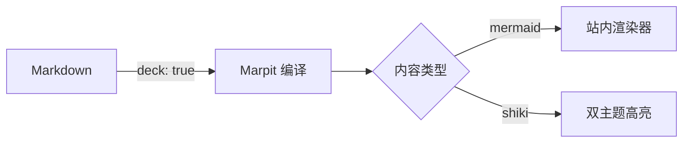

---
headingDivider: 1
paginate: true
style: |
  strong { color: var(--accent); }
---

# 用 Markdown 写幻灯片

<!-- _class: lead -->
<!-- _paginate: skip -->

Marpit 方言 · 构建期编译 · 客户端零依赖

<!-- 这是演讲者备注：逐页模式点便签按钮可见，连续浏览视图不显示。 -->

# 指令体系

页题用 `#`（渲染时自动降为 h2，页面 heading 序保持 h1 → h2），
上文 front-matter 已演示三种全局指令：

- `headingDivider: 1` —— 按 `#` 自动切页，本文全部页面都靠它
- `paginate: true` —— 右下角页码（与注释形态 `<!-- paginate: true -->` 等价）
- `style:` —— 全局样式微调，本文的**金色加粗**就是它上的色

| 指令 | 作用域 | 作用 |
| --- | :---: | --- |
| `_class: lead` | 仅本页 | 标题页居中变体 |
| `_paginate: skip` | 仅本页 | 本页不计页码 |
| `_color` / `_backgroundColor` | 仅本页 | 文字 / 底色反转变体 |
| `_header` / `_footer` | 仅本页 | 页眉 / 页脚 |
| `headingDivider` | 全局 | 按标题自动切页 |

上表「作用域」列居中——GFM 对齐语法（`:---:`）直接可用。

<!-- 备注示例：这一页汇总指令体系。局部指令加 _ 前缀只作用于当前页；
去掉前缀则从本页起持续生效。 -->

# 代码块走站内 shiki 双主题

```ts
const deck = compileDeck(markdown);
deck.slides.forEach((slide, i) => {
  console.log(`slide ${i + 1}: ${slide.length} chars`);
});
```

`行内代码`、**加粗**、*斜体*、~~删除线~~ 与 [外链](https://marpit.marp.app/) 都可用。

# 无语言代码块

```
未知语言回退为纯 <pre><code>，内容不吞、样式照旧
```

# 引用与列表

> 主题给引用块上了 accent 左条与 soft 底色，适合放提示与口号。

1. 有序列表的标记色同样由主题接管
2. 嵌套结构照常工作：
   - 无序列表子项
   - 第二个子项
3. 注意 `---` / `***` / `___` 在 Marpit 里**全部是分页符**，不存在水平分隔线
   语法——需要分隔感请用 raw `<hr>` 或留白

<!-- 这页演示 blockquote / ol / 嵌套列表的主题样式。 -->

# 背景图指令

<!-- _color: "#241d0e" -->


`` 在构建期转为 section 内联背景样式，compress-images 的字符串
改写会同步把引用换成 webp。浅色插图上用 `_color` 锁深色文字，
两种主题下都可读。

# 站内图片自动带固有尺寸

 

`w:` / `h:` 修饰符控制显示尺寸；所有站内图构建期注入 width/height
固有尺寸（unsized-images 审计零扣分），换页、解锁、嵌入场景都走同一条
contentHtml 通道。

<!-- 备注：这里放了一张真实图片，验收时确认灯箱不拦截幻灯片内的图。 -->

# 行内标签与分隔线

<!-- _class: cols -->

raw HTML 行内标签都有主题样式：<mark>mark 高亮</mark>、<u>下划线</u>、
<del>删除线</del>、上标 X<sup>2</sup> 与下标 H<sub>2</sub>O。

右栏演示 raw `<hr>`——markdown 层的 `---` / `***` 是分页符，
分隔线只能显式写 HTML：

<hr>

# 背景图 fit 模式


`![bg fit]` 以 contain 方式完整放入页面（不裁剪、留白居中）；
默认 `` 是 cover 铺满裁剪。多层 `![bg]` 叠加与
`bg right/left` 分栏是 Marp Core 语法，本站不可用——分栏用布局变体。

# 暗色变体页

<!-- _backgroundColor: "#241d0e" -->
<!-- _color: "#faf0cf" -->

`_backgroundColor` 与 `_color` 组合出反色页。行内 raw HTML 同样可用：
<kbd>→</kbd> 键位芯片、<span style="color: var(--accent)">行内 style 上色</span>。

# 页眉与页脚

<!-- _header: "**ZJBlog** · Marpit" -->
<!-- _footer: "页眉页脚指令演示（仅本页）" -->

`_header` / `_footer` 的值支持 Markdown 加粗；本页顶部与底部的两行
就是它们，加 `_` 只作用于本页。

# 图表也能上幻灯片



与文章同款语法——` ```mermaid ` fence 走站内渲染管线，
打印时自动切浅色主题。

# 站内语法同样可用

> [!tip] Callouts 也搬进来了
> 十类别配色对齐站点 token，打印自动浅色。

- [x] 数学公式：$E = mc^2$
- [x] 任务清单与 emoji 短码 🎉
- [ ] 定义列表：术语 : 定义也支持

行内 ==高亮== 与行内公式 $\alpha + \beta$ 照旧可用。

# 键盘翻页试一试

按 <kbd>→</kbd> 下一页、<kbd>←</kbd> 上一页、<kbd>Home</kbd>/<kbd>End</kbd>
首尾跳转；`#3` 这样的 hash 深链可以直达任意一页。

左下角可切「连续浏览」回堆叠视图，右上角全屏放映。

# 谢谢观看

注意上面两页之间**没有** `---`——front-matter 里的 `headingDivider: 1`
在遇到 `#` 时自动切页；显式 `---` 分页与它可混用，本文刻意只用自动形态。

<!-- 尾声两页演示 headingDivider 自动切页：源码里没有写任何 --- 分隔线。 -->
