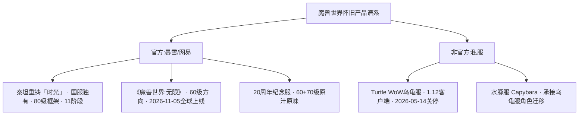
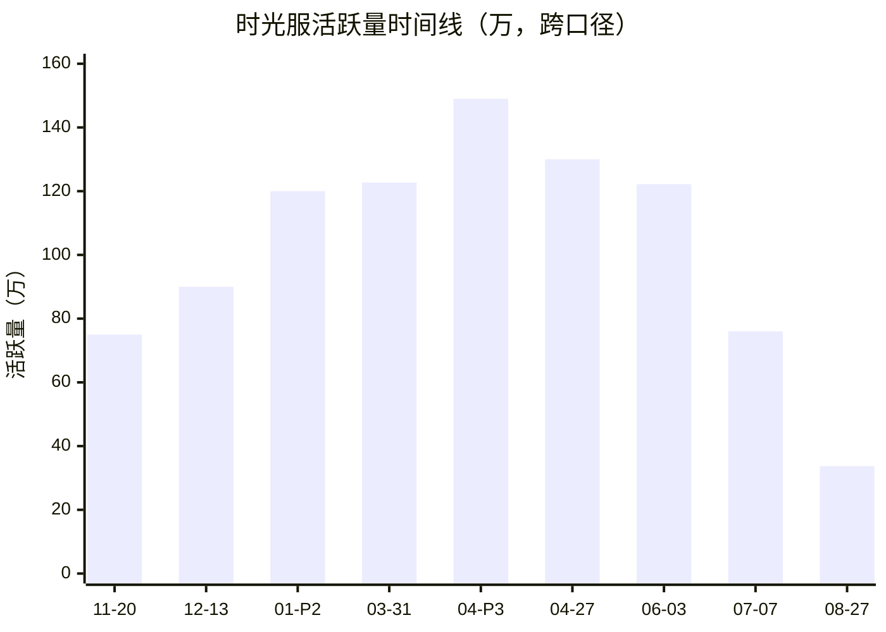
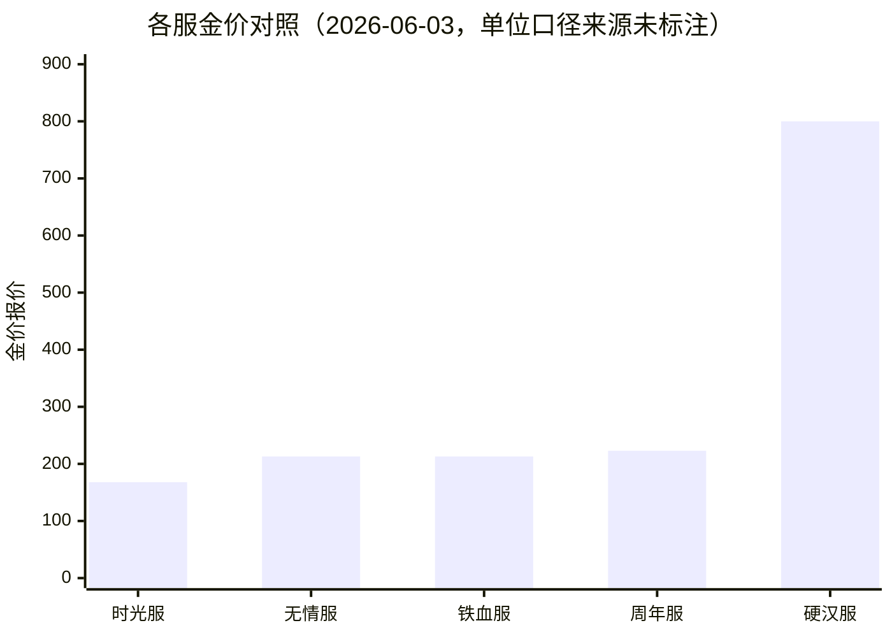
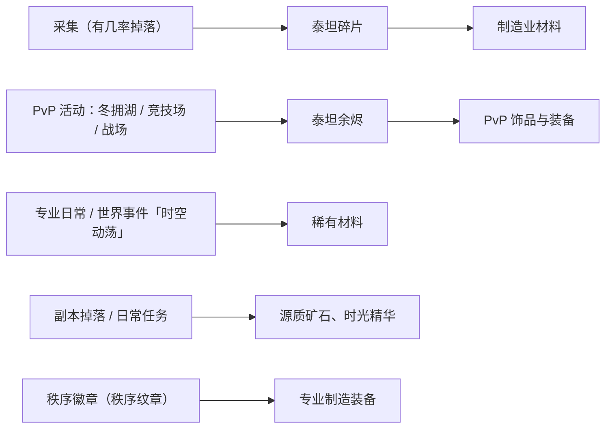
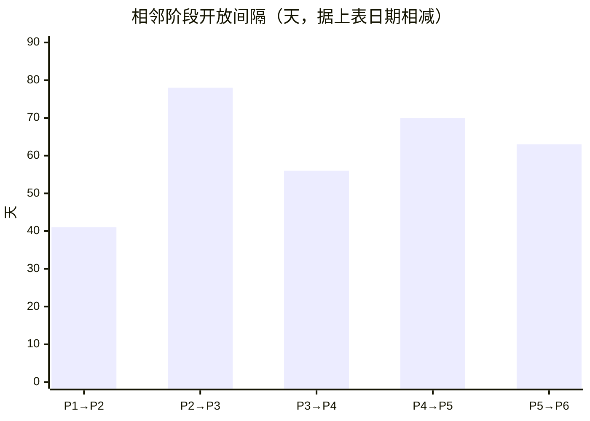
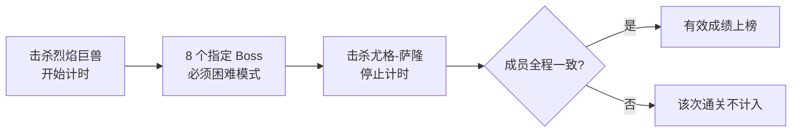
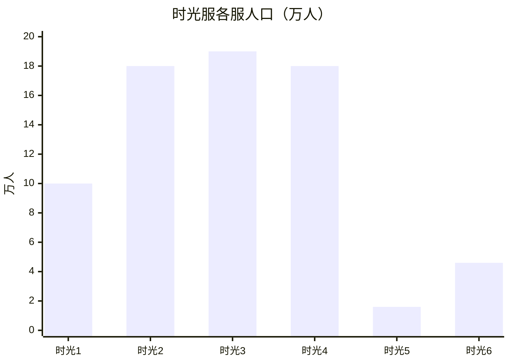

本节确立全报告的三条基准线：**产品身份**（官方还是私服、基于哪个版本）、**阶段规则**（11 个团本的开放节奏与自定义机制）、**数据口径**（哪些数字来自何处、覆盖什么时间窗、哪些只能估算）。后续所有人口、经济、职业与副本指标都在这三条基准上比较，不跨产品线、不跨口径混用。

## 版本定位：国服独有的官方“80 级纪年”服务器

泰坦重铸服务器「时光」是**国服独有的全新官方服务器类型**，由网易与暴雪合作推出，2025 年 11 月 18 日正式上线，运营主体为网易（上海网之易）。[13,18] 英文侧的报道口径一致：Wowhead 称其为仅在中国上线的全新服务器类型，并讨论它对 Classic 体系的意义；[3] 第三方站点则直接译作 "Level 80 Chrono Server"（80 级时光服务器）。[5] 部分玩家在 2025 年 11 月 14 日提前进入，首个团本熔火之心于 12 月 4 日以 80 级 / 25 人重铸形式开放。[18]

与官方经典旧世路线相比，该服在六项可核实的规则上做了系统性重做，而非还原：

| 维度 | 泰坦重铸「时光」的规则 | 与官方经典旧世的差异 |
|---|---|---|
| 等级框架 | 以“巫妖王之怒”为框架，融合 60/70/80 三大版本核心内容，等级上限统一 80 级，全部从 1 级重练 [18] | 不是单资料片还原，而是跨版本整合 |
| 经验与追赶 | 开服后全服享有经验加成，2025 年 12 月开放角色直升 [18] | 经典旧世无直升服务；具体加成倍率可用来源未披露 |
| 团本开放 | 60/70/80 经典团本统一调整为 80 级难度并存、乱序开放 [3,13,21] | 打破“按资料片顺序推进”的线性节奏 |
| 货币体系 | 秩序纹章、泰坦余烬等新货币取代勇气 / 英雄 / 征服 / 凯旋 / 寒冰纹章 [18,484] | 纹章体系被合并为单一追赶货币 |
| PvP 规则 | 装备韧性属性移除，改由 PvP 统一光环提供；所有 PvP 服务器强制阵营平衡 [18] | 官方经典旧世依赖装备堆叠韧性 |
| 竞速榜单 | 官方为 P6 奥杜尔开设全服总榜，要求困难模式全通、成员全程不变，设 35,000 元现金奖池 [648] | 官方主导的竞速激励，非社区自办 |

> [!NOTE] 本表不含“掉落与装备”一项
> 现有来源对掉落改制的可核实记录不足：套装件数是否简化、风剑与蛋刀等传说武器是否随版本升级保值，均缺少可引用的原始出处，本报告不作断言，待官方公告或第三方实测数据补齐后再议。

对照来看，同期官方 20 周年纪念服主打“原汁原味”，只做世界 Buff 存储器、荣誉军阶系统等小幅体验改善；[592] ==时光服的定位是“内容整合型快速服”，不是怀旧复刻。==

官网曾将“泰坦重铸服务器「时光」”与《魔兽世界：无限》“11 月 5 日全球同步上线”的消息并列展示，而时光服自身上线时间为 2025 年 11 月 18 日，两者关系需留意，不可当作同一产品的同一日期处理。[13,18,47]

## 阶段规则：11 个阶段的时间锚点

全部团本按 80 级 / 25 人重铸、乱序开放，路线图共 11 个阶段，截至 2026 年 10 月 13 日已推进至 P6。

| 阶段 | 团本内容 | 开放时间 | 来源 |
|---|---|---|---|
| P1 | 熔火之心（MC，80 级 25 人重铸） | 2025-12-04 | [18] |
| P2 | 风暴要塞 + 毒蛇神殿 | 2026-01-14 | [616] |
| P3 | 纳克萨玛斯 + 黑曜石圣殿 + 永恒之眼（“决战霜穹”） | 2026-04-02 | [616] |
| P4 | 十字军的试炼 + 祖尔格拉布 | 2026-05-28 | [280] |
| P5 | 祖阿曼 + 太阳之井高地（橙弓） | 2026-08-06 | [512,617] |
| P6（当前） | 奥杜尔（新版瓦兰奈尔；团本挑战榜 2026-10-12 上线） | 2026-10-08 | [512,650,652] |
| P7 | 格鲁尔巢穴 + 玛瑟里顿巢穴 + 卡拉赞 | 未开放（已公布路线图） | [483] |
| P8 | 奥妮克希亚巢穴 + 黑翼之巢 + 安其拉废墟 | 未开放 | [483] |
| P9 | 安其拉神庙 + 梦魇之龙 | 未开放 | [483] |
| P10 | 冰冠堡垒 + 红玉圣殿 | 未开放 | [483] |
| P11 | 黑暗神殿 + 海加尔山之战（蛋刀压轴） | 未开放 | [277,483] |

解读三点：其一，P1–P6 已落地、P7–P11 仅有路线图，橙弓落在 P5、蛋刀压在 P11，说明高价值橙装的释放被刻意拉长到末期。[277,512] 其二，相邻阶段实际间隔约 6 至 10 周，与“每阶段约 8–10 周”的路线图口径基本吻合，这决定了后文所有环比指标的时间窗长度在两个月上下。[280,616,652] 其三，每个阶段都配有独立的评分规则：P3 榜单沿用 2022 年巫妖王之怒怀旧服 P1 的评分标准，P4.5 另设小怪伤害是否计入的细则，这意味着“战斗表现”类数据必须按阶段口径分段使用。[521,522]

## 数据边界：覆盖窗口、统计口径与估算项

现有公开数据几乎全部来自**单一渠道**——“大脚”（BigFoot）插件的人口普查，再由 NGA、17173、大神、什么值得买等社区与媒体二次整理转述。[27,229] 时间窗自 2025 年 11 月 20 日开服后首次普查，到 2026 年 10 月 13 日的统计页快照为止。[238,322]

| 时间 | 口径 | 数字 | 同期参照 | 来源 |
|---|---|---|---|---|
| 2025-11-20（开服首查） | 大脚·24h 活跃角色 | 全服 75 万角色 | 官方预约曾称破 100 万 | [35,238] |
| 2025-12-13 | 大脚·24h 活跃角色 | 超 90 万；时光 2/3/4 服各约 21 万；6 服 13.8 万超 1 服；5 服 2.8 万 | — | [501] |
| 2026-01（P2 开放） | 日活跃人口 | 突破 120 万（历史新高）；联盟 63 万 vs 部落 56 万 | — | [658] |
| 2026-03-31 | 大脚·人口普查 | 122.7 万 | 骑士 / 法师 / 德鲁伊人口领跑 | [500] |
| 2026-04-02/03（P3 开放） | 大脚·日活跃 | 约 149 万 / 141.9 万（环比 -4.8%） | 正式服 70.6 万、熊猫人 11.8 万 | [612] |
| 2026-04-27（周末） | 大脚·活跃人口 | 超 130 万；时光 2 服 34 万、3 服 33 万、4 服 30 万、5 服 2.6 万 | — | [41] |
| 2026-06-03 | 大脚·总活跃 | 122.2 万（环比持平） | 正式服 53.4 万、熊猫人 9.9 万（环比 -3.5%） | [229] |
| 2026-07-07 | 第三方·24h 活跃角色 | 跌至 76 万（自 122 万峰值两周流失约 46 万） | 正式服 24h 活跃从 20 万升至 50 万 | [666] |
| 2026-08-27（普查重开） | 大脚·24h 上线角色 | 337,226（部落 162,091 / 联盟 175,135） | 随后口径混乱：33/52/150 万争议、普查被下架 | [45,602,603] |
| 2026-10-13（今日快照） | 大脚统计页·所有游戏角色（非 24h 活跃） | 联盟 4,691,559 / 部落 4,285,675（合计约 898 万） | 口径与活跃数不可直接换算 | [322] |

> [!WARNING] 口径陷阱：表中的数字彼此不可直接相减或换算
> 2025-11 至 2026-06 行是大脚插件的“24h 活跃角色 / 日活”口径；2026-08 起普查口径本身存在争议并一度被下架；2026-10-13 行是统计页的“所有游戏角色”累计值，与活跃数不是同一量纲。[27,229,322] 因此 130 万、122.2 万、33.7 万与约 898 万这四组数字之间**不存在官方的换算关系**，报告中任何“跌幅”“留存率”都必须标注原始口径。

可估算项目前只有一条链：NGA 玩家以“日活角色约 110 万 ÷ 人均 4 个号”推出日活玩家约 27.5 万，再按“周活 ≈ 日活 × 1.4”推出周活跃玩家约 38.5 万。[29] ==这是社区估算而非常规统计，其“人均 4 个号”的假设无法在现有来源中验证。==

数据可得性本身也在收紧：2026 年 7 月 20 日起，查分类插件（ArchonTooltip、WCL 分数类）在包括泰坦重铸「时光」在内的全部怀旧服分区被封禁，战斗表现类第三方数据的公开可得性由此受限；[218] 同一时期大脚人口统计也因“数据异常”阶段性下架功能。[27]

## 产品谱系边界：四类易混对象的区隔

| 产品 | 属性与运营方 | 版本基础 | 关键时间 | 与本报告数据的关系 |
|---|---|---|---|---|
| 泰坦重铸「时光」 | 官方，网易 × 暴雪，国服独有 [18] | 80 级框架，60/70/80 内容整合，11 阶段 [18,484] | 2025-11-18 上线；2026-10-08 进入 P6 [18,652] | ==本报告主体== |
| 《魔兽世界：无限》 | 官方，60 级方向新作，新增种族“天裔”，面向 60 级受众（尤其乌龟服玩家） [47,50,51] | 60 级 | 2026-09 嘉年华公布，2026-11-05 全球同步上线 [47,50,51] | 并行产品线，人口数据不可混算 |
| 20 周年纪念服 | 官方，赛季 / 回滚服，60+70 级“原汁原味” [592] | 60+70 级 | 国服 11 月 22 日上午 6 点上线 [592] | 生态位重叠，但规则与数据独立 |
| Turtle WoW 乌龟服 | 私服，Moonwhisper Games 运营，基于 1.12 香草时代 + 自制扩展“艾泽拉斯之谜” [66,70] | 60 级 | 2018 年立项 / 2019 年欧服上线、2023-09-09 开亚服；暴雪 2025 年 8 月诉讼获胜获永久禁令，2026-04-12 宣布关服、05-14 关闭 [66,70,121,147,149] | 私服线，仅作迁移参照 |
| 水豚服 Capybara | 私服，乌龟服后继，提供角色数据迁移 [129,148,342] | 承接乌龟服 | 2026 年 5 月乌龟服关停后出现 [129,148] | 私服线，不可与官方数据并列 |

> [!IMPORTANT] 三条口径纪律
> 第一，“时光服”专指官方泰坦重铸服务器，乌龟服、水豚服属私服线，[147] 已明确私服“做得越接近官方替代品，越容易触碰版权底线”，其数据不能与官方服并列讨论。[66,147] 第二，《魔兽世界：无限》是与时光服并行的不同产品线，NGA 已为新区分设版规、与时光服无关的帖子限流处理，[27,47] 两者人口与热度不可加总。第三，官方从未公布逐服 / 逐阵营的官方口径人口，经验倍率、直升价格、掉落与装备改制细节等具体数值在可用来源中同样缺失，相关指标只能依赖第三方口径或社区估算。

本节回答三个问题：时光服的体量有多大、阵营是否失衡、在线曲线受什么驱动。核心结论是——==时光服在 2026 年 4 月前后触及约 149 万活跃角色的峰值区间，同期体量约为正式服的 2.3 倍；阵营差长期稳定在联盟领先 2–5 个百分点；在线曲线由版本节点与节假日驱动，而非平滑的自然增长==。[229][658][612]

## 体量曲线：三次台阶、一次回落、一次口径断裂

曲线形状可以一句话概括：开服首查为基点，12 月中旬抬升约两成（90÷75−1，本文按两期数据推算），次年 1 月 P2 开放当口刷新历史新高，4 月初 P3 前后进入峰值区间；此后是两次台阶式回落，8 月下旬普查重开时已回到峰值的四分之一上下（33.7÷149≈23%，本文推算）。[658][612][666][45,602]

| 时间 | 口径 | 数字 | 同期参照 | 来源 |
|---|---|---|---|---|
| 2025-11-20（开服首查） | 大脚·24h活跃角色 | 全服75万角色 | 官方预约曾称破100万 | 17173/大脚 [35,238] |
| 2025-12-13 | 大脚·24h活跃角色 | 超90万；时光2/3/4服各约21万；6服13.8万超1服；5服2.8万 | — | 腾讯新闻 [501] |
| 2026-01（P2开放） | 日活跃人口 | 突破120万（历史新高）；联盟63万 vs 部落56万 | — | 网易 [658] |
| 2026-03-31 | 大脚·人口普查 | 122.7万 | 骑士/法师/德鲁伊人口领跑 | 17173 [500] |
| 2026-04-02/03（P3开放） | 大脚·日活跃 | 约149万 / 141.9万（环比-4.8%） | 正式服70.6万、熊猫人11.8万 | 17173 [612] |
| 2026-04-27（周末） | 大脚·活跃人口 | 超130万；时光2服34万、3服33万、4服30万、5服2.6万 | — | 17173 [41] |
| 2026-06-03 | 大脚·总活跃 | 122.2万（环比持平） | 正式服53.4万、熊猫人9.9万（环比-3.5%） | 17173 [229] |
| 2026-07-07 | 第三方·24h活跃角色 | 跌至76万（自122万峰值两周流失约46万） | 正式服24h活跃从20万升至50万 | 什么值得买 [666] |
| 2026-08-27（普查重开） | 大脚·24h上线角色 | 337,226（部落162,091/联盟175,135） | 随后口径混乱：33/52/150万争议、普查被下架 | 17173/头条 [45,602,603] |
| 2026-10-13（今日快照） | 大脚统计页·所有游戏角色（非24h活跃） | 联盟4,691,559 / 部落4,285,675（合计约898万） | 口径与活跃数不可直接换算 | 大脚人口统计页 [322] |

*注：2025-11 至 2026-06 为“大脚”插件 24h 活跃角色/日活口径；2026-08 起普查口径受争议；不同报道的“日活/活跃/在线”不可直接比较。*

放回同一条大脚口径看，时光服的相对位置更清楚：2026-06-03 的总活跃约为同期正式服的 2.3 倍（122.2÷53.4，本文推算），约为熊猫人怀旧服的 12 倍（122.2÷9.9≈12.3，本文推算），并高于经典怀旧（11.1 万）与硬汉服（4.4 万）一个数量级。[229] 但到 7 月初，第三方口径显示时光服 24h 活跃回落的同时，正式服从 20 万升至 50 万，领先幅度收窄到约 1.5 倍（76÷50，本文推算）。[666]

> [!NOTE] 角色 ≠ 玩家
> 本节所有口径统计的都是**角色**。社区以“日活角色约 110 万 ÷ 人均 4 个号”估算日活玩家约 27.5 万、再按周活≈日活×1.4 推算周活跃玩家约 38.5 万；[29] 而报道中“时光服总人口 90 万+”的表述并未说明单位是账号、角色还是玩家。[45,602] 两者都未经官方确认，只能作为“玩家数显著小于角色数”的方向性提示。

## 分区：服务器之间差近一个数量级

| 服务器 | 2025-12-13 普查 [501] | 2026-04-27 周末普查 [41] |
|---|---|---|
| 时光2服 | 约21万 | 34万 |
| 时光3服 | 约21万 | 33万 |
| 时光4服 | 约21万 | 30万 |
| 时光5服 | 2.8万 | 2.6万 |
| 时光6服 / 时光1服 | 6服13.8万，已超过1服 | — |

第二梯队由时光2/3/4服组成，长期占据 30 万级；时光5服则长期停在 2.6–2.8 万，与榜首相差约 13 倍（34÷2.6，本文推算），==“时光服总人口”这一数字完全不能代表单服体验==。[41][501] 榜首还会换人：某次未标注时点的普查显示时光4服以 20.2 万活跃人口拉大差距、坐稳第一大服，当周因团本开放叠加黑石山 PVP 活动录得环比 +13%，并伴随“晚上排队情况依旧严峻”；[674] 到 4 月下旬周末，榜首又回到时光2服。[41]

## 阵营：强制平衡机制下的稳定 52/48

| 时点 | 口径 | 联盟 | 部落 | 联盟领先 |
|---|---|---|---|---|
| 2026-01（P2 阶段） | 日活跃角色 | 63万 | 56万 | +7万（约+12.5%，本文按两阵营数推算），联盟占约 52.9% [658] |
| 2026-08-27 | 大脚·24h上线角色 | 175,135 | 162,091 | +13,044，联盟占 51.9%（差值与占比为本文推算）[45,602] |
| 时点未标注 | 24h活跃角色 | 314,014 | 278,680 | +35,334，联盟占 53.0%（差值与占比为本文推算）[684] |
| 2026-10-13 | 大脚统计页·全部游戏角色 | 4,691,559 | 4,285,675 | +405,884，联盟占 52.3%（差值与占比为本文推算）[322] |

四组独立数字方向完全一致：联盟占比稳定落在 51.9%–53.0% 区间（本文按各期两阵营数相除得出），不存在某一方被彻底压制的情形。[658][45,602][684][322] 机制层面，所有 PvP 服务器均启用阵营强制平衡机制；[18] 社区则把这轮联盟优势归因于运营方的种族与阵营改善计划。[684] 需要注意两个口径的绝对值不可混用：在“全部角色”口径下联盟多出约 40.6 万角色，在“24h 活跃/日活”口径下只多出 1.3 万至 7 万，说明“练号倾向”与“在线行为”并不是同一件事。[322][658]

## 活跃时段：版本节点与节假日双驱

- **周末效应**：2026-04-27 的周末普查录得超 130 万活跃，在同期各期数字中处于高位。[41]
- **版本节点是最强推力**：P2 开放当口日活破 120 万并创历史新高，[658] P3 前后接近 149 万，[612] 某周因“团本开放 + 黑石山 PVP 活动”带来环比 +13% 的在线率提升。[674]
- **节假日反向拉动**：2026-02-16 总活跃 81.4 万，环比前一日下降 18.7%，报道归因于除夕年夜饭；[677] 春节假期结束后活跃角色进一步锐减约 30 万。[683]
- **晚间尖峰**：多个服务器在晚间出现排队，报道直指“晚上排队情况依旧严峻”。[674]
- **缺失项**：逐小时在线曲线、工作日/周末分时对照、新增与回流玩家分项、等级段分布与公会规模分布，在可用来源中均无统计，本节无法就这些维度给出任何量化判断。

> [!WARNING] 2026 年 8 月之后，时光服不存在可信的单一人口口径
> 大脚普查在长时间停更后由雷火接手整合重开，[45,602] 重开首查落到 33.7 万一档，随后社区出现 33 万 / 52 万 / 150 万三种互相矛盾的说法，普查页面一度被下架。[45,602,603] 大脚统计页 2026-10-13 显示的“联盟 469 万 / 部落 428 万”是**全部游戏角色**快照，不是 24 小时活跃，不能与上表任何一行做换算。[322] 因此跨口径的环比一律不可比，本报告只采用“峰值百万级、当前数十万级”的粗略档位，任何小数位级的差异都应视为噪声。

**生命周期位置判断**：时光服已度过 2026 年 4 月 P3 节点的人口峰值，6 月靠版本节奏横盘，7 月出现约 46 万角色的单次流失——相对约 122 万的峰值水平约 -38%（46÷122，本文推算）。[229][666] 它仍是中国区怀旧产品线中体量最大的一支，对正式服保持约 1.5–2.3 倍优势，[229][666] 但曲线形态已从“增量上行”切换到“存量博弈”，后续每一阶段开放更接近脉冲式回流而非持续增长。[612][666]

本节确立三件事：时光服的公开金价在 P4（2026-05-28 开放）之后经历一次大幅下修并转入横盘；拍卖行可观测的价格集中在坐骑与毕业装两类头部商品上，且阵营间分化明显；至于金币产消总量、玩家财富分布、通胀率以及工作室 / RMT 规模，本次可用来源没有任何可量化口径——这几项只能判为数据空白，而不是"接近零"。

## 金价：P4 之后的一次性下修，随后进入横盘

2026-06-03 的汇总记录显示，P4 开放后时光服金价大幅下降，此后"趋于平稳，稳中小幅下降"，时光服当前报价最高 168。[229] 同一时点，周年服 223、无情服 213、铁血服 213，其中无情服与铁血服仍在"大幅跳水"；正式服与熊猫人服保持稳定。[229] 硬汉服是唯一反向样本，报 800 且呈上涨趋势、"远超其他服金价"。[229]

按同一时点做横向折算：时光服报价比无情服 / 铁血服低约 21%（1−168÷213），比周年服低约 25%（1−168÷223），而硬汉服约为时光服的 4.8 倍（800÷168）——以上为本文推算。[229] 需要说明的是，来源既未标注这组数字的单位（元/万金或其他），也未区分挂牌价、成交价与第三方收售报价，更没有附带成交额，因此它只能用于跨服相对比较，无法换算成绝对购买力。[229]

## 拍卖行物价：可观测的只有头部商品，阵营分化显著

| 商品 | 阵营 | 价格（万金） | 环比变动 | 来源 |
|---|---|---|---|---|
| 祖格猛虎（P4 团本坐骑） | 部落 | 3.08 | +14.95% | [229] |
| 祖格猛虎（P4 团本坐骑） | 联盟 | 2.72 | −14% | [229] |
| 死亡的选择（毕业饰品） | 部落 | 2.21 | 微跌 | [229] |
| 死亡裁决（毕业饰品） | 联盟 | 2.07 | 小幅上涨 | [229] |
| 蛛魔裂片、艾瑞达之心（245 毕业武器） | 部落 | 稳居高价榜前列 | 稳步涨价 | [229] |
| 蛛魔裂片、艾瑞达之心（245 毕业武器） | 联盟 | — | 全线小幅回落 | [229] |
| 菲斯克火炮（法系披风） | 部落 | — | 涨幅超 20% | [229] |
| 温蕾萨的灵巧（冷门装备） | 联盟 | — | 暴跌 21% | [229] |
| 夺灵者碎片 | 双阵营 | — | 同步小幅降价 | [229] |
| 橙弓（团内竞拍，非拍卖行挂牌） | 不适用 | 3.0 | P5 开服第三周单次成交 | [669] |

同一坐骑在两阵营的价差为 0.36 万金，即约 13%（0.36÷2.72，本文推算），且涨跌方向相反（部落 +14.95%、联盟 −14%）——这提示定价主要由分阵营的供求差异驱动，而非一次统一的全服通胀，属本文推断。[229] 供给端背景是：迅捷祖利安猛虎与扎什迅猛龙分别由高阶祭司塞卡尔与血领主曼多基尔掉落，祖尔格拉布随 P4 于 2026-05-28 开放，[280] 因此上述价格是内容上线约一周的快照，处于掉落供给的爬坡期，不宜当作稳态水平。

> [!WARNING] 成交量维度整体缺失，价格点位不能当作市场深度
> 所有可引价格都是单点数字，本次来源中没有任何一条给出这些商品的成交量、挂单量或换手率；材料、合剂与消耗品的价格更是完全没有记录。[229][669] 因此本节能得到的结论只有"头部商品贵/便宜、涨/跌"，任何关于市场厚度、通胀速度或玩家购买力的推论都超出了资料范围。

## 资源与货币通道：产出端碎片化，回收端不可考

官方为时光服设计了一套多入口、相互不重叠的产出体系：采集时有几率直接获得"泰坦碎片"，可购买制造业材料；PvP 活动（冬拥湖、竞技场、战场）产出"泰坦余烬"，用于购买 PvP 饰品与装备；新货币"秩序徽章"（亦作"秩序纹章"）用于兑换专业制造装备；源质矿石、时光精华等关键制造材料通过日常任务与副本掉落获取；专业日常任务与世界事件"时空动荡"提供稀有材料。[18] 官方还对专业系统做过一次明确的供给侧调整——制造业物品使用门槛降低、采集收益增加。[18]

被明确记录的金币注入通道只有一条，且走的是付费口径：升级后的「时光」跃迁礼包含一次 80 级角色直升、219 装等装备、高级骑术与寒冷天气飞行、史诗地面坐骑与精良飞行坐骑、双天赋解锁、数个诺森德声望崇拜，以及"一小笔用于开启旅程的金币"。[280] 来源未给出这笔金币的数额，因此无法评估其对货币总量的影响。[280]

回收端则完全空白：本次来源未提供金币产出总量、修理费 / 拍卖行税 / 坐骑等回收渠道的规模、玩家人均金币或财富分布，也没有任何通胀率指标。[229][280] 本节据此不对"通胀率呈现什么特征"这一问题给出数字答案。

## 数据可信度：自媒体报价 + 付费工具，且无一条 RMT 证据

- 金价与物价的日常更新由个人创作者承担：B 站有 UP 主每日更新时光服金价、人口普查、职业强度与热门装备价格，播放量稳定在一千多；[669] 2026-06-26 另有一篇以"金价走势"为标题的汇总帖，但可见内容中未附数值序列。[660]
- 存在商业化的第三方普查 / 物价工具，定位是"搬砖玩家与魔兽内容创作者"，用于实时跟踪物价与服务器热度变化，月费十几元，同一来源同时说明普通玩家没必要购买。[676] 也就是说，物价数据的主要消费者是依赖它套利的玩家，而工具口径不对外披露、无第三方审计。
- 关于工作室、脚本、RMT 与金团，本次来源对时光服**没有任何一条**量化或定性描述。两条"干净经济"的叙述指的都是别的服务器：[70] 的"明令禁止 RMT、无工作室存在、另有内购商城"说的是乌龟服（Turtle WoW）；[148] 的"开服同步严打金农脚本"说的是乌龟服后继的水豚服新服。二者都不可移用为时光服的状况。金团方面仅有一条间接信号——P5 开服第三周出现"有金团 V 群解散"的记载，[669] 但规模与原因均未交代。

> [!IMPORTANT] 金价不能替代通胀率
> 本节全部金价数字都缺少单位、采样方式与成交量，且发布主体是自媒体与付费第三方工具。[229][669][676] 把"金价下跌"直接读成"游戏内通胀"，会同时踩两个坑：没有量的价格无法区分是供给放量还是需求退潮；场外金价还叠加了现金交易需求与运营处置（如封号）的扰动，与游戏内货币总量并不同步——此为本文判断。凡涉及工作室、RMT、金币产消规模的量化结论，本次资料范围一律不支持。

本节汇总时光服在两类口径上的职业信号：一是人口占比与副本出场（大脚普查 + 玩家观察），二是 WCL 战斗排名（自媒体整理的全分位与 95 分位榜单），并交代自定义机制与 WCL 规则如何改变"强势专精"的定义。先说边界：本次来源中==没有任何一份给出完整的专精人口百分比表==，能锚定的只有"领跑阵营"与"不足 1%"两端；DPS 排名也全是序数（第几名），没有伤害绝对值、样本量或统计周期。[667][660]

## 专精人口：只有两端锚点

| 信号 | 内容 | 口径与时间 | 来源 |
|---|---|---|---|
| 人口领跑 | 骑士、法师、德鲁伊人口领跑 | 大脚人口普查，2026-03-31（122.7 万） | [500] |
| 开服观察 | 热门职业为法师和圣骑士；术士、萨满、盗贼较少 | 玩家初体验，无量化 | [668] |
| 冷门端 | 血 DK、痛苦术、火法、奥法属"冷门小众玩法，人气占比不足 1%" | 媒体汇总 | [229] |
| 热门榜 | "最受欢迎的五大专精"，称基于 WCL 与大脚真实数据；同时强调"职业人口多不代表副本活跃度高" | 自媒体，可见内容未附数值 | [667] |

四大人气冷门（血 DK、痛苦术、火法、奥法）各自的占比上限合计不足 4%（4 × 不足 1%，据 [229] 推导）。[667] 提出的"人口 ≠ 副本出场"是个关键方法论点：该来源明确把"最受欢迎"与"统治副本一线"分开处理，说明时光服存在"号多但不进本"的专精——但具体是哪些、差多少，来源没有给出。

## DPS 排名：敏锐贼与冰法双头领先，暗牧/元素萨/鸟德垫底

全分位榜单把 20 余个专精切成四个名次段。[467]

| 名次段（全分位） | 专精（按序） | 95 分位的变化 |
|---|---|---|
| 1–5 | 敏锐贼、冰法、生存猎、痛苦术、兽王猎 | 敏锐贼、冰法仍居前 2，且"领先幅度很大" [467] |
| 6–10 | 邪 DK、火法、狂暴战、奇袭贼、增强萨 | 邪 DK、狂暴战排名上升 [467] |
| 11–15 | 毁灭术、武器战、野德、战斗贼、惩戒骑 | 少数派职业排名普遍下降 [467] |
| 16 名之后 | 冰 DK、恶魔术、暗牧、奥法、元素萨、鸟德、射击猎、血 DK | 鸟德"跌到了谷底" [467] |

弱势端在下个阶段仍未翻转：P4 新 CD 首日的 99 分榜单中，暗牧的排名"得到了一定的提升，但也仅仅高于射击猎、恶魔术以及鸟德"——扣除射击猎这一冷门专精后，暗牧在常见专精中依然垫底。[470] 被 [467] 点名的"最悲催、当前最需要加强"的三个专精是暗牧、元素萨、鸟德。[467]

> [!WARNING] 两份榜单在同一专精上互相矛盾
> [467] 的全分位名单把恶魔术归入"16 名之后"，同文 95 分位段落却称恶魔术"直接跌落到第 7 名"。[467] 二者不可能同时成立于同一时点的同一口径。本次资料无法判定这是不同周次、不同样本还是编辑失误，因此**任何"某专精位列第 N"的引用都必须带上它来自哪一份榜单**，不可混用。

> [!IMPORTANT] 这份排名不能当强度表读
> 一是序数无刻度：全是"第几名"，没有伤害差值，第 1 与第 2 之间的"领先幅度很大"是文字描述而非数字。[467] 二是榜单本身被天梯化：来源方自己提示"WCL 榜单是战斗分析工具，加了排名后就有所异化，理性对待排名工具"，且时光服机制下"卷度"本就更高。[137] 三是治疗（HPS）与仇恨（TPS）维度在本次来源中==完全没有排名数据==——[137] 只提到 WCL 会禁用"过度使用生命分流的刷治疗分日志"，那是规则，不是结果。

## 机制与规则：为什么官方服的专精结论不能移用

时光服的装备系统做了底层改动：套装效果简化为 2 件套与 4 件套，玩家可混穿不同套装部件同时激活多个套装效果，传说武器可升级，多种纹章被统一的"泰坦余烬"取代。[18] 叠加 WCL 侧的口径，配装自由度被进一步放大——一条来源直言"时光服的部分套装机制重新调整加上 WCL 没有规则，那么就会出现各种各样的奇葩搭配"，并预判会有大量老板找团队冲 DPS 榜单。[516]

但"WCL 没有规则"这一说法与另一条来源冲突：[137] 记载了 WCL 已正式公布的规则，包括能量灌注平均每 96 秒限 1 次（超限者无个人排名）、禁用全部世界 Buff、禁用侏儒作战小鸡/钳子先生/鱼肝油/月神之光等道具、竞速需 25 人且每多一名换人加 1 分钟惩罚；同一来源还提及盗贼"黑科技"打出 5 万秒伤、防骑在新点位刷金一小时 400 金的说法。[137] 本次资料不足以判定 [516] 与 [137] 是时间先后（先无规则、后公布规则）还是"日志统计"与"排名资格"两套不同口径，引用时应按各自时点标注，不可并列为同一状态。

机制层面的专精倾斜也有具体记载：人类术士的主动技能提供 15% 暴击，可在起手卡出"超级腐蚀"，在该来源设定"后续不加强其他种族天赋"的前提下被称"独一档"；暗牧同为可卡快照的专精，该来源预判"时光服暗牧崛起应该会更早"。[192] 后半句预测在后续实战榜单中没有兑现——直到 P4 暗牧仍在底部区间。[467][470] 快照机制的理论收益，至少在已记录的阶段里没有转化为排名（此为本文判断）。

> [!NOTE] 关于暗牧的机制细节，本次资料帮不上忙
> 唯一一份讨论暗牧输出循环与配装的帖子来自 TBC 阶段的"怒炉服务器"，且明确自述"无 WCL 做准确的数据支撑，只能靠理论做一些推演"。[465] 它既不是时光服环境，也不具备可比数据，不可移用为时光服暗牧弱势原因的解释。

**缺什么。** 完整的专精人口占比表、DPS/HPS/TPS 的绝对数值与分位差距、WCL 的样本量与统计周期，本次来源一律未提供；[667][660] 虽在标题与摘要中承诺"职业人口分布""热门天赋人气分析"，可见内容中均无具体数字。[660][667] 因此本节能给出的最强结论是方向性的：**人口端由骑士、法师、德鲁伊领跑，冷门端被血 DK、痛苦术、火法、奥法占据；战斗端由敏锐贼与冰法双头领先，暗牧、元素萨、鸟德在多个榜单与多个阶段持续垫底。**

本节能确认的三条主线是：泰坦重铸「时光」用约 10 个月走完 11 个阶段中的前 6 个，PvE 内容消耗速度明显快于常规怀旧服的阶段节奏；从 P6 奥杜尔起，官方用带现金奖池的公开榜单来定义"成绩"；所有团本被统一改写为"80 级 / 25 人 / 不分普通与英雄"。==但首杀时间、全通公会数量、通关率、平均通关时长这四项结果数据，本次来源一个具体数字都没有==——本节因此只能交代规则侧与节奏侧，无法交代统计侧。

## 阶段节奏：308 天推完 6 个阶段

| 阶段 | 团本内容 | 开放时间 | 来源 |
|---|---|---|---|
| P1 | 熔火之心（MC，80级25人重铸） | 2025-12-04 | 百度百科/官网 [18] |
| P2 | 风暴要塞 + 毒蛇神殿 | 2026-01-14 | 官网公告 [616] |
| P3 | 纳克萨玛斯 + 黑曜石圣殿 + 永恒之眼（"决战霜穹"） | 2026-04-02 | 官网公告 [616] |
| P4 | 十字军的试炼 + 祖尔格拉布 | 2026-05-28 | 官网公告 [280] |
| P5 | 祖阿曼 + 太阳之井高地（橙弓） | 2026-08-06 | 官网公告 [512] |
| P6（当前） | 奥杜尔（新版瓦兰奈尔；团本挑战榜2026-10-12上线） | 2026-10-08 | 官网/17173 [652][512] |
| P7 | 格鲁尔巢穴 + 玛瑟里顿巢穴 + 卡拉赞 | 未开放（已公布路线图） | 腾讯新闻 [483] |
| P8 | 奥妮克希亚巢穴 + 黑翼之巢 + 安其拉废墟 | 未开放 | 腾讯新闻 [483] |
| P9 | 安其拉神庙 + 梦魇之龙 | 未开放 | 腾讯新闻 [483] |
| P10 | 冰冠堡垒 + 红玉圣殿 | 未开放 | 腾讯新闻 [483] |
| P11 | 黑暗神殿 + 海加尔山之战（蛋刀压轴） | 未开放 | 腾讯新闻/17173 [483][277] |

按上表日期相减（本文计算），P1→P6 的五个阶段间隔分别为 41、78、56、70、63 天，合计 308 天，平均约 61.6 天（约 8.8 周）。[18][616][280][512] 其中最短的 P1→P2 只有 41 天，最长的 P2→P3 达 78 天，节奏并不均匀。

截至 2026-10-13，11 个阶段中已释放 6 个、约 54.5%（6÷11），尚未开放的 5 个里包含 P10 冰冠堡垒与 P11 黑暗神殿（蛋刀压轴）。[483][277] 也就是说，玩家社群公认的"压轴装备线"至少还隔着 5 个阶段。

> [!NOTE] 一处需要按来源分开标注的日期冲突
> 同一阶段的开放日，百度百科记为 2026-01-29 开放风暴要塞与毒蛇神殿，与官网公告口径的 2026-01-14 相差 15 天。[18][616] 引用时不应把一个版本的日期当作唯一事实。

## 榜单化：奥杜尔挑战榜把首杀竞争变成有奖金的官方赛事

P6 奥杜尔"团本挑战榜"是第 6 阶段的全服总榜，不区分服务器、人人可参与，计时从击败首个首领烈焰巨兽的瞬间开始，到击败尤格-萨隆的瞬间停止；尤格-萨隆不强制"无守护者协助"，观察者奥尔加隆不计入统计。[648]

- 必须在困难模式下击败 XT-002 拆解者、钢铁议会、霍迪尔、托里姆、弗蕾亚、米米尔隆、维扎克斯将军、尤格-萨隆这 8 个指定首领，成绩方为有效。[648]
- 从烈焰巨兽到尤格-萨隆，参与击杀的成员必须完全一致，任何更换、增加或减少角色都会导致该次通关数据直接不计入榜单。[648]
- 排名先看通关人数：==人数更少的团队排名更靠前==；人数相同时用时更短者靠前；每次有效通关独立上榜，同一团队多次通关互不冲突。[648]
- 榜单每日 06:00 更新，并特别提醒击败首领后务必拾取掉落装备，以保证统计完整。[648]

奖池共 35000 元，预赛前 6 名晋级 10 月 30 日开启的决赛；决赛为 3 天淘汰制（每日 17:00–22:00），前两日各淘汰 1 名末位队伍，最后 4 支在第 3 天角逐总冠军。[648]

| 决赛排名 | 现金奖金（含税） |
|---|---|
| 第一名 | 16,000元 |
| 第二名 | 8,000元 |
| 第三名 | 5,000元 |
| 第四名 | 3,000元 |
| 第五名 | 2,000元 |
| 第六名 | 1,000元 |

表内六档奖金合计正好为 35000 元，与公告口径的奖池一致。[648] 按此表相除（本文计算），前两名合计 2.4 万元，占奖池的 68.6%。前 20 名团队成员须在 10 月 24 日 23:59:59 前填写联系方式；决赛成员须与排行榜名单完全一致，同一战网账号仅可参与一支队伍。[648]

与榜单并行的是 WCL 侧的日志规则，它同样把"阵容稳定"和"资源克制"写进了计分前提：

| 约束项 | 具体规则 |
|---|---|
| 世界 Buff | 全程类榜单禁用，使用者的日志会被拉黑 [137][520] |
| 道具 | 侏儒作战小鸡、钳子先生、鱼肝油、月神之光等禁止出现在任何日志中 [137] |
| 能量灌注 | 单场战斗中平均每 96 秒只能享受 1 次，超量者本人无个人排名，不影响团队 [137] |
| 刷分 | 过度使用生命分流刷"治疗分"的日志将被禁用 [137] |
| 竞速前置 | 需击杀指定数量小怪，且鲁西弗隆之前必须先消灭 4 只熔核摧毁者/熔核巨人 [137] |
| 换人惩罚 | 团本限定 25 人，每多一名角色（换人）全程时间增加 1 分钟 [137] |
| 漏怪惩罚 | 每漏 1 只按 300 秒 ÷ 该类要求数量计罚 [137] |
| 视频 | 竞速榜前 10 团队需在封榜前上传含团本重置画面的视频，确认小怪未被预清 [137][520] |

竞速榜的小怪清单为：熔核摧毁者/熔核巨人 10 只、熔岩歼灭者/火焰之王 21 只、上古熔火恶犬 13 只、熔岩奔腾者 11 只、熔岩元素 8 只、烈焰守卫 7 只、火焰行者 7 只、熔岩掠夺者 3 只，合计 80 只（本文加总）。[137] 罚则的官方示例是：要求 10 只却只击杀 9 只，全程时间加 300÷10×1＝30 秒。[137] P4 阶段的 WCL 规则延续同一思路，要求 25 人在副本入口最近一组小怪处集合，十字军试炼以击杀阿努巴拉克、祖尔格拉布以击杀哈卡为结束，禁止提前清怪、潜行跳怪与术士拉人预站位，并需上传视频与日志。[520]

> [!IMPORTANT] 两套规则都在压制"可变阵容 + 资源堆叠"
> 竞速榜用"换人 +1 分钟、漏怪按比例罚时"惩罚阵容与路线上的取巧；挑战榜更直接——成员变动即作废，且==人少者优先于更快者==。这意味着一个 24 人稳定团的成绩可以压过 25 人的更快通关，其竞争含义是"阵容稳定性 > 单次速度"（此为本文据规则文本的判断，来源未如此表述）。[648][137]

## 难度与掉落：统一重铸如何塑造进度数据

副本系统被做了核心改动：所有团队副本重铸为 80 级难度，统一为 25 人单一规模，不再区分普通与英雄难度；来自经典旧世、燃烧的远征、巫妖王之怒的团本打乱传统顺序、分阶段随机开放。[18] P1 的熔火之心即为 80 级 25 人重铸版，玩家无需完成灭火任务即可挑战最终首领。[18] 世界首领同样调整为 80 级，并采用动态掉落——掉落战利品的数量与团队中当周未击杀过该首领的 80 级角色数量相关。[18]

后续阶段继续用便利性改动压缩旧团本的重刷成本：自 P4 开启后，纳克萨玛斯入口新增"纳克萨玛斯宝珠"，可直传最终区冰龙巢穴直面萨菲隆与克尔苏加德，萨菲隆房间内的宝珠则可传送回副本入口。[280] 这类传送点与"跳 Boss"设计直接影响摸奖与追赶团的单位时间收益（本文判断）。

玩家侧对追赶机制的总结（属社区预测与经验帖，非官方口径）称：橙装可升级是时光服的核心玩法之一，P1 熔火之心掉落的橙装在 P11 阶段仍是 BIS；P2 开放后熔火之心可直接跳 Boss 摸奖，P3 后预期直通风暴要塞与毒蛇神殿尾王房间；"泰坦余烬"取代了原有的勇气/英雄/征服/凯旋/寒冰纹章等多种兑换货币，用于小号装备追赶。[484]

## 团队生态与分配制度：材料稀薄

职业堆叠、坦克/治疗配比、分配制度（DKP/GDKP/EPGP/需求优先）这些团队生态指标，本次来源没有提供任何可引用的统计数字，唯一沾边的规则性内容是能量灌注的 96 秒上限与生命分流刷分的禁令，二者都会削弱"靠多带特定职业堆资源冲榜"的收益（此为本文判断）。[137] 相关治理材料则指向另一个方向：官网发布过"时光服团队副本违规行为治理公告"，点名"游轮团"等违规团队，称其严重违反用户协议、扰乱游戏秩序，甚至存在涉赌、涉诈等违法风险。[616]

> [!WARNING] 本节最硬的限制：结果数据全缺
> 首杀时间、全通公会数量、通关率、平均通关时长、各团本的职业构成比例——本次来源中没有一项给出具体数字。挑战榜材料只公布"怎么计时、怎么排名、奖金多少"，没有任何一支队伍的完赛成绩。[648] 因此前文关于"内容消耗速度"的所有结论都建立在阶段开放时间表之上，而非建立在通关结果之上；任何"全通率 xx%"的说法都缺乏本次来源支撑。

一个可作旁证的时间线呼应：P3 开放当日大脚日活约 149 万，是记录内的峰值；而到 P5 太阳之井阶段，时光服"日活跌破百万"，大脚人口统计一度进入"维护"状态。[612][235] 内容线仍在推进，承接内容的人口却在下行——这个剪刀差属于人口与运营两节的讨论范围，此处仅作阶段节奏的对照。

本节评估时光服PvP生态的健康度。可引用的来源几乎全部是规则层材料——PvP服务器设置、阵营机制、货币管道——而==战场与竞技场的参与人数、排队时间、分段分布、赛季活跃度，本次来源一项都没有==。[18][280] 因此以下判断建立在"制度设计 + 人口/阵营结构"之上，属于结构性推断，而不是对PvP热度的实测评估。

## 规则底座：两把服务器级调节阀

时光服同步开启PVE与PVP服务器，并设有专门的PvP服务器（如时光V、时光VI）。[18] 所有PvP服务器均为阵营平衡服，并启用阵营强制平衡机制，官方给出的目的是维护服务器内的阵营生态与经济体系的稳定性。[18] 这类"强制阵营平衡的PVP服"在国服并非孤例，20周年纪念版的"铁血"服也被描述为国服首个强制阵营平衡的PVP服务器。[591]

第二个调节阀是韧性。装备上的韧性属性已被取消，取而代之的是在所有PvP战斗（战场、竞技场与野外环境）中由系统发放的韧性光环，用以控制伤害、保证游戏体验。[18]

> [!NOTE] 设计后果（本文判断）
> 把阵营比例与韧性从"玩家选择/玩家装备"上移到"服务器规则"，一边降低了PvP的进入门槛（PvE装可以直接进场），另一边也抽掉了PvP装备在防御属性上的独特卖点。[18] 荣誉经济此后要靠输出属性、收集与成就来维持吸引力——但来源中没有任何留存率、兑换量或参战率数据可以验证这条推断。

## 荣誉经济：与PvE共享的20个/周预算

时光服把PvP与PvE的货币并进了同一条管道：泰坦余烬的来源既包括英雄难度地下城与团队副本首领战，也包括冬拥湖PvP活动、竞技场与战场。[18]

| 维度 | 内容 | 来源 |
|---|---|---|
| 统一货币 | 泰坦余烬，PvP与PvE共用同一兑换货币 | [18] |
| PvP端来源 | 冬拥湖PvP活动、竞技场、战场（与英雄本、团本并列） | [18] |
| 可兑换为余烬的货币 | 荣誉点数、竞技场点数、岩石守卫者的碎片 | [18] |
| 周获取上限 | 20个（原文表述为"目前阶段"上限，是否随阶段调整未说明） | [18] |
| 用途 | 购买PvE与PvP装备、抗性装备，以及阵营声望奖章 | [18] |
| 下游兑换 | 可按一定比例兑换为泰坦碎片，比例未给出；碎片来自非可重复任务、地下城查找器额外奖励与采集类专业 | [18] |

按已公布的时间表计算，P4（2026-05-28）到P5（2026-08-06）相隔70天，P5到P6（2026-10-08）相隔63天，即约9-10周。[280][617][652] 以20个/周的硬上限推算，单阶段窗口内单个角色的泰坦余烬产出天花板约为180-200个（20×9 至 20×10，由上述来源推导）。[18][280][617][652]

这就是本节能给出的最硬经济结论：在同一个周上限之下，对一名已经靠英雄本与团本打满20个的角色而言，PvP是**替代路径而非增量路径**（本文判断）；[18] 来源未提供余烬的PvP端与PvE端产出占比，也未提供荣誉点数兑换余烬的具体比例。[18]

## 阵营与人口：PvP专服是人口洼地

官方资料点名的专门PvP服是"时光V、时光VI"；[18] 若二者与人口统计中的"时光5、时光6"是同一批服务器（本文推断，来源未做对应说明），则两个PvP专服恰是全区人数最少的两个——时光5约1.6万、时光6约4.6万，而时光2/3/4服各在18万-19万区间、时光1约10万。[662][18] 更早的2026年4月时点，时光5服约2.6万活跃人口，同样处于末位。[41] 该对比文章把选择框定为"建号自由"与"排队焦虑"之间的权衡，但未给出人口进出数据。[662]

阵营比例方面，三个可引用时点的方向高度一致：

| 时点 | 口径 | 联盟 | 部落 | 联盟占比（由来源数据推导） | 来源 |
|---|---|---|---|---|---|
| 2026-01（P2） | 日活跃人口 | 63万 | 56万 | ≈52.9%（63÷119） | [658] |
| 2026-08-27 | 大脚·24h上线角色 | 175,135 | 162,091 | ≈51.9%（175,135÷337,226） | [45,602,603] |
| 2026-10-13 | 大脚统计页·所有游戏角色 | 4,691,559 | 4,285,675 | ≈52.3%（÷8,977,234） | [322] |

三点均落在联盟约52%-53%的窄带内，但三个口径互不可比：2026-08之后普查口径本身存在争议（33万/52万/150万之争、普查一度下架），[45,602,603] 统计页的"所有游戏角色"与"24h活跃"也不是可换算的量。[322] 需要强调的是，上表是全服混算口径；PvP服务器按规则执行强制阵营平衡，[18] 其内部比例不由此外推。

## 生态判读：制度齐备，实测缺位

> [!WARNING] 结论与最硬的风险
> PvP的制度底座在来源中是完整的（专门PvP服、强制阵营平衡、服务器级韧性光环、PvP/PvE货币互通），[18] 但==没有任何一个数字能证明这套PvP生态的实际活跃度==——官网导航中"PvP排行榜"入口在本次来源里只出现为一个入口名，[280] 巅峰榜S4"荆棘之路"与P4副本同步开战，其赛制归属（PvP榜还是综合榜）来源也未说明，[280] 二者都不能当作赛季活跃度的证据。

- **PvP专服人口洼地。** 承载PvP玩法定位的服务器是人口最少的档位，且对比区服低一个数量级。[662][18]
- **统一货币的挤出效应。** PvP与PvE争夺同一个每周20个的余烬上限，PvP缺少独立于PvE的收益动因。[18]
- **竞技资源与注意力向PvE倾斜。** 同期公开的竞技性投入集中在团本挑战榜——3.5万元现金奖池、前6名晋级决赛、冠军1.6万元（六名奖金合计恰为3.5万元）；[648] 本次来源中没有任何同量级的PvP赛事或奖金公告。
- **人口下行是排队风险的输入项，但无法量化。** P5阶段"日活跌破百万"，[235] 2026-07-07第三方口径下24h活跃角色降至76万，[666] 而战场与竞技场的排队时间在来源中完全没有数据，匹配压力的变化只能存疑（本文判断）。
- **冬拥湖只剩一条记录。** 它仅作为泰坦余烬的来源被提及一次，[18] 区域目标参与度、控制权轮转与岩石守卫者碎片的产出节奏均无数据。
