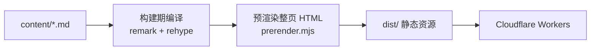
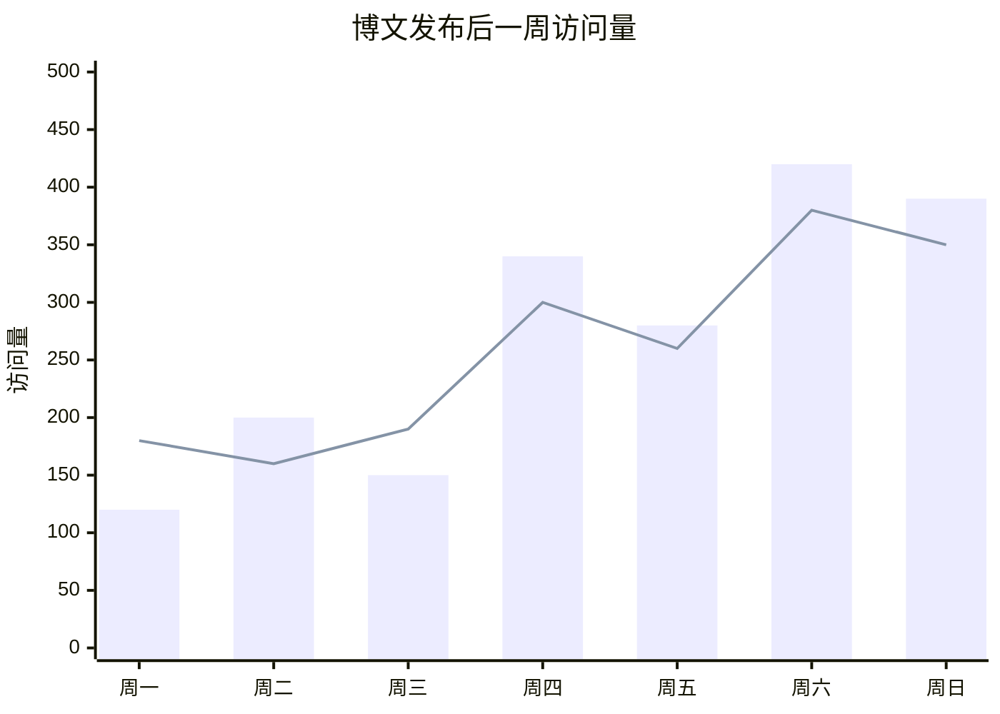
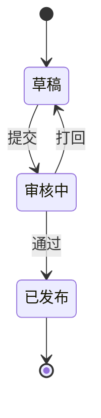
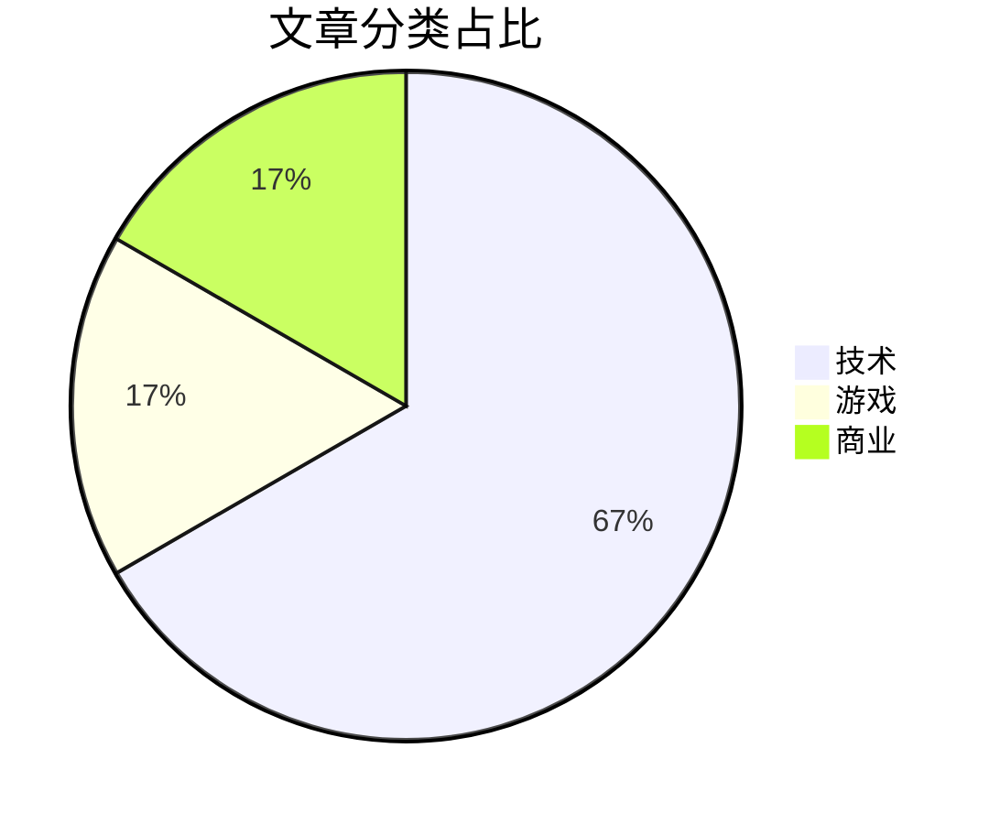
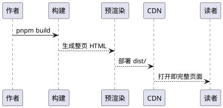

这篇文章是本站 Markdown 渲染管线的**全量语法活样例**：所有能力都在真实的文章环境里编译和渲染，写法有疑义时以本页的渲染结果为准。想对照源码学习，用文章页右上角的「复制为 Markdown」按钮即可拿到本文原文。重型块（Mermaid、STL、KaTeX 样式）都进视口才加载，所以这页再长也不拖累首屏。

## 速览：能力矩阵

| 能力 | 写法 | 渲染说明 |
| --- | --- | --- |
| 标题 | `#` ~ `######` | 正文从 `##` 起；`##`/`###` 进目录 |
| 强调与高亮 | `**粗**` `*斜*` `~~删~~` `==高亮==` | 行内即时渲染 |
| 行内代码 | `` `code` `` | 单反引号包裹 |
| 代码块 | ` ```lang ` | shiki 双主题高亮 + 复制按钮；语言白名单见「代码块」节 |
| 链接 | `[文本](url)` | 外链自动新标签打开 |
| 图片 | `` | 仅本站路径；构建期注入宽高防 CLS |
| 引用 | `>` | 可多层嵌套 |
| 列表 / 任务清单 | `-` `1.` `- [x]` | 复选框纯装饰（aria-hidden） |
| 表格 | GFM 表格 | 对齐列；窄屏横向滚动 |
| 脚注 | `[^1]` | 自动聚到文末 |
| Callout | `> [!tip]` | 十类配色，可折叠 / 嵌套 / 自定义标题 |
| 折叠 | `<details>` | summary 与内容之间留空行 |
| 数学 | `$…$` `$$…$$` | KaTeX 样式按需注入本页 |
| Mermaid | ` ```mermaid ` | v12 全部图型（文内演示六种），进视口渲染 |
| sequence / flow | ` ```sequence ` / ` ```flow ` | 构建期翻译为 Mermaid |
| 地图 | ` ```geojson ` / ` ```topojson ` | 构建期投影为内联 SVG，真实世界底图 |
| 3D 模型 | ` ```stl ` | three.js 进视口惰性加载 |
| PlantUML | ` ```plantuml ` | 公共渲染服务惰性出图 |
| HTML 子集 | `<kbd>` `<mark>` `<u>` `<sub>` `<sup>` | 裸色值与外站 iframe 禁止 |
| emoji 短码 | `:smile:` | 任意 gemoji 短码，构建期转字符 |
| 定义列表 | `术语` + `: 定义` | `dl`/`dt`/`dd` |
| 幻灯片 | ` ```marp ` 或 `deck: true` | 文内嵌入 / 整篇 Marpit 幻灯片 |

## 基础排版

基础层是 CommonMark 加 GFM 扩展，这一节的每个写法都直接在正文里演示。

### 强调与行内元素

**粗体（双星号）**、_斜体（单星号）_、***粗斜体（三星号）***、~~删除线（双波浪线）~~、==高亮（双等号）==，还有少量 HTML 标签：<u>下划线</u>、<mark>mark 标签</mark>、H<sub>2</sub>O、x<sup>2</sup>，以及键位样式 <kbd>Ctrl</kbd>/<kbd>⌘</kbd> + <kbd>K</kbd> 呼出本站命令面板。

行内代码 `const payload = extractPageData()` 用单反引号包裹；如果要显示反引号本身，用双反引号包住：`` `code` ``。

### 标题层级与锚点

正文从 `##` 起步——`#` 留给页头文章标题（正文开头的 `#` 会被构建期剥掉，避免双 h1）；目录只收 `##` 与 `###`，标题 id 由构建期生成，正文锚点与目录同源。Setext 下划线形式（文字下一行写 `===` 或 `---`）同样是合法标题、照常渲染，本站统一用 `#` 形式。

### 换行与转义

段内强制换行三者同效：行尾反斜杠、行尾两个空格、HTML 的 `<br>`（下一行就是反斜杠换行）\
就像这样，排诗歌或地址时有用。

Markdown 的 ASCII 标点可用反斜杠转义输出字面量：\*这样不变斜体\*、\# 不成标题、\[链接\] 不可点。

#### 四级标题：进正文，不进目录

##### 五级标题：同上

###### 六级标题：同上

### 引用

> 一层引用。适合摘录与转述。
>
> > 二层嵌套引用。再往下嵌套就有表演性质了，正文里两层封顶。

### 列表与任务清单

- 无序列表（横线）
  - 嵌套一层
    - 嵌套两层
- 同级第二项

1. 有序列表
2. 自动编号
3. 第三项

发布前的检查清单用任务清单：

- [x] 本地 `pnpm run ci` 全绿
- [ ] 部署后在手机上过一遍 standalone 视图

### 链接

行内链接：[CommonMark 规范](https://commonmark.org/)；带悬停提示：[GFM 规范](https://github.github.com/gfm/ "GitHub Flavored Markdown Spec")；引用式链接可以在一段里复用同一个地址：[Daring Fireball][df]，[再引一次][df]。

[df]: https://daringfireball.net/projects/markdown/

直接粘贴的裸地址也会自动成链：https://commonmark.org ，尖括号形式 <https://commonmark.org> 同样可渲染。外链由构建期统一加 `target="_blank"` 和 `noopener`。

### 表格

对齐用冒号声明（`:---` 左、`:---:` 中、`---:` 右），单元格内可用行内格式，竖线要转义：

| 语法 | 示例 | 用途 |
| :--- | :---: | ---: |
| `**粗体**` | **粗体** | 强调 |
| `` `code` `` | `code` | 术语与代码 |
| `\|` 转义 | a \| b | 单元格内画竖线 |

表格会自动包一层横向滚动容器，列再多也不会在窄屏上被挤扁。

### 分隔线、emoji 与定义列表

三个以上的 `-` 或 `*` 是分隔线：

---

emoji 短码支持 gemoji 全集，构建期转字符：:smile: :+1: :rocket:

定义列表适合「术语 → 一句话解释」：

SSR
: 构建期把整页渲染成 HTML，首屏直出，无水合白屏。

CSR
: 水合之后由 React 接管，站内导航不再整页刷新。

## 代码块

带语言标注的围栏代码块渲染成代码卡：shiki 双主题高亮（跟随明暗切换）、语言标签、右上角复制按钮。无语言的围栏退化为纯代码块，内容永远不会被吞。

```ts
// 构建期内容管线的一小块：frontmatter 缺关键字段直接构建失败
export function requireKeys(frontmatter: Record<string, unknown>, keys: string[]): void {
  for (const key of keys) {
    if (frontmatter[key] === undefined) {
      throw new Error(`frontmatter missing required key: ${key}`);
    }
  }
}
```

高亮语言是构建期**白名单**，不是 shiki 全量：`bash` / `typescript` / `javascript` / `python` / `yaml` / `go` / `dockerfile` / `json` / `toml` / `ini` / `css` / `batch` / `text`。白名单外的语言标注不报错、静默退化为无高亮纯代码块——新语言先到 `tools/shiki.ts` 登记再写：

```python
def seal(secret: str) -> str:
    """白名单语言演示：python 在列。"""
    import hashlib

    return hashlib.sha256(secret.encode()).hexdigest()
```

要展示三反引号本身，外层用四反引号围栏：

````
```
内层的三反引号原样显示。
```
````

## Callout 提示块

Callout 是本站提示信息的主力：`> [!类型]` 起头，标题写在同一行（可省略，默认用类型名），正文跟在后续 `>` 行。

> [!note] 自定义标题支持行内格式
> `代码`、**粗体**、$a^2+b^2=c^2$ 都能进 Callout，构建期照常编译。

> [!tip] 每节一到两个为宜
> Callout 服务于扫读——提醒、避坑、硬约束往里放，通篇铺满就等于没有。

> [!warning]- 默认折叠的告警
> 类型标记后加 `-` 即折叠（`+` 为默认展开），长尾细节折进去，正文只留主线。

Callout 可以嵌套，每层各用各的配色：

> [!question] Callout 能嵌套吗？
>
> > [!success] 能，常用组合是外层提问、内层作答。

十个配色类别的标准像（每类至少在这页上真实渲染一次，别名归属见下方折叠区）：

> [!note] note

> [!info] info

> [!todo] todo

> [!tip] tip

> [!success] success

> [!question] question

> [!warning] warning

> [!danger] danger

> [!example] example

> [!quote] quote

支持的全部类型别名（归入十个配色类别）：

<details>
<summary>Callout 类型别名速查</summary>

- note / info / todo
- tip / hint / important
- abstract / summary / tldr / success / check / done
- question / help / faq
- warning / caution / attention
- failure / fail / missing / danger / error / bug
- example
- quote / cite

</details>

## 数学公式

数学走 KaTeX，样式按需注入本页。行内公式：勾股定理 $a^2+b^2=c^2$，质能方程 $E=mc^2$。

块级公式用 `$$` 包裹（高斯积分）：

$$
\int_{-\infty}^{+\infty} e^{-x^2}\,\mathrm{d}x = \sqrt{\pi}
$$

也可以用 `math` 代码块语法，欧拉恒等式：

```math
e^{i\pi} + 1 = 0
```

## 图表

Mermaid 进视口才渲染，写法保持线性简单。流程与决策分支用 `flowchart`——本站的构建管线画出来就是：



时间安排用 `gantt`（`dateFormat HH:mm` 按时刻写起止）：

```mermaid
gantt
  dateFormat HH:mm
  title 发一篇博客的一天
  section 上午
  选题与查资料 :done, a1, 09:00, 10:30
  写初稿 :a2, 10:30, 12:00
  section 下午
  配图与排版 :a3, 14:00, 15:30
  校对与发布 :crit, a4, 15:30, 16:30
```



数据对比用 `xychart-beta` 画柱状图 / 折线，`bar` 与 `line` 写在一起就是叠加图：



mermaid 是 v12 全量接入，渲染器不挑图型——状态机、饼图、类图、ER 图、旅程图、时间线、思维导图、gitGraph 等全部图型都按同一惰性管线渲染，随选两个小的：





老式的 `sequence` 围栏也认——构建期直接翻译成 Mermaid 时序图，主题与惰性渲染和原生 Mermaid 完全一致（下面画的正是本站 SPA 路由的一次换页）：

```sequence
浏览器->路由: 点击站内链接
路由->CDN: fetch 目标页 HTML
CDN-->路由: 返回整页与 page-data
路由-->浏览器: 提取 payload、pushState、换视图
```

`flow` 围栏同理（构建期翻译为 flowchart，`(yes)/(no)` 变分支标签）：

```flow
s=>start: 想写一篇博客
w=>operation: 用 Markdown 写正文
c=>condition: pnpm build 通过?
p=>operation: 发布到 Cloudflare
e=>end: 上线
s->w->c
c(yes)->p->e
c(no)->w
```

## 地图与 3D

`geojson` / `topojson` 围栏在构建期投影成内联 SVG：坐标落在真实经纬范围内时自动叠加 world-atlas 世界底图（与旅行地图同源数据），示意精度即可；点位标注取 Point 的 `properties.name`，`label-dx` / `label-dy` 可调偏移，贴近视口右缘时自动换到点左侧：

```geojson
{
  "type": "FeatureCollection",
  "features": [
    { "type": "Feature", "properties": { "name": "家" }, "geometry": { "type": "Point", "coordinates": [120.12, 30.28] } },
    { "type": "Feature", "properties": { "name": "咖啡馆", "label-dx": -7 }, "geometry": { "type": "Point", "coordinates": [120.15, 30.265] } },
    { "type": "Feature", "properties": { "name": "办公室" }, "geometry": { "type": "Point", "coordinates": [120.19, 30.26] } },
    { "type": "Feature", "properties": { "name": "通勤路线（示意）" }, "geometry": { "type": "LineString", "coordinates": [[120.12, 30.28], [120.15, 30.265], [120.19, 30.26]] } }
  ]
}
```

同一份数据用 topojson 编码（坐标按 transform 量化、arc 增量存储）也能画：

```topojson
{
  "type": "Topology",
  "transform": { "scale": [0.001, 0.001], "translate": [120.0, 30.0] },
  "objects": {
    "commute": {
      "type": "GeometryCollection",
      "geometries": [
        { "type": "LineString", "properties": { "name": "路线" }, "arcs": [0] },
        { "type": "Point", "properties": { "name": "办公室" }, "coordinates": [190, 260] }
      ]
    }
  },
  "arcs": [[[120, 280], [30, -15], [40, -5]]]
}
```

`stl` 围栏放 ASCII STL，进视口后 three.js 惰性渲染成可旋转的 3D 模型（离屏自动停帧）：

```stl
solid cube_corner
  facet normal 0.0 -1.0 0.0
    outer loop
      vertex 0.0 0.0 0.0
      vertex 1.0 0.0 0.0
      vertex 0.0 0.0 1.0
    endloop
  endfacet
  facet normal 0.0 0.0 -1.0
    outer loop
      vertex 0.0 0.0 0.0
      vertex 0.0 1.0 0.0
      vertex 1.0 0.0 0.0
    endloop
  endfacet
  facet normal -1.0 0.0 0.0
    outer loop
      vertex 0.0 0.0 0.0
      vertex 0.0 0.0 1.0
      vertex 0.0 1.0 0.0
    endloop
  endfacet
  facet normal 0.577 0.577 0.577
    outer loop
      vertex 1.0 0.0 0.0
      vertex 0.0 1.0 0.0
      vertex 0.0 0.0 1.0
    endloop
  endfacet
endsolid
```

`plantuml` 围栏交给公共渲染服务，惰性出图：



## 图片与折叠

图片只走本站 `/images/` 路径（外站图无法注入宽高，过不了 unsized-images 审计），构建期自动转 webp 并写入固有尺寸：


引用式写法（`![alt][ref]` 与 `[ref]: 地址` 定义行配对，解析后与行内式同款）：

![引用式图片演示][avatar]

[avatar]: /images/deck-demo.jpg

需要手动控制尺寸时用 `` 标签而不是 Markdown 的尺寸后缀（宽高写全，只写一侧会被构建期把另一侧补成固有尺寸、拉变形）：


折叠用原生 `<details>`，summary 与内容之间**必须留空行**，里面的 Markdown 才会渲染：

<details>
<summary>点开看折叠区里的 Markdown</summary>

**粗体**、`行内代码`、列表照常渲染：

- 折叠区适合放备选方案
- 来源列表与长尾细节

</details>

脚注引用后自动聚到文末、按顺序编号[^1]，也支持命名脚注[^named]。锚点 DOM 与 GitHub 同构：引用与脚注两端的 id 都带 `user-content-` 前缀（GitHub sanitizer 的约定，remark-gfm 忠实复刻），站内两端成对、跳转完整可用。

[^1]: 普通脚注。编号与排序全自动，不用手工维护。

[^named]: 命名脚注。正文里写 `[^named]`，渲染后仍是数字编号。

## 嵌入幻灯片

正文中用 ` ```marp ` 围栏嵌入一组幻灯片：构建期编译为占位结构，进视口后升级为逐页播放器（键盘 / 按钮 / 备注 / 全屏），禁用 JS 时是完整的堆叠视图。整篇 `deck: true` 的完整 Marpit 语法样例（指令、主题 CSS、演讲者备注、图片修饰符）另见《用 Markdown 写幻灯片：Marpit 接入记》一文。

```marp
<!-- paginate: true -->

# 嵌入示例

<!-- _class: lead -->

一篇文章里的一组幻灯片

---

## 第二页

- 与整篇 deck 同一套主题与播放器
- `marp` 与 `deck` 两个围栏名等价
- 打印本文时不会被劫持纸张尺寸（@page 已剥除）

<!-- 备注只在播放器的便签面板里显示。 -->
```

## 写在最后

两个边界提醒：裸色值与 `<font color>` 过不了对比度门禁（颜色一律用站点 token），外站 iframe 因零第三方依赖审计被禁止——所以本页没有它们的「成功」演示，只有这句话。

想系统学 Markdown 本身，读两份规范就够：[CommonMark Spec](https://spec.commonmark.org/) 与 [GitHub Flavored Markdown Spec](https://github.github.com/gfm/)；本站的取舍（什么时候用什么）已浓缩在上面的能力矩阵里。本文源码随时可以右上角一键复制。
