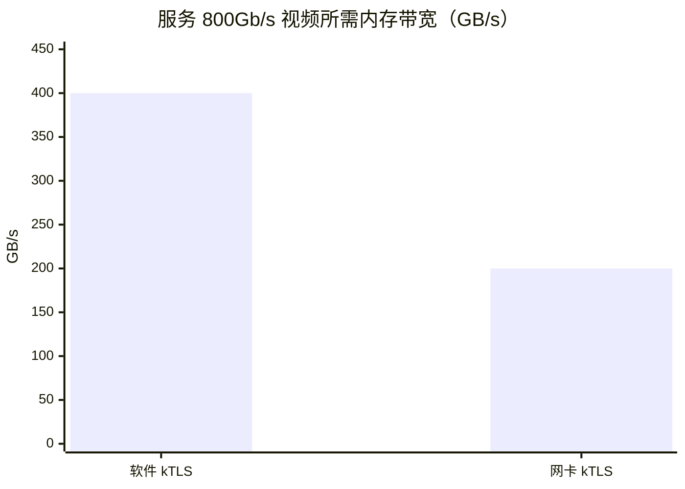

<!-- 用法：搜索「待填」逐节填内容；mermaid 节点文字可直接改。HTML 注释不会渲染。 -->

# Kernel TLS 是什么?

_zjsearch · 2026/10/18 09:14:06_

**kTLS（Kernel TLS）把 TLS 的「记录层」搬进了内核网络栈：握手仍由 OpenSSL 这类用户态库完成，但协商出的对称密钥和会话状态会交给内核，此后 `send()` / `sendfile()` 发出的数据由内核直接加密成 TLS 记录。** 内核文档对它的定位只有一句：内核 TLS ULP 是用户态 TLS 库记录层的替代品。[1](#引用来源) 它要解决的核心问题是「加解密发生在哪一层」，而不是「加密有多强」或「用什么算法」。

## 搬走的是记录层，不是握手

TLS 本身分两块：握手协议负责协商算法、交换密钥、验证证书；记录协议负责用协商好的密钥把数据加密封装。[2](#引用来源) kTLS 只接管后者。Netflix 的描述把边界说得很清楚——握手（会话建立、会话恢复）留在用户态，TLS 状态交给内核，内核在 sendfile 管线里做批量加解密。[3](#引用来源) Linux 把它实现成一个 TCP 上层协议（ULP），挂到普通 TCP socket 上，应用看到的仍然是一个 socket。[1](#引用来源)

| 环节                 | 传统用户态 TLS                            | kTLS                                                      |
| -------------------- | ----------------------------------------- | --------------------------------------------------------- |
| 握手、证书、密钥交换 | 用户态 TLS 库                             | 仍在用户态 TLS 库 [3](#引用来源)                          |
| 对称加解密           | `SSL_write()` / `SSL_read()` 在用户态完成 | 内核 socket 层，或下放给网卡 [1](#引用来源)[4](#引用来源) |
| 大文件发送           | 先读入用户缓冲区、加密、再写回内核        | `sendfile()` 直接进内核加密管线 [3](#引用来源)            |
| 会话状态归属         | 全程留在用户态                            | 握手后交给内核 [3](#引用来源)                             |

这样做省掉的是用户态与内核之间的往返拷贝：静态内容原本必须先读进用户缓冲区加密再发出去，现在数据从页缓存直接进内核加密管线，sendfile 的数据流被恢复，用户态与内核态之间的系统调用次数也随之下降。[3](#引用来源)[2](#引用来源)[5](#引用来源)

## 收益在大流量静态内容上最明显

Netflix 算过一笔账：800Gb/s 约等于 100GB/s 的吞吐，用软件 kTLS 在主机 CPU 上加密，全程需要约 400GB/s 的内存带宽；把加密下放到网卡后降到约 200GB/s，内存带宽和 CPU 占用都减半。[3](#引用来源)

在 nginx 上的实测同样偏向大块数据：RHEL 8+/Fedora 启用 kTLS 后性能提升 8%–29%（不同操作系统结果不同）[6](#引用来源)，Ubuntu 社区给出的数字是 sendfile 路径约提升 30%[7](#引用来源)；Netflix 在生产环境跑 kTLS + `SSL_sendfile` 已有多年。[8](#引用来源)

## 三种形态：内核软件、网卡、TOE

FreeBSD 的 `ktls(4)` 把实现方式拆成三种模式，这个划分对理解所有平台的 kTLS 都适用[4](#引用来源)：

| 模式                 | 谁执行加解密                                     | 特点                                                                                          |
| -------------------- | ------------------------------------------------ | --------------------------------------------------------------------------------------------- |
| `TCP_TLS_MODE_SW`    | 内核 `crypto(9)`，通常是软件实现，也可用协处理器 | 不依赖特殊网卡，兼容性最好 [4](#引用来源)                                                     |
| `TCP_TLS_MODE_IFNET` | 网卡                                             | 协议栈里只有明文，网卡在发送时加密、接收时解密；网卡需通告 `TXTLS4` / `TXTLS6` [4](#引用来源) |
| `TCP_TLS_MODE_TOE`   | TOE 网卡                                         | 由 `cxgbe` 驱动支持 [4](#引用来源)                                                            |

FreeBSD 13.0 首次引入 kTLS[4](#引用来源)；Linux 侧走的是 TLS ULP 这条路[1](#引用来源)。OpenSSL 3.0 及以后内置支持，应用只要用 `SSL_read()` / `SSL_write()` 这类标准接口一般无需改代码，改用 `SSL_sendfile(3)` 还能再多拿一些性能[4](#引用来源)；Linux 上则要显式打开 `SSL_OP_ENABLE_KTLS`。[5](#引用来源)

## 代价与开关

- 会话密钥每个方向只能设置一次，应用必须禁用 rekey——这是 kTLS 最硬的一条约束。[4](#引用来源)
- 握手继续在用户态消耗 CPU，kTLS 只优化数据面。[3](#引用来源)
- 软件模式要求内核有物理内存直接映射（direct map），并非所有架构都支持。[4](#引用来源)
- 打开方式分两侧：Linux 上 nginx 需先 `modprobe tls`，配置里保留 `sendfile on` 并加 `ssl_conf_command Options KTLS;`[6](#引用来源)；FreeBSD 上要 `kldload ktls_ocf`、`sysctl kern.ipc.tls.enable=1`，同样加 `ssl_conf_command Options KTLS;`[4](#引用来源)[9](#引用来源)。

> [!IMPORTANT] 判断要不要开：瓶颈若是握手和小请求的 QPS，kTLS 帮不上忙；瓶颈若是大文件发送时的内存拷贝和 CPU 加密开销，它正好对症。

一句话的选型：视频、静态文件、CDN 边缘这类「大块数据 + 长连接」场景值得打开；短连接 API 网关收益有限，先解决握手侧的问题更划算。

## 引用来源

- [1] [Kernel TLS — The Linux Kernel documentation](https://docs.kernel.org/networking/tls.html)
- [2] [KTLS --- Linux 核心中的 TLS 實作 - HackMD](https://hackmd.io/@oscarshiang/linux_ktls)
- [3] [Serving Netflix Video Traffic at 400Gb/s and Beyond](https://nabstreamingsummit.com/wp-content/uploads/2022/05/2022-Streaming-Summit-Netflix.pdf)
- [4] [ktls(4) - FreeBSD 15.1-RELEASE and Ports.quarterly Manual Pages](https://man.freebsd.org/cgi/man.cgi?query=ktls&sektion=4)
- [5] [Kernel TLS with Openssl and Nginx :: nonbei alley](https://blog.salrashid.dev/en/articles/2022/kernel_tls/)
- [6] [Improving NGINX Performance with Kernel TLS on RHEL 8 ... - GetPageSpeed](https://www.getpagespeed.com/server-setup/nginx-mod-klts-performance)
- [7] [Question #823576 “could we add enable-ktls to openssl build conf...” : Questions : Ubuntu](https://answers.launchpad.net/ubuntu/+question/823576)
- [8] [We've been running kTLS + SSL sendfile on FreeBSD at Netflix for the last 6 or 7... | Hacker News](https://news.ycombinator.com/item?id=30903146)
- [9] [Nginx KTLS support on FreeBSD 13/13.1? | The FreeBSD Forums](https://forums.freebsd.org/threads/nginx-ktls-support-on-freebsd-13-13-1.83619/)
