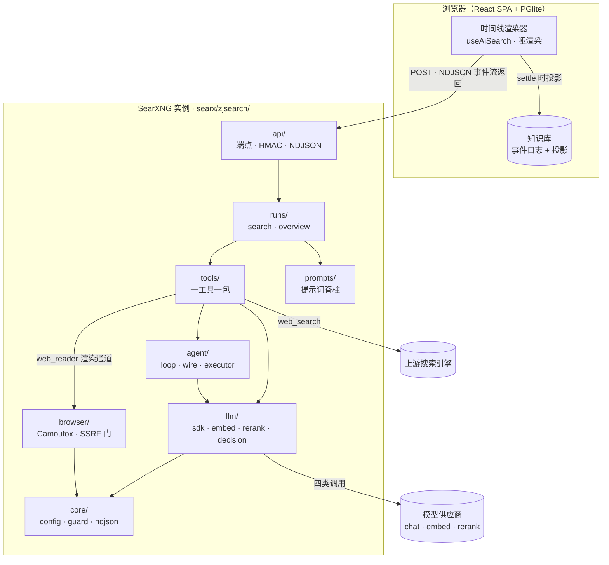
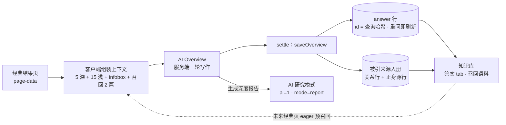
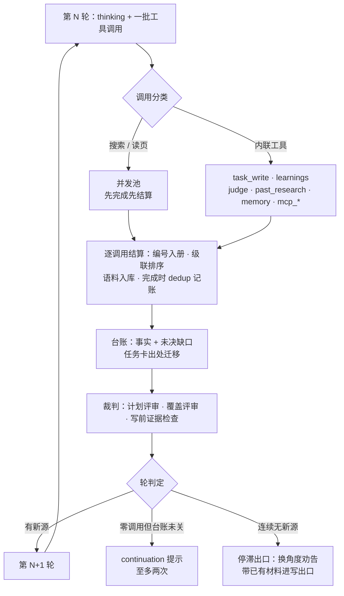
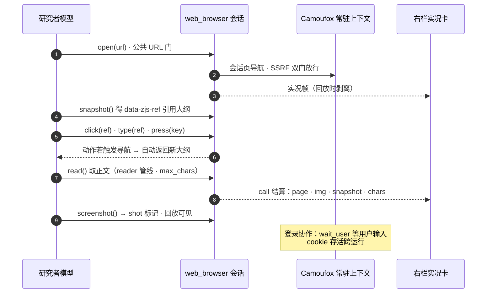
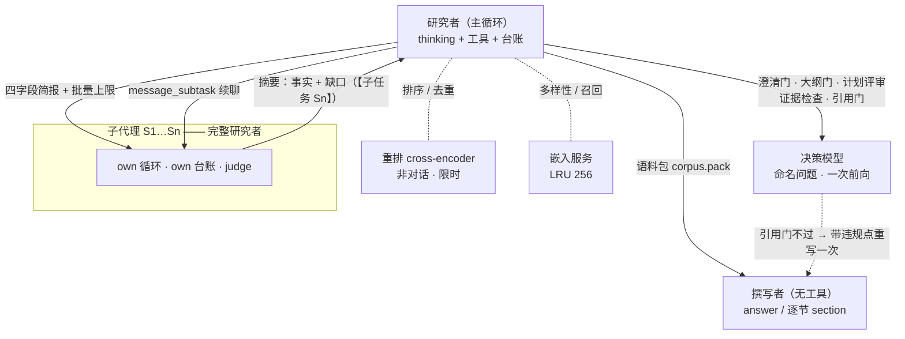

ZJSearch 是为 SearXNG（隐私优先的开源元搜索引擎，聚合多个搜索服务与数据库的结果，不追踪、不画像用户）编写的 React + TypeScript 主题：界面 100% 由 React 渲染，Jinja 模板退化为流式 Page-Data 数据壳。在这个壳之上，项目长出了一个完整的 **Agentic 研究引擎**——服务端 `searx/zjsearch/` Python 包承载研究循环，浏览器本地 PGlite 知识库沉淀每一次研究。本文是它的架构报告：两种模式怎么设计、数据从哪来、循环怎么转、工具怎么设计、浏览器怎么被操作、模型之间怎么分工。

## 速览

| 维度 | 形态 |
|---|---|
| 界面 | 100% React；page-data 流式启动，骨架屏是真实页面的几何镜像 |
| 双模式 | 经典元搜索 + AI 研究接管；AI Overview 是两模式间的桥与数据回流通道 |
| AI 栈 | 服务端八包，依赖严格向下：`api → runs → tools → agent → llm → core` |
| 模型接入 | openai / anthropic / gemini / dashscope 方言注册表 + 嵌入 / 重排 / 决策三个服务面 |
| 浏览器 | Camoufox（反检测 Firefox）常驻上下文：渲染、提取、交互驾驶三合一 |
| 记忆 | PGlite（浏览器内 Postgres/WASM）事件溯源，直播与回放走同一个 reducer |
| 输出 | 短答 / 报告 / 演示文稿，run 内两步切换；报告逐节撰写、逐节过引用门 |
| 增量性 | 上游 `webapp.py` 仅追加一行 `install(app)` 钩子，跟随上游升级零冲突 |

## 总体架构

一次提问从浏览器出发，穿过实例内的八包栈，落到两类外部依赖（搜索引擎、模型供应商）上；知识库在浏览器本地，settle 时才落投影。

- **Page-Data 流式**：搜索页先冲刷头部 + 启动骨架屏（经典 / AI 接管两种形态），React 立即启动进 pending 态、搜索框先可用；引擎跑完后的迟到分片落下真实数据，SPA 导航同样增量消费流式响应。加载中的每个表面都有自己的骨架，绝不出现空白面板。
- **依赖纪律**：横切能力（SSRF 门、文本守卫、markitdown 文档转换）在 `core/` 全局只有一份；`prompts/` 是被 runs 与 tools 消费的素材库；拼写错误的 wire 事件直接崩流——闭集靠构造维护。

## 两种模式：经典搜索与 AI 研究

同一套引擎扇出、同一份 page-data，两种消费形态。**经典搜索**是 SearXNG 的本职：分类卡片流（通用 / 图片 / 视频 / 新闻 / 音乐 / 文件 / 应用……）、过滤器、直答卡与无限滚动；**AI 研究**（`?ai=1` 接管）是完整的研究循环。首页的模式开关在两者间切换，底层共享排序瀑布与知识库，但数据契约完全不同。

经典面自己的增强也随主题携带：BM25 重排插件（CJK 逐字分词、标题 2× 加权、RRF 融合）；高级搜索语法后过滤引擎（`site:` `filetype:` `before:` `+term` `-term` 引号短语全量强制，CJK 子串匹配）；单位 / 汇率换算与股票卡（eastmoney 失败自动回落腾讯，60s 缓存）。无 JS 也不缺席：noscript 模板与自包含 RSS XSL 是同品牌面孔。

### AI Overview：经典页上的一轮快速写作

- **上下文组装刻意在客户端**：编号源列表直接从浏览器已持有的 page-data 构建——前 5 条深读（标题 + 800 字符摘要头）、后 15 条浅读（仅标题）、再拼首个 infobox（2000 字符），一行一条编号。服务器零额外载荷、跨 worker 无状态。
- **知识库预召回**：经典页 eager 召回至多 2 篇过去研究的全文头（语义 + BM25 在客户端匹配 PGlite reader 缓存，各带 1200 字符），作为带标注的 `[n]` 行续在结果之后——「来自你的过去研究、已读全文、可能过时」。点击时才召回会在首屏卡一次嵌入往返，所以是 eager；未配置嵌入时整段静默。
- **多模态上行**：图片结果的直链至多 4 条随请求走，服务端抓取内联（base64）或传引用给端点自取。
- **服务端是一轮无工具写作**：`_ordered_context` 对超 12k 字符的编号行做余弦重排（16k 上限按行截断）；流式契约与 AI 搜索同族——客户端把同一套事件流适配成裸文本渲染合同，`<think>` 标记与尾部 meta 哨兵（finish / model / usage）都在客户端合成拆分。
- **引用即编号**：模型引 `[n]` / `[n,m]`（常识用 `[*]`），引用芯片内联 favicon + 域名（Google AI Overview 风格），悬停预览标题；知识库召回页没有站内结果卡可跳，芯片直接开 URL。

### 数据回流：经典页 → 知识库

- **答案归档**：概览在 settle 时把自己存为 `answer` 行（id = 查询哈希，重问即刷新），知识库「答案」tab 直接读它——经典页因此也有了可回放的研究记忆。
- **被引才入册**：只有概览实际引用的 `[n]` 才进来源语料（每对 (query, source) 一条关系行 + 正身源行），从不整包倒灌；摘要文本随源行归档，作为未爬取来源的可检索正文——与研究路径同款口径。
- **唯一桥梁**：经典搜索历史刻意不存在（无 searches 表），AI Overview 是经典页通往知识库的**唯一**通道；回流的语料供未来经典页预召回与 AI 研究的撰写阶段消费，两个模式的知识闭环在此合拢。
- **原地升级**：概览卡完成态带「生成深度报告」动作——带当前查询 SPA 跳转 `ai=1&mode=report`，一轮快速答案原地展开为分节报告。

## 数据从哪来：web_search 的排序瀑布

研究者的每一次 `web_search` 不是把引擎结果原样入册，而是穿过一条级联瀑布——先并发扇出拿全量，再逐级收窄、排序、去近重复，最后才 mint 出全局编号 `[n]`：

融合腿的打分是加权倒数排名（k=60，与经典页的 `bm25_reranker` 插件同源）：

$$\mathrm{score}(d)=\sum_{\ell}\frac{w_\ell}{60+\mathrm{rank}_\ell(d)},\qquad w_{\text{BM25}}=1.0,\;\; w_{\text{引擎序}}=0.25,\;\; w_{\text{score 先验}}=0.4$$

- **去重记账在完成时**：查询与页面在执行完成时才进 dedup 注册表——引擎报错查询、读取失败页面保持可重跑；一场重搜若命中的全是已编号来源，不占新编号，已有编号挂到该行 `dupes` 上。带跨搜索记忆：新 URL 的向量对任何已入册来源超过 0.92 即判定为同一故事的转载，直接折叠。
- **级级 fail-open、每条腿限时**：重排双腿跑在 4-worker 派发池、20 秒预算内；嵌入批量走线程安全 LRU（256 条、文本 ≤1000 字符）；任何一级失败都退回上一级排序，瀑布永不因单点卡死。
- **长读裁剪**：读页超过 ~6k 字符时，撰写 feed 块按重排 top 分段重建（行界 ~1200 字符段、380 字符头，一次调用完成），页面的「相关中段」替代「头部」进上下文——语料与阅读窗仍保全量文本。

## 研究循环：一台相位机

三档深度是同一条 RESEARCH→WRITE 相位机的预算差异。每轮：模型输出 thinking + 一批工具调用，执行器分类并发结算，台账与裁判接着说话，轮判定决定继续、催单还是停机。

| 档位 | 轮数预算 | 产物 |
|---|---|---|
| 极速 | ≤6，单波 | 短答（单写） |
| 均衡 | 深度探针定档，顶 60 | 适中答案（单写） |
| 深度调研 | 顶 120 | 强制报告（逐节撰写） |

- **深度探针**（0–4 档）按问题难度个性化预算；子代理委派门挂在探针档位上——深度自第 2 档、均衡自第 4 档起可用。
- **活计划**：`task_write` 是全量快照改写（2–8 项），模型被教导把计划当活假设——交叉验证推翻早期假设、出现意外玩家时，改计划而不是加脚注；改写携带出处迁移，任务卡的证据计数不回零。覆盖率裁判只建议、不代笔：从未捞到来源的子任务不会被翻成 done。
- **交付实体盲区**：大纲门审读附件头部，产出 `entities: [{name, why}]`——最终交付物依赖却无任何章节研究的主体，屏幕以未决缺口呈现，由模型自己补子任务或委派。

> [!important] 失败即信息
> 空转回合（有动作、零新源）在停滞检测触发**之前**先附一条换角度劝告；停机便条只写给撰写者当诚实上下文，研究者永远看不到自己被停机。纯记账轮（写计划、存记忆）既不算进展也不算空转。

干预与续跑：steer / 停止 / 澄清 / 继续

- **steer**：运行中输入按 Enter 引导（轮边界注入 user 消息）、Shift+Enter 抢占（在飞 turn 取消后注入，循环继续）；停止信号经非破坏窥视逐轮下探，一秒内送达所有子代理，批次诚实结算为「已被提前终止」。
- **澄清**：ask 是一等公民——预筛门与 mid-research 追问同构；确认方向会以一枚 clarify 步骤钉在时间线头部。
- **继续**：run host 断开 ≠ 死亡——`ctx` 检查点随事件流落库，回来点「继续」，同一个 loop 带完整上下文复跑；存储线程与直播流走同一个 reducer 回放。

## 工具设计：一工具一包

每个工具是 `ai/tools/` 下的自治包：**spec（模型可见的说明书）+ sanitizer（入参清洗）+ service（执行体）**；执行器按位置对齐回填结果，一个畸形结果只降级那一行，本轮其余调用照常结算。

| 工具 | 职责 | 关键机制 |
|---|---|---|
| `web_search` | 找到并编号来源 | 上节排序瀑布；dedup 完成时记账；插件直答（如 `$AAPL` 股价）作为 feed 块首行「Direct answers」 |
| `web_reader` | 把页面读成正文 | Camoufox 渲染 + markitdown 提取；TTL 缓存；长读按重排分段裁 feed，语料保全量 |
| `web_browser` | 交互驾驶页面 | 快照引用点击 / 输入 / 截图，导航自动重取大纲；右栏实况镜像 + 一键接管（下节） |
| `calculator` | 数不走脑 | 非平凡数字（比率、增长、财务、预测）必须过工具；撰写者以 `<figures>` 规则承接诚实性 |
| `view_image` | 研究者的眼睛 | feed 来源行 `img=` 标记 → 抓图 → 作为下一轮 user 消息回灌（全方言接受图片 parts） |
| `past_research` | 知识库 RAG | 文档条目带 ~1500 字符头；来源条目只存身份，指向 `web_reader` 现场重读 |
| `memory` / `learnings` | 记忆与台账 | 一次补全产出 `{facts, tags}`；learnings 是研究者的发现台账，也是子代理摘要的原料 |
| `task_write` | 活计划 | 全量快照改写 + 出处迁移（上节） |
| `judge` | 裁判工具 | 命名裁决图协议（见「模型关系」） |
| `mcp_<server>_<tool>` | 外部工具桥 | streamable HTTP，每操作一条自包含连接；描述与 schema 原文进模型工具面 |

外部 MCP 服务器的工具面做**渐进披露**：总数超过阈值后不再全量注入 schema，改注册一个 `mcp_search_tools` 发现工具——模型按关键词检索、拿到命中工具的完整参数定义、下一轮按名调用；未命中返回清单供再查询。

## 浏览器怎么被操作：Camoufox 会话

`browser/` 是**一个** Camoufox（反检测 Firefox，C++ 指纹一致性，无 CDP）常驻上下文：cookie 跨运行存活——登录协作建立在它之上。`web_reader` 的渲染通道与 `web_browser` 的交互会话共用这台引擎：读页走并行车道，驾驶走串行车嘴。

- **引用会死，恢复是自动的**：快照引用是注入 DOM 的 `data-zjs-ref` 属性；动作触发导航即失效，会话自动重拍大纲随结果返回——模型永远拿到的是新鲜可点的大纲；纯重渲染导致的死引用则快速失败并附恢复配方。
- **SSRF 双门**：`core.guard` 做字符串级检查 + 逐 host 解析并索要全局地址；`context.route("**/*")` 在浏览器层再拦一遍（两门共享 `allow_hosts` 豁免），图片 / 媒体 / 字体 / 样式表资源类型直接拒——`file://` 永远到不了路由层。
- **自愈**：「已关闭」类失败丢弃中毒上下文、下一动作重启；启动失败遇配置锁则杀掉该 profile 的陈旧持有者重试一次。
- **会话页入册**：open 铸造身份、read / wait_user 登记全文——模型亲手驾驶的页面同享 `[n]` 编号，撰写者照常引用；`about:blank` 什么都不铸。
- 显示三档：`headless` 默认、`virtual`（Xvfb）给无显示服务器、`headed` 给桌面——最强一档，也是登录交互的载体；uBlock Origin 作为默认插件随行。

## 模型与模型的关系

所有角色跑在同一个方言注册表上（openai / anthropic / gemini / dashscope，加一模块即接入新供应商），分工不同：

- **子代理 = 完整研究者**：委派出去的孩子带自己的台账与 judge（裁判权仍挂在主运行的决策门下）；主运行只收摘要（事实 + 缺口），S1/S2 句柄可 `message_subtask` 续聊——孩子的上下文原封不动，只晋升新材料；子运行的重排 / 决策 / 门消耗并入主运行账本，模型统计卡上没有暗物质。
- **决策模型**说**命名裁决图**协议：`{answers: {name: choice|score|noul}} + record_questions`，一轮一批发 `decisions` 事件——澄清预筛、大纲门、计划评审、实体盲区、节级引用门（3–6 个论断抽样，不过带违规点重写一次）都走它；客户端一个通用渲染器覆盖所有现在与将来的用途。
- **撰写者无工具**：只消费研究者攒下的语料包（逐节 `corpus.pack` 预算内选材，跨节向量降重）；`<figures>` 规则要求数字只从被引用输入推导、推导过程可见——绝不把计算结果伪装成来源原话。
- **重试边界只有一道**：`Sdk.pump` 处对**首次提交事件前**的失败分类重试（429/5xx/408/503、供应商 overloaded 文案），抖动指数退避 2s×2 封顶 30s、三次；流已活后交给循环自身恢复路径；400 族永不重试——上下文溢出是反应式压缩的活。
- **prompt caching 按方言设计**：openai 系按模型桶带 `prompt_cache_key`；anthropic 三断点（system + 最后工具 + 最后消息）默认开启；gemini 靠隐式前缀缓存。系统提示按 mode+语言字节稳定，稳定块在前、每次运行便签在后。
- **AI 概览是同一引擎的最小形态**（机制见「两种模式」）：研究者缺位、无工具，对客户端拼装好的上下文做一轮写作——同一写作栈的零设计特例。

## 事件流与知识库

服务端与浏览器之间只有一条 NDJSON 流：**闭集事件即时间线操作**——`open` 开条目、`think`/`say` 携条目 id 增量、`call` 结算一次调用、`tasks`/`learnings`/`sources` 是权威快照、`decisions` 每轮一批、`settle` 宣告终态（done / awaiting / error）。客户端是哑渲染器：步骤与条目一一对应，答案缓冲独立，**settle 就是终态**——没有任何「从启发式重建状态」的代码。

wire 事件闭集速查

| 事件 | 携带 | 语义 |
|---|---|---|
| `open` / `close` | id · kind · round | 开 / 合一个时间线条目（research / write） |
| `think` / `say` | id · delta | 推理与旁白增量 |
| `calls` / `call` | 批量 / 单调用结算 | `n` `chars` `text` `preview` `dupes`；浏览器结算另带 `page` `img` `shot` `snapshot` |
| `tasks` / `learnings` | 权威快照 | 活计划任务卡 / 发现台账（快照替换语义） |
| `sources` | 全局 `[n]` 注册表 | 编号源唯一权威 |
| `decisions` | 裁决批次 | 命名裁决图协议，每轮一批 |
| `ask` | 澄清门 / 追问 | 同一 schema，一等公民 |
| `answer` | 撰写增量 | 撰写者自己的缓冲，旁白不混入 |
| `phase` | 规划→检索→撰写 | 相位脊柱（闭集，无 audit——写后审计已删） |
| `settle` | 终态 | 之后仅 `related` `memory` `tags` `usage` 晚到 |

知识库是**事件溯源**的：`run_event` 日志是唯一事实，settle 时一次事务落查询面投影（来源 / 文档 / 记忆 / 调用 / 任务 / 澄清 / 模板 / 概览答案）；回放与检索是**同一个 reducer 的两次执行**——存储线程和直播流命中同一批渲染器。召回是混合三段：BM25+向量 RRF 融合 × 标签图一跳扩展，重排端点再排序头部。

> [!warning] 红线
> 召回（历史语料 / 过去研究）只进撰写阶段与界面，**绝不喂研究者的 feed**——现成答案会杀死 live 搜索的激励。

## 输出形态：报告与演示文稿

输出格式是 **run 内的格式**，不是深度档的附属品：深度只管预算，输出结构在右栏卡片两步切换（智能报告 / 智能PPT + 模板），撰写接管后锁定、终局只读常驻。

- **报告逐节 SYNTHESIZE**：大纲门（JSON 结构化 + 实体盲区筛查）→ `outline` 事件（目录即进度）→ 逐节 `corpus.pack` 选材 → 节写流式落格 → 决策模型引用门 → 执行摘要最后写（看得到全部节成品）→ 方法论脚注机器生成（轮次 / 来源 / 耗时 / 局限）。
- **演示文稿**：模板的章节即演示章节，每章 1–4 页由模型撰写；`?mode=deck` 深链与存储线程的模式锁保持兼容。
- **模板双轨**：客户端内置预设（商业情报 / 尽调 / 竞品对比 / 行业综述 + 演示文稿三型）+ 用户自定义模板（存知识库）；服务端无状态适配——结构是绑定的，标题以问题里的真实实体重写，`optional` 节可弃。
- **Markdown 镜像契约**：prompt 只教渲染链真实支持的词汇（GFM / callouts / ==mark== / emoji / mermaid 图表 / 懒加载数学），模型产出即所得；原始 HTML 与 markdown 图片刻意不教不渲——不信任的输出不进渲染面。

## 工程与交付

- **离线可审计**：Lighthouse 门禁覆盖全部页面（含 AI 表面）且完全离线——`zjaudit` 夹具引擎按查询词出确定性结果，Mock LLM transport 按请求形状路由固定补全；AI 页自带 80/70 性能地板。
- **性能纪律**：results chunk 稳定命名 + 流式壳内预热；按方言的 prompt caching；重依赖全部惰性；图片 lazy + 固有宽高比防 CLS；系统字体零 webfont。
- **PWA 独立壳**：免缓存 Service Worker（网络直通 + 离线兜底——静态资产 immutable，SW 缓存只会在部署后复活陈旧 bundle）、safe-area 全适配、theme-color 双主题跟随。
- **QA 合同**：新工具行 / 新事件 / 新状态必须同 change 带上 `?aidebug` 模拟台夹具——模拟器演不出来的界面就渲染不出来；十场景覆盖浏览器协作、报告厨房水槽、deck、子代理、停滞与失败。
