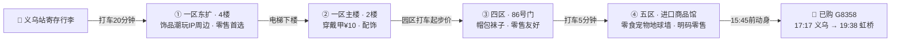

> 影视穿越 × 世界超市：上海出发的小情侣定制单——当一天群演、赶一场打铁花，再把"世界超市"的战利品拎回家。

## 🧭 行程速览

| 项目 | 安排 |
|---|---|
| **日期** | 2026.10.4（日）— 10.6（二）· 3 天 2 晚 · 双人游 |
| **路线** | 上海 → 横店（住 2 晚）→ 义乌（1 天）→ 上海 |
| **大交通** | ✅ C3633 上海南→横店 · ✅ D3356 横店→义乌 · ✅ G8358 义乌→上海虹桥（时刻见第二节） |
| **住宿** | ✅ 清明上河图亚朵X，2 晚 ¥1,945 —— 景区旁，打铁花散场步行回 |
| **门票** | ✅ 横店 10.5 一日票 ¥478/双人：四园 + 赠送梦幻谷，**每园限进 1 次** |
| **预算** | 已落定 **¥3,149**（2 人）；全包预估 ¥3,700-4,100（不含购物） |
| **还差 1 件事** | 睡前刷"横店影视城"公众号确认红人季场次与当日时刻表（D1 晚已定：不加购广州街夜场，选择休息） |

> [!info] 数据口径
> 车票 / 酒店 / 门票均于 **2026-09-22** 核实落定；**2026-10-04 出发日两轮更新**——D1 按实战落定（蟹江南蟹黄面 + 花厅好旺夜市烧烤，放弃广州街加购），D2 排定四园连玩（秦王宫/明清宫苑/梦幻谷/清明上河图），三餐落定（午餐老寻味、晚餐梦幻谷·老横店美食街）；园区演出时刻为 2026 常规档基准（国庆普遍加场，以当日时刻表为准）。订票背景：10.6 是国庆返程最高峰、车票 9.22 12:00 才起售——三段全部开售当天拿下。

## 一、行程总览：三天两晚双人定制

节奏设计：**D1 轻**（落地 + 镇区漫游倒时差）、**D2 重**（单日票从开门玩到夜场）、**D3 顺**（义乌扫货顺路返沪）。横店的精华在夜里，两晚安排不重样。

| 天 | 主题 | 白天 | 夜晚 | 住宿 |
|---|---|---|---|---|
| D1 · 10/4 周日 | 抵达 · 轻休整 | 11:57 落地 → 入住 → 蟹江南蟹黄面 → 回酒店躺平 | 18:00 花厅好旺夜市烧烤 → 回酒店早睡 | 亚朵X |
| D2 · 10/5 周一 | 单日票主场（四园连玩） | 秦王宫 → 老寻味午餐 → 明清宫苑四场连看 → 梦幻谷项目 | 《暴雨山洪》→ 清明上河图夜汴京+打铁花《烟火人间》 | 亚朵X |
| D3 · 10/6 周二 | 义乌扫货 · 返沪 | 09:18 落地 → 商贸城零售路线 → 绣湖/鸡鸣阁 | G8358 落地虹桥 → 压轴晚餐 | 回上海 |

**三段大交通的地理动线**（坐标经高德地图核实）：

```geojson
{
  "type": "FeatureCollection",
  "features": [
    { "type": "Feature", "properties": { "name": "上海南站", "label-dy": 18 }, "geometry": { "type": "Point", "coordinates": [121.430041, 31.154579] } },
    { "type": "Feature", "properties": { "name": "上海虹桥站" }, "geometry": { "type": "Point", "coordinates": [121.320081, 31.193964] } },
    { "type": "Feature", "properties": { "name": "横店·清明上河图" }, "geometry": { "type": "Point", "coordinates": [120.311459, 29.142218] } },
    { "type": "Feature", "properties": { "name": "义乌站" }, "geometry": { "type": "Point", "coordinates": [120.043829, 29.377882] } },
    { "type": "Feature", "properties": { "name": "去程 C3633" }, "geometry": { "type": "LineString", "coordinates": [[121.430041, 31.154579], [120.311459, 29.142218]] } },
    { "type": "Feature", "properties": { "name": "中转 D3356" }, "geometry": { "type": "LineString", "coordinates": [[120.311459, 29.142218], [120.043829, 29.377882]] } },
    { "type": "Feature", "properties": { "name": "返程 G8358" }, "geometry": { "type": "LineString", "coordinates": [[120.043829, 29.377882], [121.320081, 31.193964]] } }
  ]
}
```

### D1｜10月4日（周日）· 抵达日：轻休整——吃两顿好的，躺着（0 门票，票留给明天）

住**横店清明上河图亚朵X酒店**（已订：清明上河图景区旁）。单日票明天才生效，今天不赶景点：落地、吃面、休息，把体力全部留给明天的四园连玩。

- **11:57 抵达横店站**（✅ 已购：上海南 C3633，09:50 发车）：打车约 30 分钟到亚朵X，先寄存行李、14:00 后办理入住
- **下午 · 🍜 蟹江南·蟹黄面·江南糖水**（万盛南街 125-9 号，酒店打车约 10 分钟）：招牌**蟹黄面** + **花雕熟醉蟹**（蟹黄多到快溢出来、酒香与甜味平衡），收尾来碗江南糖水——藏在影视城旁的口碑小店
- **下午 · 回酒店躺着**：投影大屏 + 智能客控，午睡/追剧充电——明天 07:45 出门、全天四园连走，今天养精蓄锐比什么都值
- **18:00 · 🍢 花厅好旺夜市**（禹阳路精品商业街，酒店打车几分钟）：烧烤 + 各地小吃，横店群演和游客的宵夜主场；💘 傍晚正是剧组收工觅食时段，俩人撸串时运气好能撞见下班的演员
- **夜 · 回酒店，一天结束**：早睡养腿，明天才是重头戏
- 💡 已决定**不加购**广州街夜场（今晚选择休息）——广州街正式留作下次再来的念想；今天全程不碰 10.5 单日票，明天从开门玩到夜场散场

### D2｜10月5日（周一）· 主场日：四园连玩——秦王宫 → 明清宫苑 → 梦幻谷 → 清明上河图

继续住亚朵X（清明上河图旁）。**满配的一天**：单日票五园全含但**每园限进 1 次**，今天排下四园——**上午秦王宫 → 中午老寻味 → 13:00-15:20 明清宫苑赶四场演出 → 下午晚上梦幻谷 → 夜里清明上河图收官**，唯独不排广州街（D1 晚已定不加购、选择休息——留作下次）。南区三园彼此相邻步行转场，只有去明清宫苑一趟往返打车（10-20 分钟/程）。早餐门口打包**将军烧饼**（或酒店解决）就出发，**无需换票、凭本人身份证检票**；下方演出时刻为 2026 常规档基准，国庆红人季普遍加场——**进园先拍门口当日时刻表 + 检票口扫码进"咨询群"**（工作人员在线答疑当日节目时间地点）。

**全天时间轴**：

```mermaid
gantt
    dateFormat HH:mm
    axisFormat %H:%M
    todayMarker off
    section 秦王宫
    出门·开门冲 :q1, 07:45, 08:00
    秦王宫 深度 :q2, 08:00, 11:45
    section 午餐
    老寻味 午餐 :m1, 11:50, 12:40
    section 北区
    打车北上 :t1, 12:40, 12:55
    明清宫苑 四场连看 :q3, 13:00, 15:20
    section 南区
    打车南下 :t2, 15:25, 15:40
    梦幻谷 项目 :q4, 15:45, 17:45
    老横店美食街 晚餐 :m2, 17:45, 18:45
    暴雨山洪 :q5, 19:00, 19:30
    section 清明上河图
    夜汴京漫游 :q6, 19:45, 20:25
    打铁花 烟火人间 :q7, 20:30, 20:45
    步行回酒店 :q8, 21:00, 21:10
```



> [!tip] 🎪 国庆限定 ·「入戏横店·红人季」（9.25-10.07，全程覆盖你们的行程）
> 官方活动一览——**看烟花**、飙演技、**明星陪你过国庆**；"一张门票，一次体验 10 个剧组"：霸总明星与你搭戏、反派老戏骨与你对戏、造梦师随时搭戏零基础也能飙得过瘾、沉浸式片场演艺随时随看。具体场次与烟花的时间地点以各园区当日时刻表为准。

#### 🎬 秦王宫（08:00-11:45）：大秦美学三小时

1997 年为陈凯歌《荆轲刺秦王》而建——2289 米城墙围着 27 座殿宇，《英雄》的秦王大殿、《寻秦记》《美人心计》《木乃伊 3》都取景于此，是横店利用率最高的大片场景。**南门进、一路走到底**先爬 99 级台阶踩点，再按演出梯子接力：

| 常规档时刻 | 演出/项目 | 地点 | 看点 |
|---|---|---|---|
| 8:30 前后 | 《秦王迎宾》 | 前广场 | 开园第一场，盔甲仪仗开场 |
| 9:35-10:05 | 《英雄比剑》 | 东偏殿 | 剧情最佳；要正前方位置需提前到 |
| 10:30-10:43 | 《始皇帝登大典》 | 99 级台阶 | 帝王排面，台阶仰拍最震撼 |
| 11:10-11:29 | 《梦回秦汉》 | 西偏楼 | 去晚了没位置 |
| 9:30 起全天 | 《帝国江山》/《龙帝惊临》 | 两剧场 | 设备秀：球幕飞越大秦江山 ／ 沉浸轨道车玩的就是心跳——演出间隙哪边人少排哪边 |

- **景点动线**：四海归一殿（主殿高 44.8 米、前中后三殿纵深 120 余米）→ 💘 殿内**穿戏服坐王座拍照**（付费）+ 中央许愿池许个愿 → 出门看**明星手模墙**与取景地立牌
- **NPC**：秦王宫 NPC **无固定时刻表**——赶演出场的路上随缘碰：秦兵巡游、说书人等秦城角色会主动搭戏（近期"袁善见"出没频率高）；红人季的"造梦师"专治不敢开口，零基础也能飙一场；对戏赚的**片酬**可换纪念品
- ⚠️ 国庆实测"园子小、人挤人"——正因如此更要开门冲、按梯子走，别漫无目的乱逛

#### 🍽️ 午餐 11:50-12:40 · 老寻味·地道横店菜（长征路店，秦王宫旁"只此一家"）

✅ 已选订：本地人心中的横店菜老店、一到饭点就满——**12:00 前到店**。东阳土鸡煲（炖到软烂）、梅干菜扣肉（梅菜比肉还香）、爆炒河虾、东阳杨梅粿，全部现点现炒。**12:40 出发打车北上**（10-15 分钟）。（想吃江景正餐可换明清宫苑旁的珠江渔村·临江阁，代价是赶不上 13:00 花车巡游——见取舍。）

#### 👑 明清宫苑（13:00-15:20）：嬛球影城快闪，四场连看

以北京故宫为蓝本 1:1 复刻的"紫禁城"——《延禧攻略》《如懿传》《甄嬛传》的宫戏都在这里拍，甄学家口中的"**嬛球影城**"。**13:00 前进场**，四场演出梯子一场不落：

| 时刻 | 演出 | 看点 |
|---|---|---|
| 13:00 | 花车巡游 | 进场即遇，沿巡游路线看即可 |
| 13:30 | 《清宫秘戏》 | 可上台体验绿幕抠图——💘 情侣同框名场面 |
| 14:00 | 《紫禁大典》 | 登基排面，太和殿广场仰拍 |
| 15:00 | 《八旗马战》 | 马背实战；⚠️ **别坐前排**，马蹄溅泥 |

- **景点动线**：太和殿广场 → 乾清宫 → 💘 **御花园**（甄嬛传 NPC 大本营——温太医、安陵容等角色随缘出没，对戏、唱歌都被允许）→ **碎玉轩**打卡（嬛学第一站）
- 园区大：**进门先租双人脚踏车**，两人一辆穿宫而过最省腿
- **NPC & 片酬**：与 NPC 对戏赚"片酬"，且**片酬与清明上河图等园区通用**（园区官方口径）——下午攒的片酬，晚上在清明上河图接着赚、一起兑纪念品
- 15:20 出园**打车南下**回南区（15-20 分钟）

#### 🎡 梦幻谷（15:45-19:30）：游乐园时间 + 园内晚餐

常规约 13:30 开园（国庆以当日为准），15:45 入场：

- **游乐项目**：摩天轮（💘 黄昏转一圈俯瞰横店）｜大摆锤｜跳楼机｜海盗船｜热气球｜疯狂碰碰车｜旋转木马｜冰雪奇缘——10 月水世界已收官，陆地项目随便刷
- **🍽️ 晚餐 17:45-18:45 · 老横店美食街** ✅ 已选订：上卢馄饨、饸饹面、东阳面疙瘩、粉干、卤肉卷、烧烤；💘 二楼麻辣烫有**明星剧组同款盒饭**——体验一把"横店演员的收工饭"；想坐桌吃正餐选**棕榈餐厅**（暴雨山洪演出场旁，分量足），吃完直接去占位；猎奇可选海洋馆里的**海洋潜水体验餐厅**（边看海底动物边吃）
- ⚠️ 园内价格偏贵（几乎没有低于 10 元的）——先吃热乎的再玩
- **19:00-19:30 《暴雨山洪》**：26 分钟、百吨山洪倾泻——前排会被淋透，要刺激站前排、怕湿备雨衣 ✓
- ⚠️ 《梦幻太极》20:00 与转场打铁花重叠，忍痛放弃（见取舍）

#### 🏮 清明上河图（19:45-21:00）：夜汴京收官

以张择端名画为蓝本复刻的北宋汴京（600 余亩），《庆余年》《古剑奇谭》取景地；16:30 起灯笼次第亮起，是三园里夜游最出片的一个。暴雨山洪散场后从梦幻谷**步行即到**：

- **19:45 进场先逛**：御街 → **虹桥**（横跨汴河的标志机位）→ **上善门**城楼 → **孙羊正店**（画中著名酒楼）→ **樊楼** → 金祥湖——一路灯笼夜景随手出片
- **《汴梁之夜》19:00-20:30 · 大宋坊**：沉浸式片场，进场即可接上后半段，在宋人市井群像里穿行
- 💘 **20:30-20:45 打铁花《烟火人间》**：非遗打铁花+火壶连演，漫天金花映在汴河水面——**提前 10 分钟到水域边占位**，牵手看完，本行程最浪漫的一刻 ✓
- **NPC & 互动**：白天有《我在横店当群演》互动体验秀（吹台，10:30-20:30 长时段）和街头快闪，夜场以《汴梁之夜》片场群演为主；与 NPC 对戏赚**片酬**换纪念品
- **21:00 散场步行回亚朵X**（酒店就在旁）；还有力气可打车 10 分钟去万盛街夜市撸串当夜宵

> [!important] 取舍说明
> **四园满配的代价**：每园限进 1 次 + 演出时刻是硬约束，五园全塞只能走马观花——**砍掉广州街**（D1 晚已决定不加购、选择休息——广州街正式留作下次）；明清宫苑只给 13:00-15:20 的"四场连看快闪"（**午休随之取消，全天强度拉满**——中午那顿务必吃踏实）。清明上河图的白天场（《汴梁一梦》14:00、《你好，李清照》16:40、全民大巡游 17:30）与梦幻谷时段互斥，且每园限进 1 次——夜里进园就赶不上白天场，二选一**选夜场**（打铁花+汴梁之夜+灯笼夜景），白天场留作下次。《梦幻太极》20:00 与转场重叠，忍痛放弃。

### D3｜10月6日（周二）· 收官日：义乌扫货 → 虹桥压轴晚餐

退房后带行李直达横店站——**08:05 前出发**（约 14 公里 / 车程 25-35 分钟，别踩点）。**义乌站寄存**：站内**无自助寄存柜**，出站找服务台走**人工寄存处**；或用「途简单」「存知己」小程序订义乌站周边寄存点（行李箱约 ¥10-20/天）——早上存、傍晚取都在义乌站，最顺。

- **09:01 D3356 横店 → 义乌**（✅ 已购，09:18 到）：出站打车约 12 公里 / 20-25 分钟，**09:45 进场**，仍在"人最少"窗口内
- **上午 · 国际商贸城**（9:30-10:30 人最少 ｜ 17:30 关门）：**只逛三个区**——一区（2 楼配饰/穿戴甲 10 元、4 楼玩具）、四区（86 号门帽包）、五区进口馆（零食 + 地球墙）
  - 铁律：90% 店铺不零售，进店先问"能否零售"；买多了可快递到家；拍照先问老板
  - 💘 给 TA 挑个小礼物：穿戴甲 10 元/副、鸭舌帽 15 元、进口零食
- **午餐 · 异国风味（义乌特色）**：图省事选 **苏坦土耳其·新光汇店**（世贸中心新光汇一楼，就在国际商贸城旁，免跑城内）；或多打 10 分钟车去 **稠州总店**（稠州北路 475 号近宾王路，08:00-24:00，饭点大排长龙、12 点前到）——什锦咔吧、烤牛肉、米饭布丁；备选瑶氏醋炒鸡（囤 19.9 抵 50 券，一次可用两张）或四区 81 门 2 楼 7 街美食城速食
- **下午 · 绣湖 → 鸡鸣阁（可选）→ 返程**：
  - **绣湖公园**：市区地标，顺路湖边小憩；**鸡鸣阁**上山 10-15 分钟——不登顶免费、登顶约 ¥15，白天看全景（18:00 亮灯的夜景咱们赶不上，17:17 的车）
  - ⏱ **返程节奏**：15:00 前后五区收尾 → **15:45 前**打车回义乌站（17 点后堵车，务必避开）→ 取行李、安检进站 → **✅ 已购 G8358 17:17 → 19:38 上海虹桥**
  - 🍜 19:38 落地虹桥，回市区 20 点出头正好吃晚饭（虹桥天地餐厅推荐见第四节）
  - 🐾 给小狗小猫带礼物：五区 102 号门东广场「沣沛宠品 5E008」零售友好；时间富余再上 2 楼 7-12 街宠物专区淘，清单见第七节
  - 取舍提示：G8358 意味着放弃商贸城最后 1.5 小时与夜市——省下的力气留给虹桥商圈压轴晚饭

## 二、大交通：三段高铁（全部已购）

以下时刻经 12306 官网查询（2026-09-22）并已按购买结果落定；出发前在 12306 App 核对正晚点与检票口即可。

### ✅ 去程 · 上海南 → 横店（10 月 4 日）C3633 已购

| 车次 | 出发 | 到达 | 历时 | 二等座 | 状态 |
|---|---|---|---|---|---|
| **C3633** | **09:50 上海南** | **11:57 横店** | 2时7分 | ¥184 实付 | ✅ 已购 |

> 11:57 落地不赶不慢：寄存行李 → 万盛南街午餐 → 镇上漫游从下午开始。

### ✅ 横店 → 义乌（10 月 6 日 · D3356 已购；全天 26 班 15-25 分钟直达，二等座 ¥18-23）

| 车次 | 出发 | 到达 | 建议 |
|---|---|---|---|
| G2026 | 06:43 | 06:58 | 太早，不推荐 |
| C3614 | 07:48 | 08:03 | 早到先吃早饭 |
| G7622 | 08:10 | 08:27 | 备选参考 |
| D2912 | 08:51 | 09:08 | 备选参考 |
| **D3356** | **09:01** | **09:18** | ✅ **已购**：09:40 进商贸城，仍在人少窗口内 |
| G1628 | 10:19 | 10:35 | 改签备选，商贸城少逛 1 小时 |

> 其余 20 班分布在 11:28-21:53，改签时选择充足；东阳北（C695 等 4 班）与轻轨义东段约 40 分钟可兜底。

### ✅ 返程 · 义乌 → 上海虹桥（10 月 6 日 · G8358 已购）

> 当日义乌→上海方向 70+ 班，只列到/经**上海南或上海虹桥**的傍晚前后主力班次（松江、金山北方向已排除），供退改签备选。

**最终方案 · G8358 提前回沪吃晚饭 ✅**

| 车次 | 出发 | 到达 | 历时 | 二等座 | 点评 |
|---|---|---|---|---|---|
| **G8358** | **17:17 义乌** | **19:38 上海虹桥** | 2时21分 | ¥156 实付 | ✅ **已购**：15:45 前动身，19:38 落地回市区吃晚饭 |

<details>
<summary>备选参考（未购，退改签用 —— 点开折叠）</summary>

| 车次 | 出发 | 到达 | 历时 | 二等座 | 点评 |
|---|---|---|---|---|---|
| G1636 | 15:48 义乌 | 17:19 上海虹桥 | 1时31分 | — | 更早走，避开晚高峰 |
| G2176 | 15:10 义乌 | 16:57 上海南 | 1时47分 | — | 直达上海南 |
| C3196 | 16:06 义乌 | 18:12 上海虹桥 | 2时6分 | — | 备选 |
| G8364 | 16:49 义乌 | 18:53 上海虹桥 | 2时4分 | — | 备选 |
| G7366 | 19:38 义乌 | 21:11 上海虹桥 | 1时33分 | ¥119 | 夜市压轴路线（放弃夜市后不需要） |
| G1334 | 19:15 义乌 | 20:56 上海虹桥 | 1时41分 | ¥132 | 同上 |
| D378 | 19:22 义乌 | 21:48 上海南 | 2时26分 | ¥148 | 直达上海南 |

</details>

### 🚕 落地短驳（大交通已订，全程只剩这些打车；时长经高德路线规划核实）

- **横店站 ⇆ 亚朵X**：约 14 公里，车程 **25-35 分钟**（走屏岩山隧道）—— 10.4 落地、10.6 早上出发各一趟
- **酒店 ⇆ 万盛南街**：约 2.5 公里，打车 **10-15 分钟**（D1 蟹江南、D2 早晨）；**花厅好旺夜市**在禹阳路精品商业街，打车几分钟；**酒店 ⇆ 清明上河图**步行即到
- **10.5 只有明清宫苑一趟往返打车**：亚朵X → 秦王宫步行约 20 分钟/打车 5 分钟（一早）；秦王宫 → 老寻味（长征路）打车几分钟；老寻味 → 明清宫苑打车 10-15 分钟、返程同样；南区三园之间（梦幻谷 ⇄ 清明上河图）步行转场，散场步行回酒店
- **商贸城内部**：一区 → 四区 → 五区园区间打车起步价；**商贸城 → 义乌站**约 12 公里，车程 **20-25 分钟**，15:45 前动身避堵
- **虹桥站 → 晚饭**：虹桥天地出站连廊步行 5 分钟，落地即达

**票务规则**：单景点票 1 天有效、联票 2 天有效、联票+梦幻谷 3 天有效；官方散客渠道 [e.hengdianworld.com](http://e.hengdianworld.com)。已购的 10.5 单日票含核心四园 + 赠送梦幻谷，**仅限当日、每园限进 1 次**（不可二次入园，行程已按此设计）；D1 若加购，单买"广州街·香港街"或"横店国际马戏城"单景点票即可，别动用明天的票。

## 三、住宿：清明上河图亚朵X（已订 ✅）

✅ **横店清明上河图亚朵X酒店**，10.4 入住 → 10.6 退房，2 晚 **¥1,945**。

- **位置即行程红利**：清明上河图景区旁——D2 的清明上河图就在酒店旁边、秦王宫与之相邻，打铁花散场回酒店最省力；万盛南街美食街打车约 10 分钟；去明清宫苑、横店站打车 10-15 分钟
- 亚朵 X = 亚朵旗下智能酒店品牌，智能客控 + 投屏大屏，晚上回房接着"看电影"氛围在线
- 落地动作：11:57 到店先寄存行李（14:00 后入住），前台顺口问当日演出时刻表与园区套餐

## 四、定制三餐 & 采购清单

**🍜 三日吃饭安排（按已购车次落实）**

| 天 | 午餐 | 晚餐 |
|---|---|---|
| D1 · 10/4 横店 | 下午 **蟹江南·蟹黄面**（万盛南街 125-9 号）：蟹黄面 + 花雕熟醉蟹 + 江南糖水 | 18:00 **花厅好旺夜市**（禹阳路精品商业街）：烧烤小吃，群演宵夜主场 → 回酒店早睡 |
| D2 · 10/5 横店 | **11:50 老寻味·地道横店菜**（长征路店，秦王宫旁"只此一家"）：东阳土鸡煲/梅干菜扣肉/爆炒河虾/杨梅粿，现点现炒；12:00 前到店避饭点满座 → 12:40 打车北上明清宫苑 | **17:45 梦幻谷·老横店美食街**：上卢馄饨/面疙瘩/剧组同款盒饭（二楼麻辣烫）；正餐选暴雨山洪旁棕榈餐厅 → 双秀 → 21:00 散场步行回酒店（夜宵可选万盛街夜市） |
| D3 · 10/6 义乌→上海 | **苏坦土耳其·新光汇店**（国际商贸城旁）或稠州总店（稠州北路 475 号） | 19:38 落地虹桥 → **虹桥天地**（车站连廊步行 5 分钟）：**费大厨辣椒炒肉**（L6，先线上取号）· **宏烧鸟**（1 号小楼 A 座 3 楼）· **烧烤共和国** · Blue Frog——多数营业到 22:00，国庆热门店务必提前取号 |

**🥡 必吃清单**

- 横店（本次已吃/已订）：**蟹江南·蟹黄面·江南糖水**（万盛南街 125-9 号，D1 下午已吃）· **花厅好旺夜市**（禹阳路精品商业街，D1 晚烧烤主场）· **老寻味·地道横店菜**（长征路店，秦王宫旁"只此一家"——东阳土鸡煲/梅干菜扣肉/爆炒河虾/杨梅粿，**D2 午餐已订**）；没排上留作下次：醉爽贵州烙锅（万盛南街 147 号，本地呼声第一）· 二舅醉鸡煲（万盛南街 292 号，明星打卡）· 潮顺醉鸡煲（康庄南街）· 花厅里·猪油炒小菜（花厅村邮电路 36 号）· 万盛街夜市（万盛烧烤，万盛南街 52 号）· 兴盛路烙锅一条街（黔香缘/晚风里/后生都在）· 将军烧饼（D2 早晨顺路打包）；**珠江渔村·一村三店**（明清西路 38 号：老渔坊/珠江宴/临江阁——临江阁江景窗位+明星私房菜，就在明清宫苑旁，想吃江景正餐可替换 D2 午餐，代价是赶不上 13:00 花车巡游）· 横店味道·老字号（万盛南街 199 号度假村内，招牌神仙鸡——同上留作下次）；明星同款餐厅：「湾」、313羊庄（19-21 点最可能撞见收工明星，需预约）
- 义乌：苏坦土耳其（什锦咔吧/开心果卡戴夫卷/米饭布丁）· 瑶氏醋炒鸡（19.9 抵 50 券）· 东河肉饼 · 红糖麻糍 · 木莲豆腐
- 上海虹桥（D3 压轴）：费大厨辣椒炒肉 · 宏烧鸟 · 烧烤共和国 · 蓝蛙
- 宾王/三挺路夜市（17:30-23:30）：土耳其烤肉卷 · 印度玛莎拉脆球 · 烤包子 · 牛杂汤 · 手工炒酸奶 —— 💘 情侣约会圣地，但 G8358 17:17 返程赶不上，**留作下次义乌的念想**

**🛍️ 买什么（情侣采购清单）**

- 商贸城一区：穿戴甲 10 元/副、配饰、4 楼玩具——给 TA 挑礼物的好地方
- 四区：鸭舌帽 15 元、包包 40-60 元、袜子断码零售
- 五区进口馆：各国零食 + 网红地球墙合影
- 宾王夜市：T 恤 100 元 3 件、耳环 15 元，报价可砍 10%-20%
- 伴手礼：红糖麻花、酥饼；横店 NPC 片酬换的纪念品（免费彩蛋）

> [!warning] 商贸城避坑铁律
> 进店先问"能否零售"（90% 不零售）· 17:30 关门上午去 · 买多了可快递 · 拍照先问老板

## 五、义乌国际商贸城：只逛支持零售的店（D3 路线）

铁律先行：商贸城 90% 是批发档口，**能否零售全看店家**。这条路线只保留"零售友好"的点；进店开口第一句固定话术：**"可以零售吗？少量怎么拿？"**——比直接问价管用得多。

D3 半日零售路线：**义乌站寄存行李 → 打车「一区东 12 号门」→ 东扩 4 楼 → 一区主楼 2 楼 → 四区 86 号门 → 五区进口馆收尾**。2-3 小时够用。



**🛒 零售友好清单（照着逛就行）**

- **① 一区东扩 4 楼（散客首选 ⭐）**：打车定位「**一区东 12 号门**」电梯直达 4 楼——饰品、潮玩、IP 联名周边，**多数店铺支持单件零售**；给 TA 挑礼物的主战场
- **② 一区主楼**：2 楼配饰·**穿戴甲 ¥10/副**（进店先问零售）；4 楼玩具商家自布置打卡点，部分店可零售
- **③ 四区 · 日用百货（对散客最友好）**：打车直接导航"四区 86 号门"——鸭舌帽 ¥15、包包 ¥40-60、1 楼袜子断码零售；4 楼美食城解决午餐
- **④ 五区 · 进口商品馆**：进口零食/洗护/母婴**明码标价可零售**（价格略高）；**网红地球墙**拍照；进口啤酒/巧克力伴手礼一站买齐；🐾 宠物家庭加站：102 号门东广场「沣沛宠品 5E008」（零售批发一体，详见第六节）
- **直接跳过**：二区（五金电子，整区批发逻辑）、三区（只顺路 64 号门一楼眼镜 ¥180-380）、五区 2 楼宠物批发街（99% 不零售，见第六节实测说明）——不零售的店多看一眼都是浪费时间

> 门号与方位以现场导航为准；穿运动鞋、轻装上阵，买多了直接快递到家。

## 六、给毛孩子的礼物：宠物用品指南 🐾

一只小狗一只小猫，回程行李箱里给它们留点空间。核心采买地是商贸城**五区宠物用品专区**（3 万+单品），但先看清零售现实：

> ⚠️ 2026 年实地实测：五区 2 楼 7-12 街整片宠物档口 **99% 只做批发外贸，基本不零售**；零售价对比淘宝拼多多**没有优势**。定位建议：把逛宠物区当成"淘货乐趣 + 开眼界"，主打下面那家零售集合店，别指望扫货省钱。

**📍 去哪儿买（两站搞定）**

- **① 沣沛宠品（五区 102 号门东广场 · 5E008）**：零售｜批发｜走播一体店，散客直接买。狗狗玩具挑花眼：响纸、BB 叫、绳结耐咬、毛绒公仔、飞盘、啃咬玩偶，小型犬到中大型犬齐全——**小狗的礼物主战场，零售友好首选**
- **② 五区 2 楼 · 7-12 街宠物用品专区**：导航「五区北大门 / 109 号门」上 2 楼左手边整片。单品超 3 万种：猫抓板（批发价约 ¥5）、牵引/背带（¥5-8）、宠物衣服（¥10 内）、自动喂食器（约 ¥50）、电推剪（¥30-50）——开眼界 + 碰运气磨零售
- **③ 线上兜底**：纯自用零售对比淘宝/拼多多没有优势，行程紧张可跳过，把时间留给夜市；或在集合店买点有义乌特色的玩具/衣服当伴手礼

**🛍️ 采购清单（按毛孩子对号入座）**

| 毛孩子 | 推荐买 | 价格参考 |
|---|---|---|
| 🐕 小狗 | 绳结/耐咬玩具、BB叫响纸玩具、牵引背带、宠物衣服、飞盘 | 批发价 ¥1-10，零售稍高 |
| 🐈 小猫 | 猫抓板、逗猫棒、猫窝、智能饮水机/喂食器、梳毛手套 | 猫抓板约 ¥5、智能喂食器约 ¥50（批发口径） |
| 共用 | 食盆水盆、电推剪（人宠两用 ¥30-50）、洗护用品、定制项圈 | 基础款便宜，智能款溢价 |

选品口诀：刚需款 = 猫抓板/牵引/逗猫棒/食盆；网红常青款 = 梳毛手套/自动逗猫/车载用品；预算给到 **¥50-200** 就能把两只都安排得明明白白。

## 七、预算记账（实付 vs 预估）

| 项目 | 金额 | 说明 |
|---|---|---|
| 高铁 3 段 | **¥726** ✅ 已购 | ¥363/人 = C3633 ¥184 + D3356 ¥23 + G8358 ¥156（二等座实付） |
| 住宿 2 晚 | **¥1,945** ✅ 已订 | 清明上河图亚朵X，10.4-10.6 |
| 门票（10.5 单日票） | **¥478** ✅ 已购 | ¥239/人 双人价；含核心四园 + 赠送梦幻谷，每园限进 1 次 |
| D1 加购 | 已放弃（¥0） | D1 晚已定选择休息不加购——广州街与《走进电影》留作下次 |
| 餐饮 | 约 ¥500-700 | D2 老寻味正餐 + 梦幻谷园内晚餐 + 横店其余四顿 + 义乌午餐 + 虹桥压轴晚饭（双人） |
| 购物 | 弹性 | 商贸城零售为主（夜市已放弃） |
| 🐾 宠物用品 | 约 ¥50-200 | 集合店零售 + 专区淘货，见第六节清单 |
| **已落定支出** | **¥3,149** | 车票 + 酒店 + 门票，2 人合计 |
| **全包预估** | **约 ¥3,700-4,100** | 再含餐饮、宠物（不含购物；D1 加购已放弃） |

## 八、出发前清单：只剩这几件事

**✅ 已办结**

- [x] 车票三段：C3633 / D3356 / G8358（二等座共 ¥726）
- [x] 住宿：清明上河图亚朵X，10.4-10.6 两晚（¥1,945）
- [x] 门票：10.5 单日票（¥478/双人）—— 票面确认**含秦王宫/清明上河图/明清宫苑/广州街·香港街 + 赠送梦幻谷**；每园限进 1 次
- [x] D2 两餐落定（2026-10-04 经小红书国庆实地笔记 + 大众点评/携程核实）：午餐老寻味·地道横店菜（长征路店）、晚餐梦幻谷·老横店美食街/棕榈餐厅
- [x] D1 按实战收官（2026-10-04）：下午蟹江南·蟹黄面（万盛南街 125-9 号）→ 回酒店休整 → 18:00 花厅好旺夜市（禹阳路精品商业街）烧烤 → 回酒店早睡；**已决定不加购广州街夜场**——广州街留作下次

**⏳ 待办（按优先级）**
- [ ] **出发前 & 每天入园**：盯"横店影视城"公众号与园区**当日时刻表**——红人季（9.25-10.07）的烟花、明星搭戏场次以当日公布为准；并确认 10.5 单日票节假日是否需预约（国庆部分优惠票不可用）
- [ ] **虹桥晚饭取号**：落地前在美团/大众点评给虹桥天地热门店（费大厨等）**提前取号**，出站连廊步行 5 分钟直达

**🎒 出发当天**

- [ ] 查"横店影视城"官方公众号当日演出时刻表（D2 各园演出时刻为常规档基准，国庆普遍加场；检票口扫码进"咨询群"问工作人员最准）
- [ ] D2 装备：身份证 = 门票（每园限进 1 次，出园即作废）· 舒适鞋（日均 2 万步）· 防晒伞 · 充电宝 · 拍情侣照的浅色/古装系衣服 · 暴雨山洪前排备雨衣 · 夜场薄外套
- [ ] 义乌返程：15:45 前从商贸城动身打车去义乌站（17 点后堵车），G8358 17:17 发车
- [ ] 🐾 毛孩子礼物：五区 102 号门东广场「沣沛宠品 5E008」（小狗玩具）+ 五区 2 楼 7-12 街专区（猫抓板/智能喂食器）

---

> 数据来源：车次时刻为 2026-09-22 经 12306 官网实时查询（已按购买结果落定）；门票权益、南北区动线与「入戏横店·红人季」活动以携程门票详情页及官方海报为准（2026-09 查）；坐标与接驳车程经高德地图路线规划核实（2026-09-22）；**2026-10-04 出发日经小红书登录账号二次调研**：D2 排定四园连玩——秦王宫/清明上河图演出梯子与场地据园区节目单帖（2026 常规档基准，国庆以当日为准）与高赞攻略（429 赞实地帖），明清宫苑四场时刻以携程门票详情页为基准、NPC 片酬玩法据明清宫苑官方园区号（片酬各园区通用），梦幻谷项目清单与开园时间据同程攻略与横店官网主题页，清明上河图游览动线据知乎导游词（虹桥/上善门/孙羊正店/樊楼等）；三餐落定：D1 蟹江南·蟹黄面（万盛南街 125-9 号，携程美食页收录）与花厅好旺夜市（禹阳路精品商业街，经酒店平台周边信息核实）、D2 午餐老寻味（长征路店，大众点评收录"只此一家"）、晚餐梦幻谷老横店美食街/棕榈餐厅（据园内美食攻略帖），打铁花官方名《烟火人间》20:30-20:45 含火壶；餐饮门店口碑经大众点评/携程/Trip.com 页面比对（苏坦稠州总店与新光汇店、虹桥天地商户等）；横店镇区漫游与追星点位参考横店兔（hengdiantour.com）、知乎追星攻略与都市快报报道，演出时刻与义乌购物避坑参考小红书高赞攻略（含 2025 年国庆实地笔记），商贸城零售情报综合 chinagoods/去哪儿等散客攻略；义乌寄存价格参考途简单/存知己平台页（2026-09）；演出场次与营业时间以出行当日官方公告为准；所有价格随市场变动，下单前请以 12306 / 携程 / 商户实时页面为准。

### 主要参考笔记（小红书）

<details>
<summary>点开查看 17 篇参考笔记</summary>

- 《横店秦王宫和清明上河图游玩重点》天涯海角等你（429 赞，两园演出梯子实战：帝国江山开门冲/梦回秦汉去晚没位置/晚上巡街+打铁花）
- 《2026年秦王宫/清明上河图节目单》如九（1334 赞，两园主表演时刻与场地基准；NPC 无固定时刻路上随缘碰）
- 《💰在明清宫苑怎么赚片酬》横店影视城明清宫苑园区（官方号，153 赞，片酬各园区通用/NPC 互动玩法）
- 《谁还没有打卡嬛球影城！》奇异果kiwi（1944 赞，明清宫苑甄嬛传打卡热潮）
- 《横店秦王宫 & 明清宫苑一日游攻略》AYu（515 赞，双园一日动线实战）
- 《横店国庆节目单来啦10.3-10.5》Lily💕（198 赞，2026-10-02，官方客服节目单转贴：暴雨山洪/打铁花《烟火人间》国庆在演，检票口咨询群二维码）
- 《🔥横店国庆实拍｜景区边上四家人气餐厅！》横店味道 I 八面山（2026-10-02，珠江渔村一村三店/横店味道·老字号）
- 《梦幻谷｜美食最全攻略》彳亍 不 行（145 赞，老横店美食街/棕榈餐厅/剧组盒饭清单）
- 《逛完秦王宫一定要去吃的！！好地道的家常菜。。》圆脸团团.（81 赞，老寻味·地道横店菜）
- 《横店景区里你们都是怎么解决午饭的？》35+的职场妈妈（94 赞，评论区实战：外卖到检票口/万盛街康庄街餐饮集中）
- 《原来横店义乌可以一起去！》熊猫派🐼（3769 赞）
- 《金华义乌横店 3 日攻略，经历无数次的穿越！》一只热爱行走的喵（1827 赞）
- 《横店影视城+义乌买买买 3 天 2 晚攻略》理李思路（2025 年 10 月 6 日国庆实地，含演出时刻表）
- 《横店 3 天 2 晚实测保姆级攻略✨》胖胖的旅行日记
- 《义乌 3 天 2 晚｜8 月避暑攻略✔️》南风有我意.
- 《上海→义乌+横店 3 天 2 夜攻略｜义乌篇》咔呲咔呲
- 《🎈上海—义乌—横店｜三天两晚攻略》克拉和斯特（上海出发车次实测）

</details>

### 票务官方渠道

- [横店影视城散客门票预订](http://e.hengdianworld.com)
- [横店影视城门票（Trip.com）](https://my.trip.com)
